# Composable Event Platform Database Design

**Date:** 2026-07-13
**Status:** Approved architecture specification
**Stack:** Rails 8.1 modular monolith, PostgreSQL
**Purpose:** A simple event model that supports ticketed, RSVP, invite-only, in-person, online, hybrid, recurring, and multi-day events without a rigid event-type enum.

## 1. Executive summary

The platform has one small event core:

```text
Event
├── Event Settings
├── Collaborating Organizations
├── Event Dates
├── Recurrence Rule
├── Event Streams
└── Event Products
    ├── Product Prices
    ├── Product Inventory
    ├── Product Access
    └── Ticket Type Settings (only when product type = ticket)
```

The central rule is:

> An event is not “Ticketed,” “RSVP,” or “Invite Only.” An event offers products whose pricing, approval, audience, dates, and access channels can be combined.

Examples:

- A listing-only event has no products and no registration process.
- A standard concert has a General Admission ticket product.
- A hybrid concert has venue tickets, cheaper stream tickets, and a venue-plus-stream VIP product.
- A press RSVP is a zero-price ticket product requiring organizer approval.
- An invite-only VIP tier is a free or paid ticket product restricted by invitations or access codes.
- A three-day festival can sell individual day passes and a single full-festival pass.
- Parking, merchandise, food vouchers, donations, and future add-ons are event products that use the same prices, inventory, order, and payment models.

Every controlled attendee admission eventually produces a normal `Ticket`. Free and paid flows therefore share QR versioning, revocation, transfer, offline scanning, and check-in behavior.

## 2. Important design decisions

### 2.1 No event-type column

Do not add:

```text
events.type = ticketed | rsvp | invite_only | online
```

Those labels are organizer-wizard presets only. They create products and settings:

| Wizard preset | Records created |
|---|---|
| Ticketed | Ticket product + price + venue access |
| RSVP | Ticket product + zero or paid price + approval settings |
| Invite Only | Ticket product + invitation/code restriction |
| Online | Ticket product + stream access |
| Hybrid | Separate venue/stream products or one product with both accesses |
| Listing Only | Event and dates only; no product, registration, order, or ticket |

### 2.2 One primary organization plus collaborators

`events.organization_id` is the primary owner. It is responsible for publication, cancellation, refunds, settlement, and final authority.

`event_organizations` adds collaborators such as co-organizers, venue partners, promoters, and sponsors. This supports multiple organizers without making ownership ambiguous.

The settlement ledger and payouts belong only to the primary organization. Revenue sharing is not inferred from collaborator roles; explicit collaborator settlement splits remain a later finance feature.

### 2.3 Products are the commerce seam

`event_products` contains everything that can be selected, claimed, or purchased:

- ticket
- parking
- merchandise
- food
- donation
- digital add-on
- other future add-on

A ticket product gets one `ticket_types` row containing ticket-only behavior. Other products do not carry ticketing columns.

This is class-table composition, not Rails STI.

### 2.4 Tickets remain the admission credential

There is no separate `ticket_entitlements` table.

Ticket rights come from immutable `product_accesses` rows:

- which event date;
- venue, stream, or parking channel;
- how many entries are allowed;
- when access is valid.

After the first ticket is issued for a product, its access rows are immutable. A changed access package is a new product/version. This keeps issued-ticket behavior stable and aligns with the existing QR v3 design.

### 2.5 Multi-currency is built in

Every product has:

- one base price;
- optional fixed prices for other currencies;
- automatic conversion when no fixed override exists.

Every order snapshots the charged currency, settlement currency, exchange rate, source, and converted totals. Historical money never changes when future rates change.

### 2.6 Business `type` columns deliberately disable STI

Rails reserves `type` for Single Table Inheritance. This design intentionally uses `type` as a business discriminator, as requested.

Every model backed by a table containing a business `type` column must include:

```ruby
self.inheritance_column = nil
```

This applies initially to:

- `Events::EventOrganization`
- `Events::EventStaffAssignment`
- `Events::EventParticipant`
- `Events::EventMedia`
- `Events::EventDateChange`
- `Events::AccessZone`
- `Events::ConsentDocument`
- `Catalog::EventProduct`
- `Catalog::ProductPrice`
- `Catalog::ProductAccess`
- `Catalog::Promotion`
- `Ticketing::RegistrationQuestion`
- `Orders::OrderAdjustment`
- `Orders::Refund`
- `Finance::LedgerEntry`
- `Marketplace::SellerPayoutAccount`
- `Marketplace::SellerLedgerEntry`

Each model must have a regression test proving that reading or assigning `type` does not instantiate an STI subclass. Rails documents that `type` is normally reserved for STI and that `inheritance_column` can be overridden; this project is making that trade-off explicitly.

### 2.7 Ticketed registration uses phone-first shadow users

Controlled admission never requires an attendee to create or log into an account before starting. When a person submits a free registration or enters checkout, the identity service normalizes the phone number and finds or creates the matching `Core::User`. A newly created record is a shadow user until claimed through OTP verification and profile completion.

This is guest checkout at the product level, but it is not anonymous persistence: every registration, order, and issued ticket is linked to a real `core_users` row. This prevents separate guest identities, makes later ticket-wallet recovery reliable, and follows the project's existing phone-first authentication design.

An email-only invitation does not create a user immediately. It keeps encrypted invitation contact data until the recipient claims it and supplies a phone number. Claiming resolves or creates the shadow user, assigns `invited_user_id`, and creates the registration in one transaction.

The buyer and final attendee may differ. Newly issued tickets initially belong to the buyer/registrant; later assignment or transfer changes ownership through the ticket-transfer workflow rather than rewriting order history.

### 2.8 Organization verification is the publication trust gate

Any active organization may create and preview event drafts. Publishing requires the primary organization to be verified. A verified organization can publish a structurally valid event immediately; events do not pass through routine manual review or a normal `pending_review` state.

Platform moderation remains explicit and audited. An administrator may suspend an unsafe event, restore it after resolution, or cancel it when necessary. Exceptional high-risk cases may use the existing `Core::Review` workflow later, but that is not part of every event lifecycle.

### 2.9 Settlement is an immutable financial ledger

Accepted successful payments and item refunds create append-only settlement entries for the event's primary organization. Unaccepted payments never create organizer sale proceeds. Organizer balances are derived from ledger entries, never recalculated ad hoc from mutable order state. Corrections use reversing entries.

Each ledger entry has one currency. Payout allocations connect available ledger amounts to one payout and support partial settlement. This is deliberately smaller than a complete accounting system: configurable tax engines, invoices, credit notes, and collaborator revenue sharing remain separate future domains.

### 2.10 One event per order

An order may combine any number of that event's tickets, dates, streams, parking passes, and other add-ons, but it never spans events. This keeps organizer ownership, charge and settlement currencies, refund/cancellation rules, inventory expiry, and financial posting unambiguous.

A future multi-event basket may orchestrate several event-scoped orders in the user interface. It does not change the order aggregate or combine different organizers into one financial record.

### 2.11 Branded short links are optional infrastructure

Every resource keeps its normal application URL as the permanent canonical fallback. The generic `Links` module may add `dig.is` redirects and analytics later, but event creation, publication, checkout, ticket display, and QR/offline validation never depend on it.

Events do not store short-link foreign keys. A generic link points to an allowlisted target such as an event, ticket, or organization, allowing one canonical branded link plus multiple campaign links without changing target tables.

### 2.12 Order adjustments are the permanent pricing seam

Discounts, buyer fees, organizer commissions, payment fees, taxes, and exceptional corrections are stored as immutable `orders_order_adjustments`. The row records the amount actually used by checkout, not a live rule that may change later.

Before Orders is implemented, the `Commercial` module becomes the authoritative producer of platform commission, buyer service fee, processing-cost recovery, platform subsidy, and resale-platform-fee adjustments. It resolves platform defaults, reusable programs, negotiated organization agreements, and event exceptions independently per fee component. Every result identifies the exact immutable schedule version/component that produced it. Tax calculation remains a separate future domain and is enabled only for launch jurisdictions where the platform or organizer is legally required to calculate or collect transaction tax.

Commercial configuration is never the historical source of truth. Historical receipts and refunds use the order snapshots and adjustments that were written at checkout time; they are never recalculated from current schedules, grants, contracts, programs, provider costs, or rules.

### 2.13 Organizer payouts mature only after the event

At launch, ticket-sale proceeds are pending organizer funds until the event is completed and a platform-controlled refund/chargeback buffer has elapsed. The initial buffer is seven calendar days and may be lengthened by platform configuration or payment-provider requirements; organizers cannot shorten it.

This is both simpler and safer than advances or rolling payouts. Postponed, suspended, or cancelled events cannot release positive sale proceeds. Refunds, chargebacks, platform fees, and processing fees reduce pending balances before any payout is built. A future risk system may add per-organizer reserves or approved advances, but it must extend this ledger/allocation model rather than rewriting historical sales.

### 2.14 Event cancellation automatically returns unused refundable value

Cancelling an event immediately stops sales, registration, admission, and streaming. The system automatically initiates refunds to the original payment method through resumable batches; free credentials are revoked without creating payment records. Automatic initiation is not a promise of instant settlement: a provider may keep the refund pending or reject it when the platform/provider balance lacks funds.

At launch, the buyer receives the unused ticket/add-on value plus buyer adjustments whose checkout snapshot says they are refundable. A clearly disclosed platform/payment-processing fee may be nonrefundable, including when it prices both the original payment cost and expected refund-processing cost. Refundability is displayed before payment and stored on the immutable adjustment; it is never invented or changed after cancellation. Taxes follow the snapshotted policy approved for the launch jurisdiction.

For an event cancelled before it begins, affected unfulfilled tickets and add-ons receive their full original refundable value. For a partially completed multi-day event, only unused cancelled date allocations are refunded and remaining history is preserved. The primary organization cannot suppress required cancellation refunds, and cancelled-event sale proceeds never become payout-eligible.

### 2.15 The platform reserve is a soft, optional funding layer

The platform sets a refund-reserve target independently for each payment provider and currency. A target of zero disables the reserve for that provider/currency. Organizer payouts and other discretionary provider outflows should leave the target behind, while legitimate refunds may consume it.

Refund correctness never depends on the reserve. The refund amount comes from the immutable order/refund-policy snapshots. If normal provider proceeds plus the remaining reserve can fund the complete promised refund and provider charge, the adapter submits it. If not, the refund becomes `pending_funds`; the system never silently reduces the buyer's promised amount or marks it successful. A depleted or unsupported reserve therefore behaves like the no-reserve policy without requiring a schema change.

### 2.16 Checkout permits sequential payment-provider retries

One order may create multiple payment attempts sequentially—for example, Chapa fails and the buyer retries through another supported gateway. Only one non-superseded attempt is presented at a time and only one succeeded payment may be accepted as the order's payment.

Provider callbacks remain authoritative even after the buyer switches. If a superseded attempt succeeds, or more than one attempt succeeds, every unaccepted charge is recorded and fully returned through a `payment_reversal`; it never fulfills the order, issues tickets, commits promotion usage, or posts organizer sale proceeds. Concurrent success callbacks lock the order; the first eligible success wins and every later success follows the reversal path.

### 2.17 In-flight payments receive a short settlement grace

`orders_orders.expires_at` is the buyer-facing checkout deadline. No new payment attempt may start after it. If the current attempt was already created and remains nonterminal at that deadline, its reservations move from `held` to `processing` and remain unavailable only until that attempt's provider-configured settlement-grace deadline—normally a few minutes and always capped by platform configuration.

Launch checkout holds last ten minutes from the transaction that creates the order and inventory reservations. The order, inventory reservations, and reserved promotion share that deadline. Organizers cannot extend it, browser refreshes do not reset it, and an expired buyer must create a new order against current price, promotion, FX, and availability.

Launch configuration uses a five-minute default. A payment-provider adapter may override it from three through fifteen minutes based on verified gateway behavior; fifteen minutes is the hard platform maximum and organizers cannot change it. The selected duration is snapshotted into the attempt's absolute deadline when the attempt is created, so later configuration changes affect only new attempts.

Verified success during grace may still be accepted and fulfilled. Before releasing the hold at grace expiry, the expiry worker performs a final provider verification when supported, then locks the order, payment, and reservations. Failure/cancellation releases immediately; an unresolved attempt releases at the grace deadline. A success discovered after reservations were released is recorded but receives a full `payment_reversal` with reason `late_payment`. The system never recreates released inventory, oversells capacity, or holds inventory indefinitely.

Operations measure provider confirmation latency, successes accepted during grace, and late-payment reversals. A provider override changes only after observed production/sandbox behavior justifies it; the maximum is never expanded implicitly from a provider timeout.

### 2.18 Checkout locks transparent fees, currency, and retry limits

Checkout displays platform/service fees and payment-processing fees as separate lines. They remain separate immutable order adjustments with their own labels, amounts, and refund policies; the order's `fee_minor` is only their reconciliation total.

The buyer selects one platform-, event-, and gateway-supported charge currency before the order and inventory reservations are created. Product prices, FX evidence, fees, tax, totals, and the charge currency then remain immutable for that order. Changing currency abandons/restarts checkout and creates a new order against current availability; switching payment providers within an order never changes currency or price.

An order permits at most three sequential payment attempts during its original ten-minute window. Retries and provider switches never reset the deadline. After attempt three, the buyer may wait for an in-flight result or explicitly restart checkout; restart atomically cancels/releases the old order before creating a new one, so one buyer cannot multiply inventory holds by repeatedly restarting.

### 2.19 Gateway switching never reprices an order

At launch, the buyer-facing processing fee is standardized per charge currency and calculated before order creation. It does not vary when the buyer switches among compatible gateways. The platform absorbs differences between that immutable buyer fee and each gateway's actual processing cost; reported provider fees are reconciled on payment attempts and never rewrite the order or receipt.

The server exposes only gateway/payment-method options that support the order's exact charge currency and are currently enabled by platform policy. Compatibility is the intersection of platform currencies, event pricing, and provider-adapter capabilities. There is no silent FX conversion or fallback to ETB after order creation.

After three failed attempts, explicit restart first prepares a current price/promotion/FX quote, then uses one idempotent transaction to lock the old order and inventory pools, revalidate capacity, cancel/release the old checkout, and create/reserve the replacement order. The new order links to the old one, receives a new ten-minute deadline, and may have different current totals. If revalidation fails, the transaction rolls back and the old checkout remains until normal expiry; no replacement or duplicate hold is created. Any old in-flight provider result remains subject to the payment-reversal rules.

### 2.20 Checkout restarts are useful but bounded

A buyer may create at most two replacement orders for the same event in a rolling hour. The original checkout plus those two restarts therefore permits at most three checkout windows and nine sequential payment attempts; a successful payment, active in-flight attempt, or the rolling limit stops further restart creation.

Restart creation takes a transaction-scoped PostgreSQL advisory lock derived from `(buyer_user_id, event_id)`, counts replacement orders created during the preceding hour, and performs the existing atomic release-and-replace transaction only when the limit remains available. This avoids a new rate-limit table while preventing concurrent requests from both passing an empty-row check. The restart request also carries an idempotency key.

The endpoint additionally uses shared-cache rate limits by authenticated user, privacy-preserving device identifier, and IP address. Raw device fingerprints and IP addresses are not persisted as ordinary order data; any durable fraud signal uses a rotated keyed digest and a defined retention policy. Platform support may override a false positive through an audited action, but an override cannot bypass inventory locking or payment-acceptance rules.

### 2.21 The launch processing fee uses one transparent formula

Each supported charge currency has a versioned launch configuration with a fixed minor-unit amount, percentage in basis points, and optional minimum and maximum. Checkout calculates:

```text
raw_fee_minor = fixed_amount_minor + round_half_up(basis_minor * rate_bps / 10_000)
processing_fee_minor = clamp(raw_fee_minor, minimum_minor, maximum_minor)
```

An absent minimum or maximum leaves that side unbounded. All inputs and the final result are snapshotted on the immutable processing-fee adjustment; `source_id` identifies the configuration version. The final `amount_minor` is the accounting truth, so later configuration changes never alter a paid order. The same charge-currency formula applies to every compatible gateway, while actual provider costs remain separate payment/refund reconciliation facts.

### 2.22 Couple and group tickets are package products

A ticket product is one sellable package. `order_item.quantity` is the number of packages purchased, while `ticketing_ticket_types.admissions_per_unit` is the number of people admitted by each package. For example, one Group-of-3 package priced at ETB 1,000 creates an order item with quantity `1`, charges ETB 1,000, reserves venue capacity for three people, and issues one group ticket whose entry limit is three. Buying quantity `2` charges ETB 2,000, reserves capacity for six, and issues two group tickets.

The package starts in `group` credential mode with one QR/PNR. Everyone covered by it enters together. A successful group scan consumes every admission slot for the current product access/date only; a multi-day package receives a fresh slot-use allowance on each allowed date. If fewer people arrive, the unused slots cannot enter later for that same access/date.

When product policy enables delegation, assigning even one admission performs an all-or-nothing transition to `delegated` mode: revoke the active group credential, increment the package credential version, and issue one individual credential for every admission slot—including slots retained by the buyer. Only the new individual credentials are valid. Cancelling delegation revokes every individual credential and creates an entirely new group credential at a newer version; no QR or PNR is ever reused.

The package owner remains the commercial owner in both credential modes. Delegation assigns access, not package ownership, order history, payment responsibility, resale rights, or refund rights. A recipient may be an existing user, a claimed shadow user, or an unclaimed invitation; acceptance binds that slot credential to the recipient. Only the package owner may revoke and reassign it. Free transfer/delegation never changes the underlying payment refund destination; a later completed marketplace resale is a new paid acquisition recorded in the package's immutable acquisition chain.

Refunds operate on complete purchased packages. One unused package ticket maps to one order-item unit and its snapshotted package price. A primary/free-transfer refund returns through that acquisition's original payment; after resale, event/date cancellation refunds each affected paid acquisition through its own payment and reverses the matching seller proceeds. A used package cannot receive a normal partial-person refund. Issuance assigns deterministic package unit numbers `1..order_item.quantity`, so retrying fulfillment returns the existing package ticket instead of creating a duplicate.

A mode transition is forbidden after any slot has been used for an affected currently open date/access, because a new credential generation must never restore consumed admission. Prior closed dates do not block a transition for remaining future dates; their immutable slot-use rows stay consumed.

> **Core invariant:** A group/couple ticket is one commercial package, but its access credentials may change from one package QR to multiple individual QRs. Group and delegated credentials are never valid at the same time.

### 2.23 Transfers use a product cutoff

A transferable ticket package may be transferred only before its product-level cutoff. `transfer_cutoff_seconds_before_start` defaults to `0`, so the default cutoff is the applicable event/session start. A positive value closes transfers that many seconds earlier.

For a product covering one selected session, that session determines the cutoff. For a pass granting several sessions simultaneously, the earliest covered non-cancelled session determines it. A reschedule moves the effective cutoff with the current schedule; both transfer initiation and recipient acceptance re-evaluate it. A pending invitation never preserves an expired transfer window.

### 2.24 QR is the default; products may also require ID matching

Every ticket product validates its signed QR/PNR credential. `entry_validation_mode` defaults to `qr`; organizers may select `qr_and_id` for higher-security products. In that mode, staff must visually match an accepted photo ID to the holder name supplied by the credential index before admitting the person.

The platform stores no government-ID number, image, or extracted document data. A single-admission or delegated credential matches its individual holder. A group credential matches only the package holder and still requires the whole group to enter together; organizers requiring identity checks for every person must use individual delegated credentials.

### 2.25 Buyer delegation uses the transfer cutoff

Buyer-initiated delegation, cancellation of delegation, and slot reassignment close at the same effective product cutoff as package transfers. This avoids another organizer setting and limits last-minute credential-revocation races at the gate.

After the cutoff, an authorized event manager may perform an online-only override while every affected slot remains unused for the current access. The override requires a reason and audit record. Old/new credentials for the affected access remain online-required until assigned scanners acknowledge the resulting revocation and attendee-index versions; ordinary offline scanners cannot override the cutoff.

### 2.26 Transfers are free and sequential before cutoff

A package may be transferred any number of times before its cutoff. Transfers have no fee and no lifetime count limit at launch. Only one transfer may be pending per package, and each accepted transfer must finish before another begins.

Initiation and acceptance endpoints are rate-limited by actor, package, recipient, and network risk signals. Every attempt and accepted ownership change is audited. Rate limiting prevents automated churn; it does not create a hidden transfer-count rule or change the package price, order, refund destination, or settlement history.

### 2.27 ID mismatch requires an online manager override

For `qr_and_id`, ordinary scanner staff record the mismatch and cannot admit the attendee. An authorized event manager may approve an online override with a required reason. The server revalidates the credential, revocations, access window, slot use, manager authority, and idempotency key before atomically recording the override and admission use.

Offline ID overrides are forbidden. The audit retains who performed the visual comparison, who authorized the exception, and why, but never stores government-ID document data.

### 2.28 No voluntary buyer refunds at launch

A buyer cannot refund a valid ticket or add-on merely because plans changed. The launch platform therefore needs no organizer-configurable voluntary-refund policy or convenience-refund cutoff. A buyer who cannot attend may use an allowed package transfer before its cutoff.

This does not weaken refunds caused by the platform, organizer, payment state, or law. Event/date cancellation, eligible material schedule changes, failed or duplicate payments, legally required remedies, and explicit platform-admin corrections continue through their existing idempotent refund paths. Each refund returns through the payment relationship that created that acquisition; delegated holders and free transferees do not become refund recipients, while a marketplace buyer has a distinct accepted resale payment in the acquisition chain.

### 2.29 Venue entry is single-use by default

A venue or parking product access defaults to one successful use per admission slot and event date. Organizers may explicitly configure a larger positive bound or unlimited re-entry for products such as staff, press, festival, or all-access passes. Stream concurrency remains governed by short-lived stream sessions rather than venue scan counts.

Every use receives a positive, monotonically increasing `usage_number`. The active unreversed-use count—not the historical sequence value—is capped by `usage_limit`; after a reversal, a replacement use may therefore have a sequence greater than the limit. Unlimited mode omits only the active-count ceiling. Offline and server duplicate detection continue to operate at slot, product-access, and usage sequence level.

### 2.30 Holder-name corrections are controlled index updates

For a `qr_and_id` credential, its authenticated holder may correct `holder_name` through OTP-verified self-service before the shared product cutoff. The credential name is an event-specific operational snapshot; changing a general user profile does not silently rewrite it.

After cutoff, only an authorized event manager may correct the name online with a required reason. The service audits actor/reason and the correction event without retaining old plaintext names, updates the encrypted credential value and attendee-index projection, and publishes an index-version delta. The QR/PNR remains unchanged because the name is not a signed bearer claim. No government-ID document data is collected.

The correction command is idempotent: it locks the credential, verifies the caller/cutoff, normalizes the proposed display name, treats an unchanged normalized value as a no-op, and uses a client idempotency key so retries cannot create repeated audit or index-version changes.

### 2.31 Mistaken admissions use append-only online reversals

An authorized event manager may correct a mistaken successful check-in only through the online server. The original check-in and admission-use rows remain immutable. One `ticketing_admission_use_reversal` records the manager, reason, idempotency key, reversal time, and event-scoped sync version.

Eligibility is computed from successful uses that do not have a reversal. A reversal therefore restores one allowance without deleting history or reusing an old use row. Later admission receives a new monotonically increasing `usage_number`. Scanners learn reversals through deltas; a stale offline scanner may continue to reject the credential until synchronization, which is a safe failure. Offline reversal is forbidden.

### 2.32 Lightweight named access zones, not seating

An event may define named venue or parking zones such as `Main Gate`, `VIP Lounge`, `Backstage`, or `Parking A`. Product-access rows explicitly grant one or more zones, and scanner assignments explicitly authorize the zones they operate. A check-in must satisfy both mappings.

Events without configured zones retain one implicit general entrance and need no extra organizer setup. Once zones are enabled for an event date and access type, publication requires every applicable product access and scanner assignment to have explicit zone mappings. This is access control only—reserved seats, rows, sections, and seat inventory remain deferred.

### 2.33 Separate add-ons do not follow a ticket transfer

Transferring a ticket package moves only that commercial package and the access rights defined directly by its `catalog_product_accesses`. Separately purchased parking, merchandise, food, donation, or digital-add-on order items remain with their original buyer/holder and refund relationship.

An organizer who wants included parking, streaming, or another credential right to follow the ticket models that right directly on the ticket product as another product-access row. The platform does not infer bundles from items sharing an order. Independently transferable add-on fulfillment units and merchandise bundles remain future features.

### 2.34 Complimentary tickets use the normal issuance pipeline

An authorized event manager may issue a ticket product complimentary to a normalized phone identity. This creates a confirmed zero-charge registration, consumes the same inventory and capacity as a public registration, and issues the same package, slots, credential generation, QR, and PNR. It does not create a special complimentary product or second ticket subsystem, and it does not change the product's public price.

The registration snapshots `source = organizer_complimentary`, the issuing manager, a controlled reason, and an idempotency key. The command resolves an existing or shadow user, locks inventory and capacity, and performs confirmation plus issuance atomically. Because no money moved, it creates no order, payment, fee, refund, or finance-ledger entry. Reporting may distinguish complimentary issuance from buyer-paid or public-free registration without changing admission behavior.

### 2.35 Walk-up gate sales are ordinary online digital checkout

A gate or box-office operator may initiate a checkout with `sales_channel = walk_up`, but the buyer still pays through a supported online mobile-money or card method. The same price, currency, inventory hold, payment attempt, provider webhook, order fulfillment, and ticket issuance rules apply. Walk-up is a sales-channel snapshot, not a separate order type.

Cash drawers, tills, offline cash receipts, and staff-held balances are deferred. Walk-up checkout therefore requires connectivity and may not bypass sales windows, capacity, identity resolution, payment acceptance, or idempotency. A newly issued gate credential must be verified online until the assigned scanner has acknowledged the attendee-index and revocation versions containing that issuance; this closes the race between immediate sale and a stale offline gate index.

### 2.36 Organizer ticket cancellation cannot silently confiscate paid value

An authorized event manager may revoke a financially free ticket with a controlled reason and audit record. “Free” here means the package has no accepted buyer payment or refundable order value, including a complimentary issue of an otherwise paid public product. Revocation invalidates the package and remaining access without creating a meaningless zero-money refund.

Cancelling an unused paid ticket instead creates the applicable item-refund workflow and immediately suspends admission while the refund is pending. The package becomes permanently dead only when the refund succeeds; a failure or `pending_funds` result leaves it visibly suspended with an unresolved buyer obligation. A paid package may never move directly to `void` merely because an organizer wants to cancel it. Used paid packages require platform-admin/legal handling rather than the ordinary organizer cancellation command.

Suspected fraud uses a separate temporary, reversible suspension. Suspension blocks QR, PNR, manual lookup, transfer, delegation, stream access, and check-in without changing ownership or financial history. Review must end in restoration, free-ticket revocation, or refund-backed paid cancellation. As with every offline revocation, a disconnected scanner that has not received the suspension delta may temporarily accept the old credential; high-risk review may therefore require online validation until assigned scanners acknowledge the current revocation version.

### 2.37 Registration forms are versioned, allowlisted, and product-composable

An event may publish an event-wide registration form and ticket products may add product-specific forms. The registration transaction resolves every applicable published form version, validates the submitted answers, and stores immutable encrypted response snapshots tied to those exact versions. Editing a published form creates a new version; it never changes historical registrations.

Launch question types are deliberately allowlisted: short text, long text, single choice, multiple choice, checkbox, and date. Validation rules are structured allowlisted values such as length bounds, allowed option keys, and date bounds—not organizer-authored code, arbitrary JSON Schema execution, HTML, or regular expressions. Legal consent is not modeled as an ordinary checkbox question.

### 2.38 Waivers and terms use exact version acceptance

An event may define reusable consent documents such as attendee terms, liability waivers, media consent, or age declarations and optionally scope them to selected ticket products. Every material edit creates an immutable document version with a content hash. When a registration is submitted, the applicable required versions are snapshotted as requirements; acceptance records identify the registration, user, exact version, method, timestamp, and tamper-evident evidence digest.

Publishing a newer document affects future registrations. It does not rewrite prior acceptance or silently substitute content. If law or safety requires pending registrants to accept a newer version, an explicit audited re-consent action adds a new requirement while preserving the earlier record.

### 2.39 Purchase limits follow the verified identity across checkouts

A ticket product may limit package units per order and per canonical user. For `choose_one` products, the user limit is scoped to the selected event date; fixed and multi-date passes use one product-wide scope. Self-service must OTP-verify the phone before creating a limit-bearing inventory hold, so opening multiple browsers, replacing orders, or switching payment gateways does not reset the limit.

The limit service serializes `(ticket_type_id, scope_event_date_id, user_id)`, then counts unexpired reserved package units plus committed, non-refunded package units. It creates one allocation per requested package in the same transaction as inventory reservation. Expiry releases reserved allocations; accepted payment or free confirmation commits them; a complete package refund releases only that package's allocation. A partial date refund for an otherwise active multi-day pass does not restore a product-wide purchase allowance.

An authorized event manager may approve a registration-specific additional quantity with a controlled reason and idempotency key. The override is immutable, audited, and cannot bypass inventory, venue capacity, audience, payment, or package-size rules. Complimentary issuance still counts toward the recipient's limit; exceeding it requires the same explicit override.

### 2.40 Forms support registration-level and per-admission responses

Each question declares `response_scope = registration` or `admission_slot`. Registration-level questions are answered once by the buyer/registrant. Admission-slot questions are answered once for every package unit and admission position, allowing one Group-of-3 purchase to collect three attendee names, dietary choices, accessibility needs, or other approved details without pretending the three places are separately purchased tickets.

Slots do not exist as ticket rows before fulfillment, so pre-issuance answers target immutable `(package_unit_number, admission_position)` coordinates derived from the registration snapshots. Issuance links those coordinates to the resulting `ticketing_admission_slots`. Changing group/delegated credential mode never changes or duplicates the response target.

### 2.41 Purchase consent and personal waivers have different signers

Buyer-scope documents—purchase terms, refund disclosures, and buyer declarations—must be accepted by the registration user before approval/payment/confirmation. Admission-slot documents—personal liability or media waivers—must be accepted by the user assigned to that slot when the document requires individual acceptance.

Purchase may finish before every companion accepts a personal waiver, but the affected credential remains `pending_requirements`: it has no QR, PNR, or attendee-index entry and cannot be scanned or streamed. A group credential activates only when every covered slot satisfies its required personal documents; delegated credentials activate independently. Slot reassignment supersedes the prior subject requirement and creates a fresh requirement for the new attendee without deleting the previous acceptance history.

### 2.42 Retention is platform-controlled by data category

Versioned platform retention policies define how long registration free text, structured responses, consent evidence, security audit data, and financial records remain. New sensitive rows snapshot the applicable policy and destruction deadline. Organizers may not extend retention, disable deletion, or use exports to create an ungoverned permanent copy.

When an answer expires, the purge job erases encrypted payload data while retaining non-personal structural tombstones needed to reconcile which question/slot was completed. Consent evidence and financial records use their separately configured legal periods and are never deleted merely because ordinary registration answers expire. Explicit legal holds pause eligible destruction and are authorized, scoped, expiring/reviewable, and audited.

### 2.43 Answer corrections are append-only revisions

Submitted answers are never overwritten. Before the product cutoff, the OTP-authenticated respondent may submit a correction; afterward, only an authorized event manager may correct it online with a controlled reason. Each correction appends an encrypted revision under the original question/response target, and reads resolve the latest non-erased revision as the effective answer.

Revisions inherit the original retention policy and deadline so editing cannot extend retention. The original answer and all revisions are erased together when due. Corrections never rewrite consent evidence, QR claims, admission history, or prior exports.

### 2.44 Consent withdrawal is explicit and append-only

An attendee may withdraw optional consent. Withdrawing a currently required personal waiver preserves the historical acceptance/withdrawal evidence but immediately returns the affected credential to `pending_requirements`; future QR, PNR, stream, and scan use stops until a fresh requirement is accepted. A required buyer contract already used to complete a purchase is not retroactively withdrawn through this workflow; disputes use support/legal remedies.

Withdrawal never deletes the original acceptance before its retention deadline. Reacceptance creates a new requirement and acceptance rather than reactivating the withdrawn row.

### 2.45 Guardian-signature workflows are not launch scope

The launch platform does not assert guardian relationships or let an ordinary buyer claim legal authority for a minor. An organizer may ask a non-sensitive age declaration, but a ticket product requiring verified guardian consent cannot be published until a jurisdiction-reviewed guardian identity, relationship, signing, and revocation workflow exists. This avoids storing legally unreliable declarations as if they were valid consent.

### 2.46 Sensitive questions are deliberately bounded

Launch forms may collect encrypted dietary and accessibility information with short retention. They may not request medical diagnoses, medical documents, prescriptions, government-ID files, or arbitrary health records. Question sensitivity is an allowlisted schema field that controls organizer visibility, retention category, export eligibility, and audit requirements.

### 2.47 Attendee-data access and exports are restricted

Only primary-organization owners/admins, active event managers, and platform administrators may view authorized answer fields. Event staff and scanners never receive registration answers or consent evidence. Dietary/accessibility fields require the narrower operational permission defined for that event.

Exports use a server-owned field registry, explicit registration/admission row modes, session-bound reauthentication, retention-capped expiry, encrypted private storage, and source-erasure invalidation. Purge clears selectors and filters and retains only digest/audit evidence as a payload-free tombstone. Organizers cannot export erased fields, hidden consent evidence, or data outside the platform retention policy.

### 2.48 Resale is an organizer-controlled marketplace, not a paid transfer

Only a complete, unused commercial package may be listed before the product resale cutoff. Group/couple packages remain indivisible; delegated packages must return to group mode before listing, individual slots cannot be sold, and a multi-day pass becomes ineligible after any admission/stream use. The organizer may enable/disable resale per ticket type, set a maximum completed-resale count, and select exactly one price-cap mode: a fixed maximum in event settlement currency or a percentage of the current seller's immutable acquisition product value. The two cap modes never compete.

Completed resale—not listings or failed checkouts—advances the package resale count. The default maximum is one completed resale, bounded by a platform hard maximum. A free transfer or complimentary acquisition has zero acquisition value and cannot be monetized through resale.

The resale buyer uses a normal event-scoped order/payment and a new registration for forms, buyer terms, purchase limits, and personal requirements. Fulfillment transfers the existing package; it never decrements primary inventory or issues another commercial ticket. A resale acquisition counts against the new buyer's verified-user limit, while the seller's historical acquisition remains counted to prevent buy-resell-buy cycling.

The platform charges a separately versioned seller-side marketplace fee using fixed-plus-percentage inputs with optional minimum/maximum. It is deducted from seller proceeds and never mixed with the buyer's separately disclosed payment-processing fee. Platform administrators own fee configuration; organizers control resale eligibility/caps/counts but cannot reduce the platform fee.

Seller proceeds remain pending until event completion plus the normal safety buffer and require a verified seller payout destination. Event/date cancellation refunds every acquisition payment in the resale chain proportionally to its own payer and reverses the matching pending seller proceeds/marketplace fee; no seller profit is paid for cancelled value. This is feasible because resale proceeds are not released early.

When a buyer starts resale checkout, the listing is exclusively reserved and the seller credential is temporarily invalidated. Success atomically accepts payment, completes the resale sale, changes package ownership, increments the completed-resale count, and creates a new buyer group generation. Timeout/failure creates a newer seller group generation; a late payment receives the normal full payment reversal and never transfers ownership. Offline scanners still have a freshness window, so near-gate resale requires current revocation/index synchronization or online validation.

## 3. Reuse from the current repository

Do not recreate these existing tables:

| Existing table | Use |
|---|---|
| `core_users` | Buyers, attendees, ticket owners, staff |
| `organizations_organizations` | Primary owners and collaborators |
| `organizations_memberships` | Organization-level owner/admin/staff authority |
| `events_venues` | Physical venues |
| `events_categories` | Event discovery categories |
| `events_artists` | Artists and talent |
| `active_storage_blobs`, `active_storage_attachments`, `active_storage_variant_records` | Event cover/gallery files and generated variants |
| `core_roles`, `core_permissions`, `core_user_roles` | Platform staff RBAC |
| `core_audit_logs` | Event, refund, transfer, and support audit trail |
| `core_follows` | Existing discovery/social foundation |

New event tables must reference the actual repository names, especially `core_users` and `organizations_organizations`.

## 4. Domain modules

| Module | Responsibility |
|---|---|
| `Events` | Event identity, settings, collaborators, dates, recurrence, streams, media, named access zones, versioned consent documents |
| `Catalog` | Products, prices, access packages/zone grants, inventory, exchange rates, buyer promotions |
| `Ticketing` | Ticket settings, versioned registration forms/answers, consent acceptance, purchase limits, credentials, scanner zone scope, uses/reversals, QR/offline operations, stream sessions |
| `Orders` | Orders, line snapshots, payments, refunds |
| `Marketplace` | Organizer-controlled listings, resale sales, seller proceeds, payout accounts, and payouts |
| `Finance` | Immutable organizer settlement ledger, payout batches/allocations, provider/currency reserve targets |
| `Links` | Optional branded redirects and click analytics for allowlisted platform resources |
| `Core` | Existing identity, RBAC, audit, shared idempotency/outbox infrastructure |

The app remains a modular monolith. Foreign keys cross module boundaries where referential integrity matters. Service objects coordinate checkout, approval, ticket issuance, refunds, transfers, resale reservations/fulfillment, seller payouts, scans, and streaming authorization.

## 5. Final ERD

```mermaid
erDiagram
    ORGANIZATIONS_ORGANIZATIONS ||--o{ EVENTS_EVENTS : owns
    EVENTS_EVENTS ||--o{ EVENTS_EVENT_ORGANIZATIONS : collaborates_with
    ORGANIZATIONS_ORGANIZATIONS ||--o{ EVENTS_EVENT_ORGANIZATIONS : participates_in
    CORE_USERS ||--o{ EVENTS_EVENTS : creates
    EVENTS_EVENTS ||--o{ EVENTS_EVENT_CATEGORIES : classifies
    EVENTS_CATEGORIES ||--o{ EVENTS_EVENT_CATEGORIES : includes
    EVENTS_EVENTS ||--o{ EVENTS_EVENT_STAFF_ASSIGNMENTS : staffs
    CORE_USERS ||--o{ EVENTS_EVENT_STAFF_ASSIGNMENTS : assigned
    ORGANIZATIONS_ORGANIZATIONS ||--o{ EVENTS_EVENT_STAFF_ASSIGNMENTS : represents

    EVENTS_EVENTS ||--|| EVENTS_EVENT_SETTINGS : configures
    EVENTS_EVENTS ||--o{ EVENTS_EVENT_DATES : schedules
    EVENTS_EVENTS ||--o{ EVENTS_ACCESS_ZONES : defines
    EVENTS_EVENT_DATES ||--o{ EVENTS_ACCESS_ZONES : scopes
    EVENTS_EVENT_DATES ||--o{ EVENTS_EVENT_DATE_CHANGES : changes
    CORE_USERS ||--o{ EVENTS_EVENT_DATE_CHANGES : records
    EVENTS_EVENTS ||--o| EVENTS_EVENT_CANCELLATIONS : cancels
    CORE_USERS ||--o{ EVENTS_EVENT_CANCELLATIONS : initiates
    EVENTS_EVENT_CANCELLATIONS ||--o{ EVENTS_EVENT_DATE_CHANGES : records
    EVENTS_EVENTS ||--o| EVENTS_RECURRENCE_RULES : generates
    EVENTS_EVENT_DATES ||--o| EVENTS_EVENT_STREAMS : streams
    EVENTS_VENUES ||--o{ EVENTS_EVENT_DATES : hosts
    EVENTS_EVENTS ||--o{ EVENTS_EVENT_PARTICIPANTS : presents
    EVENTS_EVENT_DATES ||--o{ EVENTS_EVENT_PARTICIPANTS : schedules
    EVENTS_ARTISTS ||--o{ EVENTS_EVENT_PARTICIPANTS : profiles
    EVENTS_EVENTS ||--o{ EVENTS_EVENT_MEDIA : illustrates
    EVENTS_EVENT_MEDIA ||--o| ACTIVE_STORAGE_ATTACHMENTS : attaches
    ACTIVE_STORAGE_BLOBS ||--o{ ACTIVE_STORAGE_ATTACHMENTS : stores
    EVENTS_EVENTS ||--o{ EVENTS_CONSENT_DOCUMENTS : defines
    EVENTS_CONSENT_DOCUMENTS ||--o{ EVENTS_CONSENT_DOCUMENT_VERSIONS : versions
    EVENTS_CONSENT_DOCUMENTS ||--o{ EVENTS_CONSENT_DOCUMENT_PRODUCTS : scopes
    TICKETING_TICKET_TYPES ||--o{ EVENTS_CONSENT_DOCUMENT_PRODUCTS : requires

    EVENTS_EVENTS ||--o{ CATALOG_EVENT_PRODUCTS : offers
    CATALOG_EVENT_PRODUCTS ||--o| TICKETING_TICKET_TYPES : specializes
    CATALOG_EVENT_PRODUCTS ||--o{ CATALOG_PRODUCT_PRICES : prices
    CATALOG_EVENT_PRODUCTS ||--o{ CATALOG_PRODUCT_INVENTORIES : limits
    CATALOG_EVENT_PRODUCTS ||--o{ CATALOG_PRODUCT_ACCESSES : grants
    CATALOG_EVENT_PRODUCTS ||--o{ CATALOG_PRODUCT_DATE_ALLOCATIONS : values
    EVENTS_EVENT_DATES ||--o{ CATALOG_PRODUCT_DATE_ALLOCATIONS : allocates
    EVENTS_EVENTS ||--o{ CATALOG_PROMOTIONS : campaigns
    CATALOG_PROMOTIONS ||--o{ CATALOG_PROMOTION_CODES : accepts
    CATALOG_PROMOTIONS ||--o{ CATALOG_PROMOTION_PRODUCTS : scopes
    CATALOG_EVENT_PRODUCTS ||--o{ CATALOG_PROMOTION_PRODUCTS : eligible
    EVENTS_EVENT_DATES ||--o{ CATALOG_PRODUCT_INVENTORIES : scopes
    EVENTS_EVENT_DATES ||--o{ CATALOG_PRODUCT_ACCESSES : applies_to

    TICKETING_TICKET_TYPES ||--o{ TICKETING_ACCESS_CODES : restricts
    TICKETING_TICKET_TYPES ||--o{ TICKETING_INVITATIONS : invites
    TICKETING_TICKET_TYPES ||--o{ TICKETING_REGISTRATIONS : receives
    CORE_USERS ||--o{ TICKETING_REGISTRATIONS : submits
    CORE_USERS ||--o{ TICKETING_REGISTRATIONS : reviews
    EVENTS_EVENTS ||--o{ TICKETING_REGISTRATION_FORMS : collects
    TICKETING_TICKET_TYPES ||--o{ TICKETING_REGISTRATION_FORMS : extends
    TICKETING_REGISTRATION_FORMS ||--o{ TICKETING_REGISTRATION_FORM_VERSIONS : versions
    TICKETING_REGISTRATION_FORM_VERSIONS ||--o{ TICKETING_REGISTRATION_QUESTIONS : asks
    TICKETING_REGISTRATIONS ||--o{ TICKETING_REGISTRATION_FORM_SUBMISSIONS : submits
    TICKETING_REGISTRATION_FORM_SUBMISSIONS ||--o{ TICKETING_REGISTRATION_ANSWERS : answers
    TICKETING_REGISTRATION_ANSWERS ||--o{ TICKETING_REGISTRATION_ANSWER_REVISIONS : corrects
    TICKETING_ADMISSION_SLOTS ||--o{ TICKETING_REGISTRATION_ANSWERS : identifies
    TICKETING_REGISTRATIONS ||--o{ TICKETING_REGISTRATION_CONSENT_REQUIREMENTS : requires
    EVENTS_CONSENT_DOCUMENT_VERSIONS ||--o{ TICKETING_REGISTRATION_CONSENT_REQUIREMENTS : snapshots
    TICKETING_ADMISSION_SLOTS ||--o{ TICKETING_REGISTRATION_CONSENT_REQUIREMENTS : subjects
    TICKETING_REGISTRATION_CONSENT_REQUIREMENTS ||--o| TICKETING_REGISTRATION_CONSENTS : accepts
    TICKETING_REGISTRATION_CONSENTS ||--o| TICKETING_REGISTRATION_CONSENT_WITHDRAWALS : withdraws
    TICKETING_REGISTRATIONS ||--o{ TICKETING_PURCHASE_LIMIT_ALLOCATIONS : allocates
    TICKETING_REGISTRATIONS ||--o| TICKETING_PURCHASE_LIMIT_OVERRIDES : overrides
    CORE_USERS ||--o{ TICKETING_PURCHASE_LIMIT_ALLOCATIONS : limits
    CORE_DATA_RETENTION_POLICIES ||--o{ TICKETING_REGISTRATION_ANSWERS : governs
    CORE_DATA_RETENTION_POLICIES ||--o{ TICKETING_REGISTRATION_CONSENTS : governs
    EVENTS_EVENTS ||--o{ TICKETING_ATTENDEE_EXPORTS : exports
    CORE_USERS ||--o{ TICKETING_ATTENDEE_EXPORTS : requests

    COMMERCIAL_FEE_SCHEDULES ||--o{ COMMERCIAL_FEE_SCHEDULE_VERSIONS : versions
    COMMERCIAL_FEE_SCHEDULE_VERSIONS ||--o{ COMMERCIAL_FEE_COMPONENTS : defines
    COMMERCIAL_FEE_COMPONENTS ||--o{ COMMERCIAL_FEE_AMOUNTS : currency_amounts
    COMMERCIAL_FEE_COMPONENTS ||--o{ COMMERCIAL_FEE_TIERS : tiers
    COMMERCIAL_FEE_SCHEDULES ||--o| COMMERCIAL_PROGRAMS : offers
    COMMERCIAL_FEE_SCHEDULE_VERSIONS ||--o{ COMMERCIAL_ASSIGNMENTS : applies
    ORGANIZATIONS_ORGANIZATIONS ||--o{ COMMERCIAL_ASSIGNMENTS : receives
    EVENTS_EVENTS ||--o{ COMMERCIAL_ASSIGNMENTS : overrides
    COMMERCIAL_PROGRAMS ||--o{ COMMERCIAL_PROGRAM_ENTITLEMENTS : grants
    COMMERCIAL_PROGRAMS ||--o{ COMMERCIAL_SUBSIDY_BUDGETS : funds
    COMMERCIAL_ASSIGNMENTS ||--o{ COMMERCIAL_SUBSIDY_BUDGETS : funds
    COMMERCIAL_SUBSIDY_BUDGETS ||--o{ COMMERCIAL_SUBSIDY_RESERVATIONS : reserves
    COMMERCIAL_FEE_COMPONENTS ||--o{ COMMERCIAL_VOLUME_COUNTERS : counts
    COMMERCIAL_FEE_COMPONENTS ||--o{ COMMERCIAL_VOLUME_USAGES : measures
    EVENTS_EVENTS ||--o{ COMMERCIAL_EVENT_PAYER_SELECTIONS : chooses
    COMMERCIAL_FEE_SCHEDULE_VERSIONS ||--o{ COMMERCIAL_SIMULATIONS : validates
    COMMERCIAL_FEE_SCHEDULE_VERSIONS ||--o{ COMMERCIAL_APPROVALS : approves

    EVENTS_EVENTS ||--o{ ORDERS_ORDERS : sells
    CORE_USERS ||--o{ ORDERS_ORDERS : buys
    ORDERS_ORDERS ||--o| ORDERS_ORDERS : replaces
    ORDERS_ORDERS ||--o{ ORDERS_ORDER_ITEMS : contains
    CATALOG_EVENT_PRODUCTS ||--o{ ORDERS_ORDER_ITEMS : snapshots
    TICKETING_REGISTRATIONS ||--o| ORDERS_ORDER_ITEMS : purchased_by
    ORDERS_ORDERS ||--o{ ORDERS_ORDER_ADJUSTMENTS : prices
    ORDERS_ORDER_ITEMS ||--o{ ORDERS_ORDER_ADJUSTMENTS : allocates
    CATALOG_PROMOTIONS ||--o{ ORDERS_PROMOTION_REDEMPTIONS : redeemed
    CATALOG_PROMOTION_CODES ||--o{ ORDERS_PROMOTION_REDEMPTIONS : entered
    ORDERS_ORDERS ||--o| ORDERS_PROMOTION_REDEMPTIONS : discounts
    CORE_USERS ||--o{ ORDERS_PROMOTION_REDEMPTIONS : uses
    ORDERS_ORDERS ||--o{ ORDERS_PAYMENTS : paid_by
    ORDERS_PAYMENTS ||--o{ ORDERS_PAYMENT_EVENTS : receives
    ORDERS_PAYMENTS ||--o{ ORDERS_REFUNDS : refunded_by
    EVENTS_EVENT_CANCELLATIONS ||--o{ ORDERS_REFUNDS : batches
    ORDERS_REFUNDS ||--o{ ORDERS_REFUND_ITEMS : itemizes
    EVENTS_EVENT_DATE_CHANGES ||--o{ ORDERS_REFUND_ITEMS : causes
    ORDERS_ORDER_ITEMS ||--o{ ORDERS_REFUND_ITEMS : returns
    TICKETING_TICKETS ||--o{ ORDERS_REFUND_ITEMS : revokes
    EVENTS_EVENT_DATES ||--o{ ORDERS_REFUND_ITEMS : excludes
    ORDERS_REFUND_ITEMS ||--o{ ORDERS_REFUND_ADJUSTMENT_ALLOCATIONS : apportions
    ORDERS_ORDER_ADJUSTMENTS ||--o{ ORDERS_REFUND_ADJUSTMENT_ALLOCATIONS : reverses

    TICKETING_TICKETS ||--o{ MARKETPLACE_RESALE_LISTINGS : lists
    TICKETING_TICKET_TYPES ||--o{ MARKETPLACE_RESALE_LISTINGS : governs
    COMMERCIAL_FEE_COMPONENTS ||--o{ MARKETPLACE_RESALE_LISTINGS : prices_fee
    CORE_USERS ||--o{ MARKETPLACE_RESALE_LISTINGS : sells
    MARKETPLACE_RESALE_LISTINGS ||--o| MARKETPLACE_RESALE_SALES : completes
    ORDERS_ORDERS ||--o| MARKETPLACE_RESALE_LISTINGS : reserves
    ORDERS_ORDER_ITEMS ||--o| MARKETPLACE_RESALE_SALES : acquires
    ORDERS_PAYMENTS ||--o| MARKETPLACE_RESALE_SALES : funds
    CORE_USERS ||--o{ MARKETPLACE_RESALE_SALES : sells_or_buys
    MARKETPLACE_RESALE_SALES ||--o{ MARKETPLACE_SELLER_LEDGER_ENTRIES : posts
    CORE_USERS ||--o{ MARKETPLACE_SELLER_PAYOUT_ACCOUNTS : owns
    CORE_USERS ||--o{ MARKETPLACE_SELLER_LEDGER_ENTRIES : earns
    CORE_USERS ||--o{ MARKETPLACE_SELLER_PAYOUTS : receives
    MARKETPLACE_SELLER_PAYOUT_ACCOUNTS ||--o{ MARKETPLACE_SELLER_PAYOUTS : receives_into
    MARKETPLACE_SELLER_PAYOUTS ||--o{ MARKETPLACE_SELLER_PAYOUT_ALLOCATIONS : allocates
    MARKETPLACE_SELLER_LEDGER_ENTRIES ||--o{ MARKETPLACE_SELLER_PAYOUT_ALLOCATIONS : funds

    ORGANIZATIONS_ORGANIZATIONS ||--o{ FINANCE_LEDGER_ENTRIES : earns
    EVENTS_EVENTS ||--o{ FINANCE_LEDGER_ENTRIES : generates
    ORDERS_ORDERS ||--o{ FINANCE_LEDGER_ENTRIES : settles
    ORDERS_PAYMENTS ||--o{ FINANCE_LEDGER_ENTRIES : funds
    ORDERS_REFUNDS ||--o{ FINANCE_LEDGER_ENTRIES : reverses
    ORGANIZATIONS_ORGANIZATIONS ||--o{ FINANCE_PAYOUTS : receives
    FINANCE_PAYOUTS ||--o{ FINANCE_PAYOUT_ALLOCATIONS : contains
    FINANCE_LEDGER_ENTRIES ||--o{ FINANCE_PAYOUT_ALLOCATIONS : allocates
    FINANCE_PROVIDER_RESERVE_POLICIES {
        string provider
        string currency
        bigint target_minor
    }
    LINKS_SHORT_LINKS ||--o{ LINKS_SHORT_LINK_CLICKS : records

    TICKETING_REGISTRATIONS ||--o{ TICKETING_TICKETS : issues
    ORDERS_ORDER_ITEMS ||--o{ TICKETING_TICKETS : purchases
    CATALOG_EVENT_PRODUCTS ||--o{ TICKETING_TICKETS : packages
    CORE_USERS ||--o{ TICKETING_TICKETS : owns
    TICKETING_TICKETS ||--o{ TICKETING_ADMISSION_SLOTS : contains
    TICKETING_TICKETS ||--o{ TICKETING_CREDENTIAL_GENERATIONS : versions
    TICKETING_CREDENTIAL_GENERATIONS ||--o{ TICKETING_CREDENTIALS : issues
    TICKETING_ADMISSION_SLOTS ||--o{ TICKETING_CREDENTIALS : delegates
    TICKETING_CREDENTIALS ||--o| TICKETING_CREDENTIAL_CLAIMS : claimed_by
    TICKETING_ADMISSION_SLOTS ||--o{ TICKETING_ADMISSION_USES : consumes
    CATALOG_PRODUCT_ACCESSES ||--o{ TICKETING_ADMISSION_USES : scopes
    TICKETING_ADMISSION_USES ||--o| TICKETING_ADMISSION_USE_REVERSALS : corrects
    CATALOG_PRODUCT_ACCESSES ||--o{ CATALOG_PRODUCT_ACCESS_ZONES : grants
    EVENTS_ACCESS_ZONES ||--o{ CATALOG_PRODUCT_ACCESS_ZONES : permits
    TICKETING_CREDENTIALS ||--o{ TICKETING_CHECKIN_LOGS : scanned
    TICKETING_CHECKIN_LOGS ||--o{ TICKETING_ADMISSION_USES : records
    TICKETING_TICKETS ||--o{ TICKETING_STREAM_SESSIONS : views
    EVENTS_EVENT_STREAMS ||--o{ TICKETING_STREAM_SESSIONS : authorizes
    TICKETING_TICKETS ||--o{ TICKETING_TICKET_TRANSFERS : transfers
    TICKETING_TICKETS ||--o{ TICKETING_TICKET_SUSPENSIONS : reviews

    EVENTS_EVENTS ||--o{ TICKETING_REVOCATIONS : publishes
    TICKETING_TICKETS ||--o| TICKETING_REVOCATIONS : revokes
    EVENTS_EVENTS ||--o{ TICKETING_CREDENTIAL_REVOCATIONS : publishes
    TICKETING_CREDENTIALS ||--o| TICKETING_CREDENTIAL_REVOCATIONS : revokes
    EVENTS_EVENTS ||--o{ TICKETING_ATTENDEE_INDEX_ENTRIES : indexes
    ORGANIZATIONS_ORGANIZATIONS ||--o{ TICKETING_SCANNER_DEVICES : registers
    TICKETING_SCANNER_DEVICES ||--o{ TICKETING_SCANNER_DEVICE_ASSIGNMENTS : assigned
    EVENTS_EVENTS ||--o{ TICKETING_SCANNER_DEVICE_ASSIGNMENTS : authorizes
    TICKETING_SCANNER_DEVICE_ASSIGNMENTS ||--o{ TICKETING_SCANNER_ASSIGNMENT_ZONES : scopes
    EVENTS_ACCESS_ZONES ||--o{ TICKETING_SCANNER_ASSIGNMENT_ZONES : permits
    TICKETING_SCANNER_DEVICE_ASSIGNMENTS ||--o{ TICKETING_SCAN_UPLOADS : uploads
    TICKETING_SCANNER_DEVICE_ASSIGNMENTS ||--o{ TICKETING_CHECKIN_LOGS : submits
```



## 6. Event domain tables

### 6.1 `events_events`

The event's public identity.

| Column | Type | Rules |
|---|---|---|
| `id` | UUIDv7 | Primary key |
| `organization_id` | UUID | Required FK to `organizations_organizations`; primary owner |
| `created_by_id` | UUID | Required FK to `core_users` |
| `title` | string | Required |
| `slug` | string | Required, case-insensitive unique |
| `description` | text | Optional |
| `status` | string | `draft`, `published`, `postponed`, `suspended`, `completed`, `cancelled`, `archived` |
| `visibility` | string | `public`, `private` |
| `published_at` | timestamptz | Required when published |
| `postponed_at` | timestamptz | Required while event is postponed |
| `suspended_at` | timestamptz | Required while suspended |
| `completed_at` | timestamptz | Required when completed |
| `cancelled_at` | timestamptz | Optional |
| `archived_at` | timestamptz | Required when archived |
| `revocation_version` | bigint | Required, default `0`; QR v3 delta version |
| `attendee_index_version` | bigint | Required, default `0`; QR v3 attendee-index delta |
| `schedule_version` | bigint | Required, default `0`; event-date/offline scanner schedule version |
| `admission_use_reversal_version` | bigint | Required, default `0`; mistaken-use reversal delta version |
| `lock_version` | integer | Optimistic locking |
| timestamps | timestamptz | Required |

Indexes:

- unique `lower(slug)`;
- `(organization_id, status, created_at DESC)`;
- partial public-discovery index `(published_at DESC)` where `status = 'published' AND visibility = 'public'`.

Visibility controls discovery, not admission:

- `public` events may appear in browse, search, feeds, category pages, venue pages, artist pages, and organizer pages;
- `private` events are excluded from every discovery surface but remain reachable through their direct or branded short link;
- product audience rules separately determine who may register, obtain a free ticket, or purchase a paid ticket.

A private event is therefore not automatically invite-only. It may offer public, access-code, invitation, or mixed-audience products.

Publication runs as one locked service transaction. It verifies that the primary organization is active and verified, the event has at least one category, date, and ready cover image with alt text, and every configured product has internally valid prices, inventory, and access. A listing-only event may publish with no products. After commit, background jobs update discovery/search and send notifications.

If the primary organization's verification is revoked, a dedicated service suspends its published events and records the reason in `Core::AuditLog`. Reinstatement is also explicit and audited.

### 6.2 `events_event_categories`

Minimal many-to-many classification using the existing event-category catalog.

| Column | Type | Rules |
|---|---|---|
| `event_id` | UUID | Required FK |
| `category_id` | UUID | Required FK to `events_categories` |

Constraints and behavior:

- unique `(event_id, category_id)`;
- index `(category_id, event_id)` for category browse pages;
- categories are equal: there is no primary flag or display order;
- drafts may have no category, but the publication transaction requires at least one;
- the organizer flow initially allows at most three categories;
- category additions/removals lock the event row so concurrent requests cannot exceed the application limit.

### 6.3 `events_event_organizations`

Additional organizations collaborating on one event.

| Column | Type | Rules |
|---|---|---|
| `event_id` | UUID | Required FK |
| `organization_id` | UUID | Required FK |
| `type` | string | `co_organizer`, `venue_partner`, `promoter`, `sponsor` |
| `active` | boolean | Required, default `true` |
| timestamps | timestamptz | Required |

Constraints:

- unique `(event_id, organization_id)`;
- primary owner may not also appear as a collaborator;
- `type` check constraint;
- model declares `self.inheritance_column = nil`.

Adding an organization as a collaborator does not grant its members event access. Individual access is assigned explicitly below.

### 6.4 `events_event_staff_assignments`

Explicit user access to one event. This is a narrow operational assignment layer, not a second configurable RBAC system.

| Column | Type | Rules |
|---|---|---|
| `event_id` | UUID | Required FK |
| `user_id` | UUID | Required FK to `core_users` |
| `organization_id` | UUID | Optional FK; organization the user represents for this event |
| `assigned_by_id` | UUID | Required FK to `core_users` |
| `type` | string | `manager`, `staff`, `scanner` |
| `status` | string | `active`, `suspended`, `revoked` |
| `starts_at` | timestamptz | Optional temporary-access start |
| `ends_at` | timestamptz | Optional temporary-access expiry |
| timestamps | timestamptz | Required |

Rules:

- unique `(event_id, user_id)` so one effective event role is unambiguous;
- when `organization_id` is present, it must be the primary organization or an active collaborator, and the user must have an active membership in it;
- `ends_at > starts_at` when both are present;
- `type` and `status` check constraints;
- model declares `self.inheritance_column = nil`;
- assignment creation, role changes, suspension, and revocation are audited.

Authorization resolution is intentionally simple:

- active owners and admins of the primary organization manage all of its events without assignment rows;
- primary-organization staff require an active event assignment;
- membership in a collaborator organization grants no event access by itself;
- collaborator members and independent contractors require active event assignments;
- `manager` manages event content, products, attendees, and team assignments;
- `staff` receives limited operational access defined by policy;
- `scanner` receives only event/scanner operations;
- platform administrators continue through existing global RBAC.

If box-office operations are implemented later, `box_office` can be added as another explicit type without introducing customizable event permission tables.

### 6.5 `events_event_settings`

One row per event for event-wide behavior.

| Column | Type | Rules |
|---|---|---|
| `event_id` | UUID | Primary key and FK |
| `timezone` | string | Required IANA timezone, e.g. `Africa/Addis_Ababa` |
| `base_currency` | char(3) | Required ISO 4217 code, default `ETB` |
| `settlement_currency` | char(3) | Required; organizer payout currency |
| `allow_guest_checkout` | boolean | Default `true` |
| `allow_ticket_transfers` | boolean | Default `false` |
| `show_remaining_inventory` | boolean | Default `false` |
| `minimum_age` | smallint | Optional |
| `require_id_check` | boolean | Default `false` |
| `max_products_per_order` | smallint | Required sensible limit |
| `config` | jsonb | Only non-critical, non-queryable future display settings |
| timestamps | timestamptz | Required |

`allow_guest_checkout` means no pre-existing account or login is required. A phone-backed shadow `Core::User` is still resolved or created before a registration, inventory hold, or order is persisted.

Pricing, approval, invitation, capacity, venue/stream access, and waitlist rules do not belong here because they can differ between products.

### 6.6 `events_event_dates`

Materialized event sessions/dates. A one-day event has one row. A multi-day or recurring event has several.

| Column | Type | Rules |
|---|---|---|
| `event_id` | UUID | Required FK |
| `venue_id` | UUID | Optional FK to `events_venues` |
| `name` | string | Optional, e.g. `Festival Day 2` |
| `doors_at` | timestamptz | Optional |
| `starts_at` | timestamptz | Required |
| `ends_at` | timestamptz | Required |
| `status` | string | `scheduled`, `postponed`, `cancelled`, `completed` |
| `venue_capacity` | integer | Optional global physical capacity |
| `held_venue_count` | integer | Required, default `0` |
| `issued_venue_count` | integer | Required, default `0` |
| `source_key` | string | Optional recurrence generation key |
| timestamps | timestamptz | Required |

Constraints:

- `ends_at > starts_at`;
- `doors_at <= starts_at` when present;
- counts are nonnegative;
- held plus issued venue count may not exceed venue capacity when capped;
- unique `(event_id, source_key)` where source key is present;
- index `(event_id, starts_at)`.

An overnight event simply has an `ends_at` on the next calendar date. Multiple sessions on one date are supported because rows are keyed by timestamp, not by a unique calendar date.

### 6.7 `events_event_participants`

The public lineup, speakers, hosts, instructors, teams, and guests attached to an event. This supports event types beyond concerts without requiring every one-off participant to become a global profile.

| Column | Type | Rules |
|---|---|---|
| `event_id` | UUID | Required FK |
| `event_date_id` | UUID | Optional FK when appearing on one particular date/session |
| `artist_id` | UUID | Optional FK to an existing `events_artists` public profile |
| `name` | string | Required event-specific display name snapshot |
| `type` | string | `performer`, `speaker`, `host`, `instructor`, `panelist`, `team`, `guest` |
| `description` | text | Optional event-specific introduction |
| `display_order` | integer | Required, default `0` |
| `metadata` | jsonb | Optional display-only data such as stage or topic |
| timestamps | timestamptz | Required |

Rules:

- when present, the event date must belong to the same event;
- linking an artist preserves artist-page discovery and followed-artist feeds;
- `name` is retained as an event snapshot even when an artist profile is linked;
- one-off participants need no artist or user record;
- `type` check constraint and `self.inheritance_column = nil`;
- index `(event_id, event_date_id, display_order)` and `(artist_id, event_id)`;
- prevent duplicate linked-artist appearances for the same event/date/type while allowing the same artist on different dates or in different roles.

### 6.8 `events_recurrence_rules`

Optional generation rule for repeated dates.

| Column | Type | Rules |
|---|---|---|
| `event_id` | UUID | Required, unique FK |
| `rrule` | text | Required RFC 5545 rule |
| `timezone` | string | Required |
| `dtstart_local` | timestamp | Required local wall time |
| `duration_seconds` | integer | Required, positive |
| `generated_until` | timestamptz | Last materialized horizon |
| `active` | boolean | Default `true` |
| timestamps | timestamptz | Required |

The rule generates normal `event_dates` rows. Sold or individually edited dates are never recalculated destructively when the rule changes.

### 6.9 `events_event_streams`

One optional stream configuration per event date.

| Column | Type | Rules |
|---|---|---|
| `event_date_id` | UUID | Required, unique FK |
| `provider` | string | Required adapter key; `youtube` at launch, later `mux`, `cloudflare_stream`, or another explicitly registered adapter |
| `provider_stream_id` | string | Encrypted or protected identifier |
| `provider_playback_id` | string | Protected as required by provider |
| `access_protection` | string | Required: `public`, `soft_gated`, or `signed`; explicitly selected and validated against the provider adapter |
| `status` | string | `scheduled`, `live`, `ended`, `disabled` |
| `live_from` | timestamptz | Required |
| `live_until` | timestamptz | Required |
| `replay_enabled` | boolean | Default `false` |
| `replay_available_until` | timestamptz | Required when replay is enabled |
| `max_concurrent_devices` | smallint | Per ticket; default `1` |
| `config` | jsonb | Provider-specific, non-secret settings |
| timestamps | timestamptz | Required |

Provider secrets live in Rails credentials or encrypted columns, never public serializers.

For the launch YouTube adapter, `config` accepts only allowlisted non-secret evidence such as `privacy_status`, `privacy_evidence` (`api_verified` or `organizer_confirmed`), and `privacy_checked_at`. The stream-configuration command writes those values and the normal audit log records the actor; clients cannot submit arbitrary provider config keys.

`access_protection` describes what the playback provider actually enforces:

- `public`: anyone with the provider link can play the stream;
- `soft_gated`: Digis verifies ticket access before rendering playback, but the underlying provider link or embed identifier can still be shared;
- `signed`: the provider validates an expiring signed playback grant, so copying the unsigned playback identifier is insufficient.

The stream configuration command derives or validates this value using the registered provider adapter. Organizers cannot label a YouTube embed as `signed`, and adapters cannot silently upgrade or downgrade the stored classification. At launch, `youtube` supports `public` and `soft_gated`; there is no self-hosted/internal adapter. A future Mux or Cloudflare Stream adapter may enable `signed` after its contract, key management, expiry, and revocation tests pass.

Paid `soft_gated` YouTube streaming products are allowed at launch, but both the organizer setup flow and buyer checkout must disclose that Digis controls access to its playback page rather than to a leaked YouTube link. The launch setup flow requires an unlisted YouTube broadcast and organizer acknowledgement of that limitation. When an organizer connects YouTube through OAuth, publication verifies the broadcast privacy through the provider API; when the organizer supplies a video ID manually, publication requires explicit confirmation because Digis cannot prove the setting without authorized API access. [YouTube documents that an unlisted broadcast is viewable by anyone who has its link](https://developers.google.com/youtube/v3/live/getting-started), so this confirmation improves setup correctness but does not convert soft gating into security. Public serializers may expose the protection classification but never provider secrets or unpublished playback identifiers. A product may not be described or sold as signed, secure, non-shareable, or provider-enforced unless the configured stream uses `access_protection = 'signed'`.

Database and publication rules:

- check `access_protection IN ('public', 'soft_gated', 'signed')`;
- require a nonblank registered `provider` and protected `provider_playback_id` before a stream becomes live;
- validate `(provider, access_protection)` through the provider registry when configuring and publishing the stream;
- publication rejects unsupported provider/protection pairs and any secure-playback claim without `signed` protection;
- paid `soft_gated` access stores the immutable requirement on `catalog_product_accesses` and shows the sharing-risk disclosure during product presentation and checkout, so later provider changes cannot rewrite what the buyer was promised;
- provider changes may not reduce protection below any frozen or sold stream-access requirement;
- provider changes require a locked stream-configuration command, invalidate active stream sessions, and create fresh grants under the new adapter.

### 6.10 `events_event_media`

One metadata/order row per event image, backed by one Active Storage attachment named `file`. This is preferable to attaching a bare array directly to the event because cover uniqueness, gallery order, accessibility text, captions, uploader identity, and later moderation remain explicit.

| Column | Type | Rules |
|---|---|---|
| `event_id` | UUID | Required FK |
| `created_by_id` | UUID | Required FK to `core_users` |
| `type` | string | `cover` or `gallery` |
| `position` | integer | Required, nonnegative; cover is always `0` |
| `alt_text` | string | Optional in draft; required before publication |
| `caption` | text | Optional |
| timestamps | timestamptz | Required |

`Events::EventMedia` declares `self.inheritance_column = nil` and `has_one_attached :file`. There is no blob key, storage URL, or attachment ID on this table; Rails' existing Active Storage tables own that relationship as described by the [official Active Storage guide](https://guides.rubyonrails.org/active_storage_overview.html).

Constraints and behavior:

- check `type IN ('cover', 'gallery')` and `position >= 0`;
- check cover rows use `position = 0`;
- deferrable unique `(event_id, type, position)` makes cover unique and gallery ordering collision-free inside a deferred reorder transaction;
- lock the event while adding/reordering media; the initial application limit is one cover and twenty gallery images;
- a published event requires one attached, successfully analyzed cover with nonblank `alt_text`; gallery remains optional;
- each row must have exactly one attached image before it can be published/serialized as ready;
- allow JPEG, PNG, and WebP initially; reject SVG and non-image content; enforce a configurable original-size limit (initially 15 MB) and verify analyzed content rather than trusting only the client MIME header;
- generate named cover, gallery, and thumbnail variants asynchronously and serve those variants through the configured storage/CDN path instead of persisting URLs;
- strip unsafe/unneeded metadata from public variants and never expose storage credentials or unrestricted original-object URLs;
- direct uploads are allowed only after event-update authorization, and attaching a signed blob ID rechecks that authorization;
- removed media is detached transactionally and purged asynchronously after commit; a scheduled cleanup removes old unattached direct-upload blobs;
- index `(event_id, type, position)` for ordered preload and `(created_by_id)` for audit/support.

Authorization follows event content management: primary-organization owners/admins and active event `manager` assignments may upload, reorder, caption, replace, and remove event media. Platform administrators retain support/moderation access. Every mutation is audited, and public serializers expose only safe variant URLs, type, position, alt text, and caption.

### 6.11 `events_event_date_changes`

Append-only schedule history for postponement, rescheduling, and date cancellation. One row changes one materialized event date; `change_group_id` groups a multi-day or bulk organizer action.

| Column | Type | Rules |
|---|---|---|
| `event_id` | UUID | Required FK |
| `event_date_id` | UUID | Required FK; must belong to event |
| `event_cancellation_id` | UUID | Optional FK; required when a full-event cancellation produced this date change |
| `change_group_id` | UUID | Required; shared by one organizer action |
| `changed_by_id` | UUID | Required FK to `core_users` |
| `type` | string | `postponed`, `rescheduled`, `cancelled` |
| `old_venue_id` | UUID | Optional FK |
| `old_doors_at` | timestamptz | Optional snapshot |
| `old_starts_at` | timestamptz | Required snapshot |
| `old_ends_at` | timestamptz | Required snapshot |
| `new_venue_id` | UUID | Optional FK snapshot; null means no physical venue |
| `new_doors_at` | timestamptz | Optional |
| `new_starts_at` | timestamptz | Required for `rescheduled`; null for open-ended postponement/cancellation |
| `new_ends_at` | timestamptz | Required for `rescheduled`; null for open-ended postponement/cancellation |
| `reason` | text | Required attendee-safe explanation |
| `refund_window_ends_at` | timestamptz | Optional deadline for refunds caused by this change |
| `created_at` | timestamptz | Required |

`Events::EventDateChange` declares `self.inheritance_column = nil`. Rows are immutable and never deleted; corrections append another change.

The schedule-change service:

1. authorizes a primary-organization owner/admin, active event `manager`, or platform administrator, then locks the event and affected dates in deterministic order;
2. rejects changes to completed dates except an audited platform-admin correction;
3. snapshots old values, validates new local/UTC times and venue, and inserts one history row per date;
4. updates each existing `events_event_dates` row without replacing its ID;
5. sets the date to `postponed`, `scheduled`, or `cancelled` and sets the event to `postponed` only when all remaining upcoming dates are open-ended postponed;
6. increments `events_events.schedule_version` once for the group and writes idempotent outbox messages in the same transaction;
7. after commit, notifies buyers, ticket holders, invitees, and authorized staff and retries stream-provider schedule updates independently;
8. allows the normal refund service to accept affected purchases until `refund_window_ends_at` when a window is present.

Existing registrations, orders, product accesses, tickets, QR versions, and ownership remain unchanged because they reference the stable event/date IDs. A reschedule alone does not revoke or reissue tickets. Public event responses expose the current schedule plus attendee-safe change history; internal audit retains actor and full snapshots.

Indexes: `(event_date_id, created_at DESC)`, `(event_id, created_at DESC)`, `(change_group_id)`, and `(event_cancellation_id)` where present. A check constraint enforces the required new timestamps for `rescheduled`, valid new intervals, and null new timestamps for open-ended postponement/cancellation.

### 6.12 `events_event_cancellations`

One resumable coordinator for irreversible full-event cancellation and automatic refunds. It tracks orchestration progress; actual money movements remain in `orders_refunds`, refund items, adjustment allocations, and the finance ledger.

| Column | Type | Rules |
|---|---|---|
| `event_id` | UUID | Required unique FK |
| `initiated_by_id` | UUID | Required FK to `core_users` |
| `idempotency_key` | string | Required globally unique key |
| `status` | string | `pending`, `processing`, `completed`, `partially_failed` |
| `attendee_reason` | text | Required public explanation |
| `internal_note` | text | Optional restricted support note |
| `total_payments_count` | integer | Required nonnegative snapshot |
| `resolved_payments_count` | integer | Required nonnegative, default `0`; successfully refunded or determined to require no refund |
| `failed_payments_count` | integer | Required nonnegative, default `0`; unresolved after the current attempt |
| `initiated_at` | timestamptz | Required |
| `refunds_started_at` | timestamptz | Optional |
| `completed_at` | timestamptz | Optional |
| `last_error` | text | Optional scrubbed operational error |
| `lock_version` | integer | Required optimistic locking |
| timestamps | timestamptz | Required |

Only a primary-organization owner/admin or platform administrator may initiate cancellation. Event managers and collaborator organizations cannot perform this irreversible financial action. A cancelled event is never restored; a replacement event is created separately.

`events_event_cancellation_payments` is the durable payment-work snapshot for
this coordinator. It stores one row per accepted payment selected at the
cancellation boundary, with a unique `(event_cancellation_id, payment_id)`
pair and resumable `pending`, `processing`, `resolved`, or `failed` state. The
row is orchestration evidence only; refund amounts and provider state remain
in the immutable `orders_refunds` rows. This separate snapshot is required so
payments with no refundable value, failed preparation, and retry progress are
represented without inventing zero-value refunds or double-counting the
cancellation counters.

The cancellation workflow:

1. lock the event, cancellation row, future dates, products, and active inventory holds in deterministic order;
2. atomically set the event/future dates to `cancelled`, append one immutable date-change row per future date, stop sales/registration/waitlist offers, release uncommitted holds, increment schedule/revocation versions, and write cancellation/refund/notification outbox messages;
3. make gate and stream authorization reject the event immediately; offline scanners must sync the new event state before operating;
4. snapshot eligible payments and process them in bounded, retryable batches using deterministic idempotency keys derived from cancellation and payment IDs;
5. for an event cancelled before use, refund each unfulfilled affected buyer item and only the buyer adjustments whose immutable `refund_policy` permits event-cancellation refunds;
6. for a partially completed multi-day event, create date-scoped refund items only for unused cancelled dates using immutable product-date allocations;
7. revoke free tickets and invitations without creating zero-value refunds; cancel active registrations and stream sessions;
8. keep fulfilled physical merchandise and completed donations outside automatic refund unless their product/refund policy or applicable law requires otherwise;
9. reverse organizer sale/fee/tax settlement and record any provider refund fee through append-only ledger entries, while keeping all positive event proceeds payout-ineligible;
10. notify every affected acquisition payer about their money and the current ticket holder about access; free transfers never change who receives an earlier payment refund;
11. leave insufficient-liquidity refunds in `pending_funds`, publish a safe buyer status, and retry after a provider balance/top-up signal without duplicating the refund;
12. mark `completed` only when every eligible payment is resolved, or `partially_failed` when pending-funds, retry, or manual-support items remain visible.

Provider failures never roll the event back to published. Jobs retry safely, support can retry one payment, and counters are reconciliation caches rather than the financial source of truth. The canonical refund totals remain the refund/adjustment rows.

Indexes: unique `(event_id)`, unique `(idempotency_key)`, and `(status, updated_at)` for retry/reconciliation workers.

### 6.13 `events_event_cancellation_payments`

One durable work snapshot for each accepted payment affected by one event
cancellation.

| Column | Type | Rules |
|---|---|---|
| `event_cancellation_id` | UUID | Required FK |
| `payment_id` | UUID | Required FK to an accepted payment in the same event |
| `status` | string | `pending`, `processing`, `resolved`, or `failed` |
| `attempts` | integer | Required nonnegative retry count |
| `next_retry_at` | timestamptz | Optional retry gate for pending/ambiguous work |
| `resolved_at` | timestamptz | Required when `resolved` |
| `last_error` | text | Scrubbed operational error, never provider secrets |
| `lock_version` | integer | Required optimistic-lock counter |
| timestamps | timestamptz | Required |

Unique `(event_cancellation_id, payment_id)`, plus indexes for cancellation
and retry status. Database integrity rejects a payment from another event or
an unaccepted payment. Workers claim rows with `FOR UPDATE SKIP LOCKED`, and
retries reuse the same refund idempotency keys.

### 6.14 `events_access_zones`

Optional lightweight gate/area definitions. This is not reserved seating.

| Column | Type | Rules |
|---|---|---|
| `event_id` | UUID | Required FK |
| `event_date_id` | UUID | Optional FK; null means reusable across all event dates |
| `type` | string | `venue` or `parking`; STI disabled |
| `name` | string | Required organizer-facing and scanner-facing label |
| `code` | string | Required event-scoped stable machine code |
| `active` | boolean | Required, default `true` |
| `sort_order` | integer | Required, default `0` |
| timestamps | timestamptz | Required |

Unique `(event_id, code)`. When `event_date_id` is present it must belong to the same event. Index `(event_id, type, active, sort_order)`. `Events::AccessZone` declares `self.inheritance_column = nil`.

With no active zones for a date/type, scanning uses the implicit general entrance and stores no zone ID. Once at least one zone is active, every applicable product access and scanner assignment needs explicit mappings before publication/gate activation; an empty mapping never means “all zones.” Deactivation is blocked while an active product/assignment mapping references the zone.

Zone definitions and grants freeze when offline gate sessions open. An emergency mid-session change increments `schedule_version` and requires affected scanners to return online and acknowledge the new version before continuing; stale offline devices may not keep scanning under the old zone policy.

### 6.14 Versioned consent documents

#### `events_consent_documents`

Logical document identity owned by one event.

| Column | Type | Rules |
|---|---|---|
| `event_id` | UUID | Required FK |
| `type` | string | `terms`, `liability_waiver`, `media_consent`, `age_declaration`, or `other`; STI disabled |
| `name` | string | Required organizer-facing label |
| `active` | boolean | Required, default `true` |
| timestamps | timestamptz | Required |

`Events::ConsentDocument` declares `self.inheritance_column = nil`. Unique `(event_id, name)`.

#### `events_consent_document_versions`

| Column | Type | Rules |
|---|---|---|
| `consent_document_id` | UUID | Required FK |
| `version` | integer | Required positive monotonic number |
| `title` | string | Required attendee-facing title snapshot |
| `body` | text | Required immutable plain/rich-text source sanitized by the server |
| `content_sha256` | char(64) | Required digest of canonical title/body/type bytes |
| `required` | boolean | Required, default `true`; snapshotted into each registration requirement |
| `acceptance_scope` | string | `buyer` or `admission_slot` |
| `status` | string | `draft`, `published`, or `retired` |
| `published_by_id` | UUID | Optional FK to `core_users`; required when published |
| `published_at` | timestamptz | Optional; required when published |
| timestamps | timestamptz | Required |

Unique `(consent_document_id, version)`, with a partial unique index allowing one `published` version per document. A published version is immutable; replacement creates the next version and retires the prior one for new registrations without deleting it.

#### `events_consent_document_products`

Optional ticket-product scope: `consent_document_id`, `ticket_type_id`, and timestamps. Unique `(consent_document_id, ticket_type_id)` and same-event enforcement. No product-scope rows means the document applies to every ticket product in the event.

#### `ticketing_registration_consent_requirements`

| Column | Type | Rules |
|---|---|---|
| `registration_id` | UUID | Required FK |
| `consent_document_version_id` | UUID | Required FK to the exact immutable version |
| `required` | boolean | Required, default `true` |
| `acceptance_scope` | string | Required version snapshot: `buyer` or `admission_slot` |
| `package_unit_number` | integer | Null for buyer scope; required positive package ordinal for admission-slot scope |
| `admission_position` | smallint | Null for buyer scope; required positive admission position for admission-slot scope |
| `admission_slot_id` | UUID | Optional FK filled after issuance; must match position snapshots |
| `subject_user_id` | UUID | Registration user for buyer scope; assigned attendee/shadow user for slot scope before acceptance |
| `status` | string | `pending`, `accepted`, `withdrawn`, or `superseded` |
| `supersedes_requirement_id` | UUID | Optional self-FK for reassignment/re-consent lineage |
| `required_reason` | string | `initial_submission` or controlled `reconsent` reason |
| `required_by_id` | UUID | Optional FK; required for later re-consent |
| `required_at` | timestamptz | Required |
| `superseded_at` | timestamptz | Optional; required when superseded |
| timestamps | timestamptz | Required |

Partial unique indexes permit one current buyer requirement per `(registration, document version)` and one current slot requirement per `(registration, document version, package_unit_number, admission_position)`, where current status is `pending` or `accepted`. Scope/coordinate/subject fields are check-constrained. The version's document, any product scope, and registration must belong to one event.

#### `ticketing_registration_consents`

| Column | Type | Rules |
|---|---|---|
| `registration_consent_requirement_id` | UUID | Required unique FK |
| `registration_id` | UUID | Required same-registration FK for database enforcement/querying |
| `accepted_by_user_id` | UUID | FK to `core_users`; required until retention erasure |
| `signer_role` | string | `buyer` or `attendee`; must match requirement scope and subject |
| `acceptance_method` | string | `checkbox` or `otp` |
| `content_sha256` | char(64) | Required snapshot equal to the accepted document version digest |
| `evidence_digest` | char(64) | Server-generated digest over registration, subject, signer, version, method, and acceptance time; required until erasure |
| `request_uuid` | UUID | Request correlation ID; required until erasure |
| `retention_policy_id` | UUID | Required FK to snapshotted consent-evidence policy version |
| `retain_until` | timestamptz | Required policy-calculated evidence retention deadline unless law requires indefinite retention |
| `accepted_at` | timestamptz | Required |
| `erased_at` | timestamptz | Optional policy erasure time |
| timestamps | timestamptz | Required |

Acceptance rows are append-only until their evidence-retention deadline; policy erasure nulls signer/evidence/request identifiers and fills `erased_at` while preserving a non-personal tombstone. Buyer requirements must be accepted before approval, payment-order creation, complimentary confirmation, or waitlist-offer acceptance. Admission-slot requirements may remain pending after purchase, but the corresponding credential cannot activate; a group credential requires every covered slot to be clear. Raw IP address, government-ID data, and consent content are not duplicated into the acceptance row; the immutable version plus hashes provide the evidence boundary, while `Core::AuditLog` supplies authorized administrative history.

Assigning or reassigning a slot locks its current consent requirements, marks prior current requirements `superseded`, and creates fresh requirements for the new subject. Prior acceptance remains historical and never authorizes the replacement attendee. Acceptance locks the current requirement, verifies OTP-authenticated subject identity, inserts the evidence row, changes the requirement to `accepted`, and activates/publishes the credential only when every requirement for its covered slots is satisfied.

#### `ticketing_registration_consent_withdrawals`

| Column | Type | Rules |
|---|---|---|
| `registration_consent_id` | UUID | Required unique FK to the acceptance being withdrawn |
| `registration_id` | UUID | Required same-registration FK |
| `withdrawn_by_user_id` | UUID | Required FK to the original attendee signer |
| `reason_code` | string | Optional controlled reason |
| `idempotency_key` | string | Required unique command key |
| `withdrawn_at` | timestamptz | Required |
| timestamps | timestamptz | Required |

Withdrawal is append-only. It locks the acceptance, current requirement, affected credential, and revocation/index projections. Optional consent becomes withdrawn with no replacement requirement. Required personal consent becomes withdrawn, the credential moves to `pending_requirements`, its QR/PNR/index entry is revoked/tombstoned, and a new pending requirement is appended for possible reacceptance. Completed buyer-contract consent is not withdrawable through this endpoint.

## 7. Catalog domain tables

### 7.1 `catalog_event_products`

Anything an attendee can select, claim, or purchase.

| Column | Type | Rules |
|---|---|---|
| `event_id` | UUID | Required FK |
| `name` | string | Required |
| `description` | text | Optional |
| `type` | string | `ticket`, `parking`, `merchandise`, `food`, `donation`, `digital_addon`, `other` |
| `active` | boolean | Default `true` |
| `hidden` | boolean | Default `false`; restricted products |
| `allow_custom_price` | boolean | Default `false`; donations/pay-what-you-want |
| `sales_start_at` | timestamptz | Optional |
| `sales_end_at` | timestamptz | Optional |
| `min_per_order` | integer | Default `1` |
| `max_per_order` | integer | Optional |
| `schedule_change_refund_policy` | string | `full_or_partial` or `full_only`; default `full_or_partial` for passes granting multiple dates simultaneously |
| `sort_order` | integer | Default `0` |
| `metadata` | jsonb | Non-critical product presentation data |
| `lock_version` | integer | Optimistic locking |
| timestamps | timestamptz | Required |

Constraints:

- type allowlist check;
- quantity limits positive and ordered;
- sales end after sales start;
- index `(event_id, active, sort_order)`;
- model declares `self.inheritance_column = nil`.

Ticket products require a `ticket_types` row. Other product types must not have one.

Order co-location never creates a bundle. Separately purchased add-ons retain their own order-item ownership and do not follow a ticket transfer. Included rights that must move with a ticket—such as parking or streaming packaged into VIP admission—are additional `catalog_product_accesses` on that ticket product, so they share the commercial package owner and credential generation without an add-on transfer engine.

### 7.2 `catalog_product_prices`

Base and organizer-overridden currency prices.

| Column | Type | Rules |
|---|---|---|
| `event_product_id` | UUID | Required FK |
| `type` | string | `base`, `override` |
| `currency` | char(3) | Required ISO 4217 code |
| `amount_minor` | bigint | Required, nonnegative |
| `sales_start_at` | timestamptz | Optional price window |
| `sales_end_at` | timestamptz | Optional |
| `active` | boolean | Default `true` |
| timestamps | timestamptz | Required |

Constraints:

- exactly one active base price per product and price window;
- no overlapping active windows for the same product/type/currency;
- override currency must differ from or intentionally replace automatically converted output;
- model declares `self.inheritance_column = nil`.

Zero is a valid amount. A zero-price ticket still creates a registration and ticket; it simply skips payment.

### 7.3 `catalog_exchange_rates`

Historical exchange-rate quotes used by automatic conversion.

| Column | Type | Rules |
|---|---|---|
| `base_currency` | char(3) | Required |
| `quote_currency` | char(3) | Required |
| `rate` | decimal(24,12) | Required, positive |
| `source` | string | Provider/manual source |
| `effective_at` | timestamptz | Required |
| `expires_at` | timestamptz | Required |
| `created_at` | timestamptz | Required |

Indexes:

- `(base_currency, quote_currency, effective_at DESC)`;
- `(expires_at)` for cleanup/refresh jobs.

Rates are never floats. Orders snapshot the selected rate so this table may retain or archive old quotes without changing financial history.

### 7.4 `catalog_product_inventories`

Capacity or stock for a product, optionally scoped to one event date.

| Column | Type | Rules |
|---|---|---|
| `event_product_id` | UUID | Required FK |
| `event_date_id` | UUID | Optional FK; null means event-wide stock |
| `capacity` | integer | Required |
| `held_count` | integer | Required, default `0` |
| `sold_count` | integer | Required, default `0` |
| `lock_version` | integer | Required |
| timestamps | timestamptz | Required |

Checks:

```sql
capacity >= 0
held_count >= 0
sold_count >= 0
held_count + sold_count <= capacity
```

Unique `(event_product_id, event_date_id)`, with a separate partial unique index for a null event date.

For physical tickets, confirmation must satisfy both product inventory and the event date's global venue capacity. Stream-only products may be uncapped and omit inventory.

### 7.5 `catalog_inventory_reservations`

Short-lived holds during checkout or approval.

| Column | Type | Rules |
|---|---|---|
| `product_inventory_id` | UUID | Required FK |
| `registration_id` | UUID | Nullable FK |
| `order_item_id` | UUID | Nullable FK |
| `reservation_group_id` | UUID | Required; groups multi-day/add-on holds |
| `quantity` | integer | Required, positive |
| `status` | string | `held`, `processing`, `committed`, `released`, `expired` |
| `expires_at` | timestamptz | Required for nonterminal holds |
| `committed_at` | timestamptz | Optional |
| `released_at` | timestamptz | Optional |
| timestamps | timestamptz | Required |

Exactly one of registration or order item owns a reservation:

- a free ticket/RSVP uses the registration;
- a paid product uses the order item.

For a ticket package, product-inventory reservation quantity counts packages. The same locked transaction separately reserves `package_quantity * admissions_per_unit_snapshot` against every applicable physical event-date capacity. Releasing or committing the checkout updates both measurements together.

Pool counter change and reservation creation occur in one locked PostgreSQL transaction.

`processing` means checkout has closed but the current payment attempt is still inside its bounded settlement grace. It continues to count against `held_count`; it is not sold. A status/expiry worker index on `(status, expires_at)` supports prompt transition or release.

#### 7.5.1 `catalog_venue_capacity_reservations`

Venue capacity is recorded independently from product inventory so event-wide and unlimited products can still reserve the correct physical event dates without inventing per-date product pools.

| Column | Type | Rules |
|---|---|---|
| `reservation_group_id` | UUID | Required |
| `event_date_id` | UUID | Required FK |
| `event_product_id` | UUID | Required FK |
| `registration_id` / `order_item_id` | UUID | Same owner as the product hold |
| `quantity_people` | integer | Required, positive; packages multiplied by admissions per unit |
| `status` | string | Same lifecycle as the inventory reservation |
| `expires_at`, `committed_at`, `released_at` | timestamptz | Lifecycle timestamps |
| `request_fingerprint` | string | Required SHA-256 digest |

Unique `(reservation_group_id, event_date_id)`.

The reserve command receives selected `event_date_ids` for product-pool selection and explicit `venue_event_date_ids` for physical admission. A stream-only ticket may select an event date while passing no venue dates, so it never consumes the in-person venue capacity. All rows in both reservation tables share one request fingerprint and transition as one advisory-locked group.

### 7.6 `catalog_product_accesses`

Describes what a credential-bearing product grants.

| Column | Type | Rules |
|---|---|---|
| `event_product_id` | UUID | Required FK |
| `event_date_id` | UUID | Required FK |
| `type` | string | `venue`, `stream`, `parking` |
| `required_access_protection` | string | Required only for `stream`: `public`, `soft_gated`, or `signed`; null for venue/parking |
| `usage_limit` | integer | Successful uses permitted per admission slot/date/channel; venue/parking default `1`, positive values are bounded, explicit null means unlimited |
| `opens_offset_seconds` | integer | Optional offset from the current event-date start; negative opens earlier |
| `closes_offset_seconds` | integer | Optional offset from the current event-date end; positive closes later |
| timestamps | timestamptz | Required |

Constraints:

- unique `(event_product_id, event_date_id, type)`;
- usage limit positive when present;
- computed access close must be after computed access open;
- product and event date must belong to the same event;
- stream rows require `required_access_protection`; venue and parking rows require it to be null;
- model declares `self.inheritance_column = nil`.

When offsets are null, the effective access window follows the current event-date schedule (or stream availability for stream access). Relative offsets keep immutable ticket rights compatible with postponement/rescheduling; absolute schedule timestamps are not copied into product access rows.

The product builder always writes the intended venue/parking value: `1` unless the organizer explicitly enables bounded or unlimited re-entry. This avoids interpreting an omitted form value as unlimited access. Stream rows normally leave scan usage unlimited because `ticketing_stream_sessions` enforces playback authorization and concurrency separately. The required protection is an immutable product promise once the first hold exists. Publication and provider changes require the configured event stream to deliver an equal or stronger level using `public < soft_gated < signed`. A paid YouTube stream may promise `soft_gated`, with the required sharing-risk disclosure; it may not promise `signed`.

Examples:

- one-day venue ticket: one `venue` row;
- one-day stream ticket: one `stream` row;
- hybrid ticket: one venue row and one stream row;
- three-day festival pass: three venue rows;
- festival venue + replay pass: venue and stream rows for each covered day;
- parking pass: one parking row.

#### `catalog_product_access_zones`

Explicit zone grants for a venue or parking product access.

| Column | Type | Rules |
|---|---|---|
| `product_access_id` | UUID | Required FK to a `venue` or `parking` access |
| `access_zone_id` | UUID | Required FK |
| timestamps | timestamptz | Required |

Unique `(product_access_id, access_zone_id)`. Product access and zone must belong to the same event; a date-specific zone must match the access date; zone `type` must match access `type`. When zones are enabled for that event date/type, at least one mapping is required before product publication. Stream access never has zone mappings.

### 7.7 `catalog_product_date_allocations`

Defines how one multi-date product's value is divided across its covered dates for schedule-change and date-cancellation refunds. Basis points keep the allocation currency-independent.

| Column | Type | Rules |
|---|---|---|
| `event_product_id` | UUID | Required FK |
| `event_date_id` | UUID | Required FK |
| `allocation_basis_points` | integer | Required positive share; `2500` means 25% |
| timestamps | timestamptz | Required |

Constraints and behavior:

- unique `(event_product_id, event_date_id)`;
- product and date belong to the same event;
- the product must grant at least one access on that date;
- allocations for one product sum exactly to 10,000 basis points, enforced at commit by a deferred database constraint trigger plus service validation;
- passes using `full_or_partial` require one allocation for every date granted simultaneously before sales begin;
- single-date products and `choose_one` recurring products implicitly allocate 100% to the ticket's selected date and need no allocation rows;
- allocations and `schedule_change_refund_policy` become immutable when the first order/inventory reservation is created; a changed package is a new product/version;
- allocation applies to the original item subtotal and refundable buyer adjustment shares using deterministic largest-remainder rounding in the order charge currency;
- unequal allocations are valid—for example, a headline festival day may carry 50% while two smaller days carry 25% each.

These rows value dates; they do not duplicate venue, stream, parking, or entry rights from `catalog_product_accesses`.

### 7.8 `catalog_promotions`

A deliberately small buyer-discount definition. Platform commission grants and agreements belong to `Commercial`; this table changes the buyer's product price.

| Column | Type | Rules |
|---|---|---|
| `event_id` | UUID | Required FK; promotions never span events |
| `supersedes_promotion_id` | UUID | Optional self-FK when replacing a previously used promotion |
| `version` | integer | Required, starts at `1` |
| `name` | string | Required organizer-facing name |
| `type` | string | `percentage` or `fixed` |
| `percentage_basis_points` | integer | Required only for percentage discounts; `1000` means 10% |
| `fixed_amount_minor` | bigint | Required only for fixed discounts |
| `currency` | char(3) | Required; defaults to event base currency and denominates monetary thresholds/caps |
| `minimum_subtotal_minor` | bigint | Optional nonnegative eligible subtotal threshold |
| `maximum_discount_minor` | bigint | Optional positive cap, primarily for percentage discounts |
| `redemption_limit` | integer | Optional positive total reservation/application limit |
| `per_user_limit` | integer | Required positive limit; default `1` |
| `starts_at` | timestamptz | Optional |
| `ends_at` | timestamptz | Optional |
| `status` | string | `draft`, `active`, `disabled` |
| `lock_version` | integer | Required optimistic locking |
| timestamps | timestamptz | Required |

Checks enforce exactly one calculation value for the selected type, a percentage between 1 and 10,000 basis points, nonnegative money, and `ends_at > starts_at`. `Catalog::Promotion` declares `self.inheritance_column = nil`.

After the first redemption reservation, calculation fields, currency, limits, windows, and product scopes are immutable. A material policy change creates a new promotion version linked through `supersedes_promotion_id`; disabling the old version prevents new reservations without changing historical adjustments.

Only one buyer promotion may apply to an order in the initial design. This intentionally avoids stacking, priority, and exclusion semantics. A percentage uses the eligible item subtotal in charge currency. Fixed amounts, minimums, and caps are converted from the promotion currency using the same snapshotted checkout FX quote, with currency-specific rounding.

### 7.9 `catalog_promotion_codes`

One promotion may have multiple campaign/influencer codes that share the same discount policy.

| Column | Type | Rules |
|---|---|---|
| `promotion_id` | UUID | Required FK |
| `code_digest` | string | Required keyed digest of normalized `event_id:code` |
| `code_ciphertext` | text | Required encrypted value for organizer retrieval |
| `label` | string | Optional internal campaign label |
| `redemption_limit` | integer | Optional positive limit for this particular code |
| `starts_at` | timestamptz | Optional additional code window |
| `ends_at` | timestamptz | Optional additional code window |
| `active` | boolean | Required, default `true` |
| timestamps | timestamptz | Required |

The event-namespaced digest is globally unique, so the visible code `SAVE10` may safely be reused by different events while remaining unambiguous during event checkout. Codes are never logged in plaintext.

### 7.10 `catalog_promotion_products`

Optional product scope.

| Column | Type | Rules |
|---|---|---|
| `promotion_id` | UUID | Required FK |
| `event_product_id` | UUID | Required FK |

Unique `(promotion_id, event_product_id)`. Both records must belong to the same event. No scope rows means every product in the promotion's event is eligible.

Promo codes and ticket access codes are intentionally separate. A promo code changes price; an access code authorizes access to a restricted ticket product. Checkout may validate one of each.

Authorization is explicit:

- primary-organization owners/admins and users with an active event `manager` assignment may create, activate, disable, version, and report on buyer promotions for that event;
- a collaborator may manage promotions only through an explicit active event `manager` assignment, never merely through organization collaboration;
- event `staff` and `scanner` assignments cannot manage promotions;
- platform administrators may manage buyer promotions for support/moderation purposes;
- platform commission, organizer fee, processing-fee, and platform-funded commercial rules are not catalog promotions and remain platform-admin-only;
- promotion creation, material changes, activation, disabling, code creation/export, and administrative overrides are audited without recording plaintext codes.

## 8. Ticketing domain tables

### 8.1 `ticketing_ticket_types`

Ticket-only behavior attached one-to-one to a product whose type is `ticket`.

| Column | Type | Rules |
|---|---|---|
| `event_product_id` | UUID | Required, unique FK |
| `approval_mode` | string | `automatic`, `manual` |
| `audience` | string | `public`, `access_code`, `invitation`, `code_or_invitation` |
| `date_selection` | string | `fixed`, `choose_one` |
| `waitlist_enabled` | boolean | Default `false` |
| `transferable` | boolean | Optional override of event setting |
| `transfer_cutoff_seconds_before_start` | integer | Required nonnegative product cutoff; default `0` means applicable event/session start |
| `admissions_per_unit` | smallint | Required positive number of people admitted by one purchased package; default `1` |
| `delegation_enabled` | boolean | Default `false`; permits the buyer to split a package into individual access credentials |
| `delegation_validation_mode` | string | `offline_allowed` or `online_required`; default `offline_allowed` |
| `entry_validation_mode` | string | `qr` or `qr_and_id`; default `qr` |
| `max_packages_per_user` | integer | Optional positive cross-checkout limit; null means no product-specific lifetime/session cap |
| `resale_enabled` | boolean | Required, default `false` |
| `resale_cutoff_seconds_before_start` | integer | Required nonnegative cutoff; default `0` means applicable event/session start |
| `resale_price_cap_type` | string | Null while disabled; `fixed` or `percentage` while enabled |
| `resale_fixed_cap_minor` | bigint | Required nonnegative only for `fixed` cap |
| `resale_fixed_cap_currency` | char(3) | Required only for fixed cap; equals event settlement currency |
| `resale_percentage_cap_bps` | integer | Required positive only for `percentage`; `10000` means 100% of seller acquisition product value |
| `max_completed_resales` | smallint | Required positive while enabled; default `1`, bounded by platform hard maximum |
| timestamps | timestamptz | Required |

There is no separate RSVP table or RSVP type. RSVP behavior is composed from:

- zero or paid product price;
- automatic or manual approval;
- public, code, or invitation audience;
- optional waitlist.

`admissions_per_unit` becomes immutable when the first registration, inventory reservation, or order item exists for the product. Changing the package size requires a new product/version so existing prices, capacity commitments, QR entry limits, and refunds remain correct.

The effective transfer cutoff is the current `starts_at` of the selected/covered event date minus `transfer_cutoff_seconds_before_start`. A multi-date pass uses its earliest covered non-cancelled date. Both initiation and acceptance must occur before the effective cutoff. `entry_validation_mode = 'qr_and_id'` requires a holder name before credential activation and adds the visual ID result to every gate attempt; it never stores ID-document data.

Quantity is measured in sellable packages, not people. The existing `catalog_event_products.max_per_order` remains the single per-order setting; its effective request cap is combined with access-code, invitation, and platform caps. `ticketing_ticket_types.max_packages_per_user` adds only the cross-checkout identity limit and is evaluated per selected date for `choose_one` products and product-wide otherwise.

Resale cap fields are mutually exclusive: fixed mode requires only amount/currency, and percentage mode requires only basis points. The cap uses one rule, never `LEAST`/priority logic between both. Resale settings are organizer-controlled and audited; fee settings are not stored here. Disabling resale stops new listings and cancels unsold active/reserved listings through the marketplace coordinator without changing already completed sales.

### 8.2 `ticketing_access_codes`

Shared codes that authorize a ticket product.

| Column | Type | Rules |
|---|---|---|
| `ticket_type_id` | UUID | Required FK |
| `code_digest` | string | Required deterministic keyed digest |
| `label` | string | Optional organizer label |
| `max_uses` | integer | Optional |
| `used_count` | integer | Default `0` |
| `max_quantity_per_use` | integer | Default `1` |
| `starts_at` | timestamptz | Optional |
| `expires_at` | timestamptz | Optional |
| `active` | boolean | Default `true` |
| timestamps | timestamptz | Required |

Unique `(ticket_type_id, code_digest)`. Plaintext codes are normalized before hashing and are not written to logs.

### 8.3 `ticketing_invitations`

Named guest-list invitations.

| Column | Type | Rules |
|---|---|---|
| `ticket_type_id` | UUID | Required FK |
| `invited_user_id` | UUID | Optional FK to `core_users` |
| `name` | string | Optional |
| `email_ciphertext` | text | Optional encrypted contact |
| `phone_ciphertext` | text | Optional encrypted contact |
| `contact_digest` | string | Required searchable identity digest |
| `token_digest` | string | Required, unique high-entropy link token digest |
| `allowed_quantity` | integer | Required, default `1` |
| `status` | string | `pending`, `accepted`, `revoked`, `expired` |
| `expires_at` | timestamptz | Optional |
| `accepted_at` | timestamptz | Optional |
| `created_by_id` | UUID | Required FK to `core_users` |
| timestamps | timestamptz | Required |

### 8.4 `ticketing_registrations`

The attendee's request or booking. Used for free and paid ticket products.

| Column | Type | Rules |
|---|---|---|
| `event_id` | UUID | Required FK |
| `ticket_type_id` | UUID | Required FK |
| `user_id` | UUID | Required FK to the resolved or newly created `core_users` row |
| `selected_event_date_id` | UUID | Required only for `choose_one` ticket types |
| `access_code_id` | UUID | Optional FK |
| `invitation_id` | UUID | Optional FK |
| `source` | string | `self_service`, `organizer_complimentary`, or `walk_up`; immutable after submission |
| `created_by_id` | UUID | Required FK to `core_users`; recipient for self-service, issuing manager for complimentary, or initiating actor for assisted walk-up |
| `issuance_idempotency_key` | string | Required and unique for organizer complimentary issuance; optional otherwise |
| `complimentary_reason` | string | Controlled code required only for organizer complimentary issuance |
| `identity_digest` | string | Required deduplication key |
| `package_quantity` | integer | Required positive number of sellable package units requested; default `1` |
| `admissions_per_unit_snapshot` | smallint | Required positive ticket-type value captured when the registration is created |
| `party_size` | integer | Required positive capacity snapshot; equals `package_quantity * admissions_per_unit_snapshot` |
| `status` | string | `pending_payment`, `pending_approval`, `waitlisted`, `offered`, `confirmed`, `rejected`, `cancelled`, `expired` |
| `submitted_at` | timestamptz | Required |
| `waitlisted_at` | timestamptz | Required while waitlisted; determines queue order |
| `offered_at` | timestamptz | Required while an offer is active |
| `offer_expires_at` | timestamptz | Required while an offer is active |
| `reviewed_by_id` | UUID | Optional FK to the organizer user making the current manual decision |
| `approved_at` | timestamptz | Current effective approval timestamp |
| `rejected_at` | timestamptz | Current effective rejection timestamp |
| `decision_reason` | text | Optional attendee-visible explanation for the current manual decision |
| `confirmed_at` | timestamptz | Optional |
| `cancelled_at` | timestamptz | Optional |
| `lock_version` | integer | Optimistic locking |
| timestamps | timestamptz | Required |

Rules:

- normalize the supplied phone and resolve/create the user before persisting the registration;
- `source`, actor, reason, and idempotency fields are coupled by check constraints; `organizer_complimentary` requires an authorized event manager, reason, and unique idempotency key, while other sources forbid a complimentary reason;
- complimentary issuance may bypass the public audience gate but never product/event availability, capacity, inventory, package limits, or credential rules; it confirms and issues atomically without an order or financial rows;
- `walk_up` registration is fulfilled only through a matching paid online order or the ordinary zero-price confirmation path; the channel never implies cash acceptance;
- access-code/invitation allowed quantities and checkout quantity limits count package units, then capacity checks multiply by `admissions_per_unit_snapshot`;
- an active registration identity is deduplicated from a keyed digest of the normalized phone, never plaintext contact data;
- self-service must OTP-verify the canonical user's current phone before creating an inventory/purchase-limit hold; manager-issued complimentary registration may resolve an unclaimed shadow recipient but still consumes that user's limit;
- every applicable published registration form version must have one complete validated submission; required buyer-scope consent must be accepted before approval, payment, offer acceptance, or confirmation, while admission-slot consent gates only the affected credential's activation;
- free automatic: confirm immediately if capacity is available;
- free manual: await organizer approval;
- paid automatic: confirm only after payment succeeds;
- paid manual: approval and payment order are explicit product policy; recommended default is approve first, then collect payment;
- automatic approval sets `approved_at` without a reviewer; manual approval sets both `approved_at` and `reviewed_by_id`;
- manual rejection sets `rejected_at`, `reviewed_by_id`, and the optional decision reason;
- `approved_at` remains set when an approved registration later becomes waitlisted, offered, pending payment, or confirmed;
- a currently rejected registration cannot enter the waitlist;
- approval and rejection timestamps are mutually exclusive for the current effective decision;
- reconsideration is an explicit locked action that audits the previous decision before replacing the effective decision fields;
- approval, rejection, and reconsideration actions write `Core::AuditLog` records;
- when capacity is unavailable and waitlisting is enabled, keep this registration as the queue entry rather than copying it to another table;
- queue scope is `(ticket_type_id, selected_event_date_id)` and order is `(waitlisted_at, id)`;
- offer promotion locks the registration and required inventory rows, reserves the entire `party_size`, and uses `FOR UPDATE SKIP LOCKED` so workers cannot create duplicate offers;
- partial-party offers are forbidden; select the oldest eligible registration whose complete party fits;
- when an offer expires, release its reservation and move it to the back of the queue by resetting `waitlisted_at`;
- check constraints couple `waitlisted_at`, `offered_at`, and `offer_expires_at` to their applicable states;
- index `(ticket_type_id, selected_event_date_id, status, waitlisted_at, id)` supports queue processing;
- confirmation reserves/commits all required product inventories and venue capacity;
- confirmation commits capacity for `party_size` people but issues `package_quantity` package tickets.

### 8.4.1 Versioned registration forms

#### `ticketing_registration_forms`

Logical form identity: `event_id`, optional `ticket_type_id`, required `name`, `active`, and timestamps. Null `ticket_type_id` means event-wide; a present ticket type adds a product-specific form. Unique event-wide names and unique `(ticket_type_id, name)` prevent ambiguous duplicates. The ticket type must belong to the form event.

#### `ticketing_registration_form_versions`

| Column | Type | Rules |
|---|---|---|
| `registration_form_id` | UUID | Required FK |
| `version` | integer | Required positive monotonic number |
| `status` | string | `draft`, `published`, or `retired` |
| `published_by_id` | UUID | Optional FK; required when published |
| `published_at` | timestamptz | Optional; required when published |
| timestamps | timestamptz | Required |

Unique `(registration_form_id, version)` and a partial unique index on `registration_form_id WHERE status = 'published'`. Published/retired versions and their questions are immutable.

#### `ticketing_registration_questions`

| Column | Type | Rules |
|---|---|---|
| `registration_form_version_id` | UUID | Required FK |
| `key` | string | Required stable key unique within the version |
| `type` | string | `short_text`, `long_text`, `single_choice`, `multiple_choice`, `checkbox`, or `date`; STI disabled |
| `response_scope` | string | `registration` or `admission_slot` |
| `sensitivity` | string | `standard`, `dietary`, or `accessibility`; medical/document categories are forbidden at launch |
| `label` | string | Required attendee-facing snapshot |
| `help_text` | text | Optional sanitized guidance |
| `required` | boolean | Required, default `false` |
| `position` | integer | Required nonnegative display order |
| `options` | jsonb | Required array of stable key/label pairs only for choice types; otherwise empty array |
| `validation_rules` | jsonb | Required allowlisted rule object; default `{}` |
| timestamps | timestamptz | Required |

Unique `(registration_form_version_id, key)` and `(registration_form_version_id, position)`. `Ticketing::RegistrationQuestion` declares `self.inheritance_column = nil`. Server validation rejects unknown rule keys, organizer-authored executable expressions, HTML, and arbitrary regular expressions.

#### `ticketing_registration_form_submissions`

| Column | Type | Rules |
|---|---|---|
| `registration_id` | UUID | Required FK |
| `registration_form_version_id` | UUID | Required FK to applicable published version |
| `submitted_by_user_id` | UUID | Required FK to `core_users` |
| `submitted_at` | timestamptz | Required |
| timestamps | timestamptz | Required |

Unique `(registration_id, registration_form_version_id)`. The form and registration must share the event, and a product-specific form must match the registration's ticket type.

#### `ticketing_registration_answers`

| Column | Type | Rules |
|---|---|---|
| `registration_form_submission_id` | UUID | Required FK |
| `registration_question_id` | UUID | Required FK belonging to the submitted version |
| `question_key_snapshot` | string | Required |
| `question_type_snapshot` | string | Required allowlisted type |
| `response_scope_snapshot` | string | `registration` or `admission_slot` |
| `question_label_snapshot` | string | Required |
| `package_unit_number` | integer | Null for registration scope; required positive package ordinal for admission-slot scope |
| `admission_position` | smallint | Null for registration scope; required positive position within the package for admission-slot scope |
| `admission_slot_id` | UUID | Optional unique FK filled after ticket issuance; must match the two position snapshots |
| `answer_ciphertext` | text | Encrypted canonical JSON scalar/array; required until policy erasure |
| `retention_policy_id` | UUID | Required FK to snapshotted `core_data_retention_policies` version |
| `retain_until` | timestamptz | Required policy-calculated destruction deadline unless policy explicitly requires indefinite legal retention |
| `answered_at` | timestamptz | Required |
| `erased_at` | timestamptz | Optional policy/user-request erasure time |
| `erasure_reason` | string | Controlled reason required with `erased_at` |
| timestamps | timestamptz | Required |

Partial unique indexes enforce one registration-scoped answer per `(submission, question)` and one slot-scoped answer per `(submission, question, package_unit_number, admission_position)`. Scope and coordinate nullability are check-constrained; slot coordinates must fit the registration's package/admission snapshots. Issuance backfills only `admission_slot_id`; answer content and snapshots otherwise remain immutable. Policy erasure atomically nulls only `answer_ciphertext` and fills erasure fields. Reporting decrypts only under organizer authorization; sensitive free text is never copied into logs, search indexes, QR payloads, or scanner attendee indexes.

#### `ticketing_registration_answer_revisions`

| Column | Type | Rules |
|---|---|---|
| `registration_answer_id` | UUID | Required FK |
| `revision_number` | integer | Required positive monotonic number |
| `answer_ciphertext` | text | Encrypted replacement canonical JSON; required until erasure |
| `revised_by_id` | UUID | Required FK to respondent or authorized manager |
| `source` | string | `attendee_correction` or `manager_correction` |
| `reason_code` | string | Optional for attendee before cutoff; required for manager |
| `idempotency_key` | string | Required unique command key |
| `revised_at` | timestamptz | Required |
| `erased_at` | timestamptz | Optional; erased with the parent answer |
| timestamps | timestamptz | Required |

Unique `(registration_answer_id, revision_number)`. Revision creation locks the answer, validates the same question type/rules and actor/cutoff, allocates the next number, and appends audit metadata without logging values. The effective value is the highest non-erased revision, falling back to the original answer. A revision inherits the parent's retention policy/deadline and cannot extend it.

At submission, the server locks/loads the currently published applicable event-wide and product-specific versions, rejects stale client version IDs, validates one required registration answer and the complete package-unit/admission-position matrix for every required slot question, and inserts the registration, submissions, answers, all consent requirements, and available buyer-scope acceptances in one transaction. Slot-scope requirements remain pending until a subject is assigned and accepts. When that workflow also reserves inventory, it inserts purchase-limit allocations in the same transaction; manual-approval or waitlist paths allocate later when an offer/checkout actually creates a hold. A stale form response returns the new form version without partially creating a registration.

### 8.4.2 Purchase-limit allocations and overrides

#### `ticketing_purchase_limit_allocations`

One row represents one sellable package unit counted against one user's limit.

| Column | Type | Rules |
|---|---|---|
| `ticket_type_id` | UUID | Required FK |
| `user_id` | UUID | Required FK to canonical `core_users` identity |
| `scope_event_date_id` | UUID | Required only for `choose_one`; null for product-wide fixed/multi-date scope |
| `registration_id` | UUID | Required FK |
| `unit_number` | integer | Required positive package ordinal within registration |
| `ticket_id` | UUID | Optional FK; filled when this committed unit is issued or acquired by resale |
| `status` | string | `reserved`, `committed`, or `released` |
| `expires_at` | timestamptz | Required while reserved; matches inventory/order/offer hold |
| `committed_at` | timestamptz | Required when committed |
| `released_at` | timestamptz | Required when released |
| `release_reason` | string | Controlled reason required when released |
| `idempotency_key` | string | Required unique package-unit allocation key |
| timestamps | timestamptz | Required |

Unique `(registration_id, unit_number)` and `(registration_id, ticket_id)` where a ticket is present. Multiple users may retain historical committed allocations for the same package across resale ownership; this deliberately prevents buy-resell-buy limit cycling. Index `(ticket_type_id, scope_event_date_id, user_id, status, expires_at)` supports the locked count. Status/time fields are coupled by checks.

The allocation service takes a transaction-scoped PostgreSQL advisory lock derived from `(ticket_type_id, scope_event_date_id-or-zero, user_id)`, releases expired reservations, counts current `reserved` plus `committed` rows, applies only a registration-specific override, then inserts all requested package-unit allocations atomically with inventory/listing holds. Primary confirmation and resale acquisition commit them; primary whole-package refund/void releases the matching unit, but resale does not release the seller's historical committed allocation. Order/offer/listing expiry releases only the buyer's reservation. Replacing checkout reuses the registration allocations rather than multiplying them.

#### `ticketing_purchase_limit_overrides`

| Column | Type | Rules |
|---|---|---|
| `registration_id` | UUID | Required unique FK |
| `ticket_type_id` | UUID | Required same-ticket-type snapshot |
| `user_id` | UUID | Required same-user snapshot |
| `scope_event_date_id` | UUID | Optional same-scope snapshot |
| `additional_packages` | integer | Required positive one-registration allowance |
| `approved_by_id` | UUID | Required FK to authorized event manager/platform administrator |
| `reason_code` | string | Required controlled code |
| `idempotency_key` | string | Required unique command key |
| `created_at` | timestamptz | Required |

Overrides are immutable, cannot be transferred to another registration, and write `Core::AuditLog`. The existing `Core::User` phone identity and organization/event authorization remain canonical; this feature creates no separate customer identity or permission tables.

Migration/rollout rules:

1. deploy form, consent, allocation, and override tables before exposing organizer settings;
2. apply new form/consent versions only to registrations submitted after publication—never fabricate historical answers or acceptances;
3. if tickets already exist when a per-user limit is enabled, backfill one committed allocation per active/refundable package ticket using its registration user and selected-date scope before enforcing the limit;
4. reconcile allocation counts against issued package units, then enable enforcement per event/product behind a feature flag;
5. any required re-consent for an existing registration creates a real new requirement and user acceptance rather than a migration-generated acceptance row.

### 8.4.3 Platform retention policies and legal holds

#### `core_data_retention_policies`

| Column | Type | Rules |
|---|---|---|
| `category` | string | `registration_free_text`, `registration_structured`, `consent_evidence`, `security_audit`, or `financial_record` |
| `jurisdiction_code` | string | Optional platform-controlled country/region policy scope; null is default |
| `version` | integer | Required positive monotonic version within category/scope |
| `retention_days` | integer | Optional positive duration; null only for an explicitly justified indefinite legal record |
| `action` | string | `erase_payload` or `retain` |
| `status` | string | `draft`, `active`, or `retired` |
| `effective_at` | timestamptz | Required when active |
| `created_by_id` | UUID | Required FK to platform administrator |
| timestamps | timestamptz | Required |

Unique `(category, jurisdiction_code, version)` with null-safe uniqueness, plus one active version per category/jurisdiction through PostgreSQL partial indexes. Organizers cannot create or edit these policies. New answers/acceptances snapshot the selected policy ID and calculate `retain_until`; later policy changes do not silently extend existing data.

#### `core_data_retention_holds`

| Column | Type | Rules |
|---|---|---|
| `event_id` | UUID | Optional FK |
| `registration_id` | UUID | Optional FK |
| `user_id` | UUID | Optional FK |
| `category` | string | Optional allowlisted category; null means every eligible category in scope |
| `reason_code` | string | Required controlled legal/security reason |
| `placed_by_id` | UUID | Required platform-administrator FK |
| `starts_at` | timestamptz | Required |
| `expires_at` | timestamptz | Optional review/expiry deadline |
| `released_by_id` | UUID | Optional platform-administrator FK |
| `released_at` | timestamptz | Optional |
| `idempotency_key` | string | Required unique command key |
| timestamps | timestamptz | Required |

Exactly one of event, registration, or user scope is present. An active hold has no release fields and applies only while its window is active. Holds and releases are audited; the purge worker locks eligible rows, rechecks active holds, erases in bounded idempotent batches, and records counts/errors without logging payload values.

Retention never rewrites commercial truth. Orders, payments, refunds, ledger records, consent evidence, and security logs follow their own policy/legal categories; erasing an ordinary answer does not delete a registration, ticket, scan, or financial record.

### 8.4.4 `core_reauthentication_proofs`

One short-lived, single-use proof that the currently authenticated user recently
completed a purpose-specific factor.

| Column | Type | Rules |
|---|---|---|
| `user_id` | UUID | Required FK to current authenticated user |
| `session_jti_digest` | char(64) | Required HMAC-SHA-256 binding to current access session |
| `purpose` | string | `attendee_export_request` or `attendee_export_download` |
| `factor_type` | string | Launch value `password` |
| `token_digest` | char(64) | Required unique HMAC-SHA-256 digest; raw proof returned once |
| `issued_at` | timestamptz | Required |
| `expires_at` | timestamptz | Required, exactly five minutes after issue |
| `consumed_at` | timestamptz | Optional, written by one atomic consume operation |
| timestamps | timestamptz | Required |

Issuance is authenticated, verifies `current_user.authenticate(password)`, and
binds to the memoized decoded JWT JTI. Consumption rechecks active user/session,
purpose, expiry, and unused state under one conditional update. Invalid, expired,
wrong-session, and consumed proofs share one non-oracular error. Raw passwords,
proofs, session JTIs, and their digests never enter logs, audits, exports, or URLs.
Cache-backed throttling allows five failed checks per user/session per 15 minutes
and 30 issuance attempts per IP per hour, using purpose-separated HMAC counter
keys and no attacker-triggerable global account lockout.

### 8.4.5 `ticketing_attendee_exports`

Audited request for one temporary generated attendee-data file. The canonical
workflow and fixed limits are defined in
`docs/superpowers/specs/2026-08-09-private-attendee-exports-design.md`.

| Column | Type | Rules |
|---|---|---|
| `event_id` | UUID | Required FK |
| `requested_by_id` | UUID | Required FK to authorized requester |
| `status` | string | `pending`, `processing`, `ready`, `failed`, `expiring`, or `expired` |
| `row_mode` | string | `registration` or `admission` |
| `format_version` | string | Launch value `csv_v1` |
| `field_keys` | jsonb | Normalized selector array, max 100; required before and null after tombstoning |
| `filters` | jsonb | Bounded ticket-type/date/status object; required before and null after tombstoning |
| `field_set_digest`, `filter_digest` | char(64) | Required versioned HMAC-SHA-256 request evidence retained after expiry |
| `reason_code` | string | Required controlled audit reason |
| `data_cutoff_at` | timestamptz | Required immutable upper bound for source-row existence |
| `row_count` | integer | Optional nonnegative; required while ready/after completion |
| `file_sha256` | char(64) | Optional; required while ready and retained in tombstone |
| `idempotency_key_digest` | char(64) | Required unique HMAC of operation namespace, requester, and HTTP idempotency key |
| `request_fingerprint` | char(64) | Required canonical HMAC of actor/event/mode/fields/filters/reason |
| `digest_key_version` | string | Required platform HMAC-key version for retained request digests |
| `processing_started_at` | timestamptz | Required only while processing |
| `attempt_count` | integer | Required `0..3` |
| `ready_at`, `failed_at`, `expiring_at`, `expired_at` | timestamptz | State-coupled lifecycle evidence |
| `expires_at` | timestamptz | Required; max request + 24 hours and capped to earliest included retention deadline |
| `last_download_authorized_at` | timestamptz | Optional URL-issuance projection, not completed-download proof |
| `failure_code` | string | Optional scrubbed controlled code; cleared in tombstone |
| `lock_version` | integer | Required optimistic lock counter |
| timestamps | timestamptz | Required |

`registration` mode emits one row per registration and forbids slot fields.
`admission` mode emits one row per immutable package-unit/admission-position and
may repeat registration fields. Built-ins come only from a server registry;
question selectors use `question:<registration_form_id>:<question_key>` and may
merge historical versions only when a canonical semantic fingerprint matches.
That fingerprint covers key, type, response scope, sensitivity, normalized
label/help text, requiredness, canonically ordered option keys/labels, and
canonically ordered validation rules; it excludes position, timestamps, row IDs,
and version IDs. Contact, dietary, and accessibility fields have independent
permissions.

Launch contact selectors are `registration_user_email` and
`registration_user_phone`, sourced from the canonical `registration.user` when
generation runs. Admission rows repeat those registration-user values and never
represent a companion or assigned slot subject. Assigned-attendee contact fields
are deferred until admission-slot assignment exists with separate authorization,
retention, and semantic rules.

Fingerprint normalization uses Unicode NFC, trims/collapses whitespace, sorts
options by immutable key, recursively sorts validation-object keys, and preserves
semantically meaningful array order while sorting set-like
`allowed_option_keys`. Reordering options or questions alone is compatible;
changing wording, option meaning, requiredness, or validation is not.
Default role grants give all export permissions to `SUPER_ADMIN`/`ADMIN`,
request/contact to `ORGANIZER`, and none to `CORE_ADMIN`/`SUPPORT`/`USER`;
dietary/accessibility require an explicit narrow grant. Event manageability and
permission are both required and never widen one another.

Launch filters are bounded arrays of at most 100 event-owned ticket-type IDs,
at most 100 event-owned access-date IDs, and registration statuses from the
canonical registration state set. Access-date matching includes choose-one
selected dates and fixed/multi-day product-access intersections. Values within a
filter use OR; different filter keys use AND. Controlled reasons are `event_operations`,
`attendee_communication`, `dietary_accommodation`,
`accessibility_accommodation`, `customer_support`, and `legal_compliance`;
selecting a reason never grants permission to its corresponding data.

The model has `has_one_attached :file, service: :private_exports`. Generation is
outbox-triggered, lease/retry safe, bounded, deterministic `csv_v1`, and protects
spreadsheet formula prefixes. Exact idempotent replay returns the existing row
after current authentication/authorization and fingerprint comparison, without
requiring, reading, validating, or consuming another proof. Controllers therefore
pass proof as optional input instead of requiring it before idempotency resolution.
A genuinely new request requires and consumes its session-bound proof, then
creates the row, audit, and outbox event in one transaction.

`data_cutoff_at` bounds registration creation and append-only answer/revision
content; it is not an impossible long-lived database snapshot. Mutable
registration state, canonical registration-user contact, and current
authorization are evaluated when generation runs.
Plain SHA-256 is used for file integrity only; low-entropy selectors, filters,
idempotency keys, and request fingerprints use purpose-separated, versioned
platform HMAC keys. Referenced historical key versions remain available for the
retention life of their tombstones.

Every answer-erasure transaction first changes the event's pending, processing,
ready, or failed exports to `expiring` and publishes one idempotent
`ticketing.attendee_export.purge_requested` outbox event per export. New download
authorization is therefore blocked before ciphertext removal commits. The purge
worker removes the blob, clears selectors/filters, and then leaves an `expired`
digest-only tombstone. Download authorization is a POST command requiring a fresh
proof; it audits issuance and returns a bearer URL capped to two minutes and the
remaining artifact lifetime. An already-issued provider URL has the documented
bounded bearer/deletion-propagation limitation.

Export request/replay, claim/reclaim, finalization, download authorization,
invalidation, expiry transitions, and source-answer erasure all acquire the same
transaction-scoped advisory lock derived from
`("registration-privacy-event", event_id)` before any export row lock. Retention
also keeps its existing scope locks for legal-hold/erasure races. Multi-event
erasure acquires event locks in ascending event-ID order; invalidation then locks
exports in ascending export-ID order. CSV generation/upload runs outside locks.
ID-driven workers may read immutable `event_id` first, then acquire the event
lock and lock/reload the export; they never hold an export row lock while waiting
for the event lock.
This closes the late-request invalidation gap: a request either commits before
erasure and is invalidated, or waits and sees post-erasure data. Per-export states
still decide finalization-first versus invalidation-first races. Independent-
connection tests enforce both directions and the global lock order.

### 8.5 `ticketing_tickets`

The purchased commercial package. This is the ownership, refund, and product-fulfillment boundary; QR/PNR credentials are versioned children.

| Column | Type | Rules |
|---|---|---|
| `event_id` | UUID | Required FK |
| `event_product_id` | UUID | Required FK |
| `registration_id` | UUID | Optional FK for admission tickets |
| `order_item_id` | UUID | Optional FK for paid ticket/add-on packages |
| `unit_number` | integer | Required positive package ordinal within the registration/order item; stable issuance idempotency key |
| `admissions_per_unit_snapshot` | smallint | Required positive immutable number of admission slots in this package |
| `owner_user_id` | UUID | Required FK to `core_users`; current commercial owner/access controller, not a substitute for acquisition-payment refund links |
| `current_acquisition_type` | string | `primary_purchase`, `resale_purchase`, `free_registration`, `free_transfer`, or `complimentary` |
| `current_acquisition_order_item_id` | UUID | Optional FK; required for paid primary/resale acquisition |
| `current_acquisition_product_value_minor` | bigint | Required nonnegative product-only acquisition value in settlement currency; zero for free/complimentary transfer |
| `current_acquisition_currency` | char(3) | Required event settlement currency |
| `completed_resale_count` | smallint | Required nonnegative cache reconciled from completed resale sales; default `0` |
| `credential_mode` | string | `group` or `delegated` |
| `credential_version` | integer | Required positive current generation version; default `1` |
| `current_credential_generation_id` | UUID | Required unique FK to this ticket's active generation after issuance |
| `status` | string | `active`, `suspended`, `refunded`, `void` |
| `issued_at` | timestamptz | Required |
| `lock_version` | integer | Optimistic locking |
| timestamps | timestamptz | Required |

Constraints:

- unique `(order_item_id, unit_number)` where `order_item_id IS NOT NULL`;
- unique `(registration_id, unit_number)` where `registration_id IS NOT NULL`;
- credential version and admission count positive;
- product belongs to the same event;
- product must have at least one access row to issue a credential;
- at least one of registration or order item must be present.
- acquisition type/order-item/value fields are check-constrained; paid acquisitions require a same-event order item, while free registration/transfer/complimentary value is zero;
- `completed_resale_count` equals immutable completed marketplace-sale rows and cannot exceed the platform hard maximum.

`void` is limited to financially free tickets, duplicate/erroneous zero-charge issuance, or an issuance transaction that never represented accepted buyer funds. A paid ticket can become `refunded` only through its linked refund workflow. While `suspended`, ownership and payment history remain unchanged and no access, transfer, delegation, or streaming operation is allowed.

All package tickets initially belong to the buyer. An order-item `quantity = N` reconciles to exactly `N` package rows numbered `1..N`; a free registration similarly issues `package_quantity` packages. A whole-package ownership transfer revokes the active credential generation, increments `credential_version`, and creates a new generation for the new owner.

### 8.6 `ticketing_admission_slots`

Persistent admission positions inside one commercial package. Slots exist before delegation and carry usage history across every credential generation.

| Column | Type | Rules |
|---|---|---|
| `ticket_id` | UUID | Required FK |
| `position` | smallint | Required positive ordinal `1..admissions_per_unit_snapshot` |
| `assigned_user_id` | UUID | Optional FK to existing or claimed shadow user |
| `assignment_status` | string | `unassigned`, `pending_claim`, `claimed` |
| `claimed_at` | timestamptz | Optional |
| timestamps | timestamptz | Required |

Unique `(ticket_id, position)`. Exactly `admissions_per_unit_snapshot` slots must exist before the first credential generation is activated. Group mode does not assign companion identities.

### 8.7 `ticketing_credential_generations`

Immutable history of each mutually exclusive credential set for a package.

| Column | Type | Rules |
|---|---|---|
| `ticket_id` | UUID | Required FK |
| `version` | integer | Required positive monotonic version |
| `mode` | string | `group` or `delegated` |
| `status` | string | `active` or `revoked` |
| `excluded_event_date_ids` | UUID[] | Required sorted immutable snapshot of event dates excluded from this generation; default empty |
| `activated_at` | timestamptz | Required |
| `revoked_at` | timestamptz | Optional |
| `revocation_reason` | string | Optional controlled reason |
| timestamps | timestamptz | Required |

Unique `(ticket_id, version)` and partial unique `(ticket_id)` where status is `active`. The ticket's current generation, mode, and version must match this row. A date-scoped refund replaces the active row with a newer generation whose sorted exclusion snapshot is used by QR, PNR, attendee-index, and scanner authorization; failed provider submission restores access only through another newer generation. Revoked generations are immutable and never reactivated.

### 8.8 `ticketing_credentials`

One Ed25519-signed QR/PNR bearer credential. Its UUID is the QR claim `cid`; the package UUID is `tid`.

| Column | Type | Rules |
|---|---|---|
| `ticket_id` | UUID | Required FK to commercial package |
| `credential_generation_id` | UUID | Required FK |
| `admission_slot_id` | UUID | Null for package credential; required for individual credential |
| `event_id` | UUID | Required same-event FK snapshot for lookup/indexing |
| `type` | string | `package` or `individual`; STI disabled |
| `holder_user_id` | UUID | Optional; required when a delegated credential is claimed |
| `holder_name` | text | Encrypted; required before activation when product entry validation is `qr_and_id` |
| `status` | string | `pending_claim`, `pending_requirements`, `active`, `revoked` |
| `slot_positions` | smallint[] | Required immutable signed positions; all package slots for group, exactly one for individual |
| `entry_limit` | smallint | Required and equals `cardinality(slot_positions)`; individual equals `1` |
| `qr_token` | text | Null while pending claim/requirements; required signed payload containing `cid`, `tid`, `slots`, mode, accesses, and generation version after activation |
| `lookup_code` | string | Null while pending claim/requirements; required event-scoped PNR after activation and never reused |
| `issued_at` | timestamptz | Required once a bearer QR/PNR is issued |
| `revoked_at` | timestamptz | Optional |
| `revocation_reason` | string | Optional controlled reason |
| timestamps | timestamptz | Required |

`Ticketing::Credential` declares `self.inheritance_column = nil`.

Constraints:

- credential UUID primary key is globally unique and never reused; `UNIQUE(credential_id, version)` would therefore be redundant;
- unique `(event_id, lookup_code)`;
- one package credential per generation through a partial unique `(credential_generation_id)` where type is `package`;
- one individual credential per slot/generation through unique `(credential_generation_id, admission_slot_id)` where type is `individual`;
- slot positions are positive and unique; group positions equal the package's complete slot set, while an individual position equals its `admission_slot.position`;
- `entry_limit = cardinality(slot_positions)`;
- a group generation contains exactly one package credential and no individual credentials;
- a delegated generation contains exactly one individual credential for every package slot and no package credential;
- only credentials belonging to the ticket's active generation may be `active`, `pending_claim`, or `pending_requirements`;
- `pending_requirements` has no QR/PNR/index row; a package credential requires every covered slot's current personal consent accepted, while an individual credential requires only its slot.

`holder_name` is operational identity data, not a verified government identity. It is omitted from the signed QR payload and public serializers. The attendee-index projection includes it only for products requiring visual ID matching and only on authorized scanner/help-desk devices. Before cutoff, the authenticated holder may correct it after OTP verification; after cutoff, only an online event manager may do so with a reason. The service audits actor/reason and that a correction occurred, updates the encrypted value, and publishes an index delta without changing QR/PNR or generation version. It does not copy profile-name edits automatically or retain old plaintext names, ID numbers, or document images.

The final cross-row cardinality/no-mixed-mode invariant is enforced by the locked transition service and a deferred constraint trigger. A package credential has no slot and admits every slot together. An individual credential has exactly one slot and admits one person.

Executable PostgreSQL indexes:

```sql
CREATE UNIQUE INDEX idx_one_package_credential_per_generation
ON ticketing_credentials (credential_generation_id)
WHERE type = 'package';

CREATE UNIQUE INDEX idx_one_individual_credential_per_slot
ON ticketing_credentials (credential_generation_id, admission_slot_id)
WHERE type = 'individual';
```

Rails migration form:

```ruby
add_index :ticketing_credentials,
  :credential_generation_id,
  unique: true,
  where: "type = 'package'",
  name: "idx_one_package_credential_per_generation"

add_index :ticketing_credentials,
  [:credential_generation_id, :admission_slot_id],
  unique: true,
  where: "type = 'individual'",
  name: "idx_one_individual_credential_per_slot"
```

These indexes prevent duplicate credential rows. They cannot prove that a delegated generation contains every package slot or that group and individual rows never mix; the transition service plus deferred constraint trigger enforce those cross-row cardinality rules at commit.

### 8.9 `ticketing_credential_claims`

Recipient acceptance for one delegated slot without transferring commercial ownership.

| Column | Type | Rules |
|---|---|---|
| `credential_id` | UUID | Required unique FK to an individual credential |
| `invited_user_id` | UUID | Optional existing/shadow user known at invitation time |
| `claimed_by_user_id` | UUID | Optional; required when accepted |
| `contact_digest` | string | Required keyed digest of normalized invitation contact |
| `token_digest` | string | Required unique high-entropy acceptance token digest |
| `status` | string | `pending`, `accepted`, `revoked`, `expired` |
| `expires_at` | timestamptz | Optional |
| `accepted_at` | timestamptz | Optional |
| timestamps | timestamptz | Required |

Acceptance authenticates/resolves the intended recipient and binds `holder_user_id` plus the slot assignment. It activates the credential only when that subject's required personal consent is complete; otherwise it transitions to `pending_requirements`. The holder cannot resell, transfer, or reassign it; only the package owner may revoke and reassign the slot.

`pending_claim` and `pending_requirements` rows have no QR token or PNR. The final requirement acceptance generates/signs and activates/indexes the credential in one transaction. This is required by revocation-based offline validation: an authentic token must never exist before it is intended to be usable.

#### Credential-mode transition transaction

Delegating the first slot or cancelling delegation performs one idempotent transaction:

1. lock the commercial package, active generation, every slot, and affected current-date usage rows;
2. verify package ownership, product delegation policy, validation mode, event status, the shared transfer/delegation cutoff, and that no affected slot was used for the currently open access/date;
3. revoke every credential in the active generation and publish its generation revocation;
4. increment `credential_version` and create the next generation in the opposite mode;
5. create either one package credential or exactly one individual credential per slot;
6. set `current_credential_generation_id` and `credential_mode`; activate each credential whose holder/consent requirements are complete and leave the others pending without QR/PNR;
7. write attendee-index removals/additions only for active credentials plus an audit/outbox record in the transaction; deliver credentials only after commit.

A failed transaction leaves the old generation active. Reassigning one individual credential within delegated mode keeps the generation, revokes the old `cid`, and creates a pending-claim row with a new never-reused `cid` for that slot; acceptance signs that `cid`, creates its PNR/index row, and activates it. It never reactivates the group credential.

Operationally: current open-date usage blocks a mode change for that affected access; usage on closed past dates does not block a change for future accesses; no generation change deletes or restores historical usage; and the new generation retains every still-valid future product access while excluding refunded, cancelled, closed, or otherwise unavailable accesses.

Buyer-initiated mode changes and slot reassignments are rejected at or after the effective transfer cutoff. An event `manager` may override the cutoff only through an online server transaction with a required reason while all affected current-access slots remain unused. The transaction audits the manager and forces affected credentials to `online_required` validation until every active scanner assignment acknowledges the new revocation and attendee-index versions. This temporary safety state is derived from the override/audit and sync-version records; it does not weaken the normal all-or-nothing credential invariant.

### 8.10 `ticketing_admission_uses`

Successful slot consumption, independent of which credential generation authorized it.

| Column | Type | Rules |
|---|---|---|
| `admission_slot_id` | UUID | Required FK |
| `product_access_id` | UUID | Required FK; identifies event date and channel |
| `credential_id` | UUID | Required FK recording the QR/PNR used |
| `checkin_log_id` | UUID | Required FK |
| `usage_number` | integer | Required positive ordinal for this slot/access |
| `used_at` | timestamptz | Required |
| timestamps | timestamptz | Required |

Unique `(admission_slot_id, product_access_id, usage_number)`. `usage_number` is a monotonically increasing historical sequence, not a reusable allowance number. The first normal single-entry use is `1`; if it is later reversed, a replacement admission becomes `2` while eligibility counts only unreversed uses. A group scan inserts one use for every slot in one transaction; an individual scan inserts one. Multi-day access has different `product_access_id` rows, so Friday use never consumes Saturday.

The offline scanner keys its local row by commercial package ID plus signed slot position because it does not hold server slot UUIDs:

```ruby
LocalAdmissionUse.insert_once!(
  ticket_id: payload[:tid],
  slot_position: position,
  product_access_id: product_access.id,
  usage_number: 1
)
```

During upload, the server resolves `(tid, slot_position)` to `admission_slot_id`, locks it, and writes:

```ruby
Ticketing::AdmissionUse.create!(
  admission_slot_id: resolved_slot.id,
  product_access_id: product_access.id,
  credential_id: credential.id,
  checkin_log_id: checkin.id,
  usage_number: 1,
  used_at: scan.scanned_at
)
```

For a bounded access, the server locks the slot/access, counts successful uses without a reversal, rejects when that active count already equals `catalog_product_accesses.usage_limit`, and allocates `MAX(usage_number) + 1`. Explicit unlimited re-entry skips only the active-count ceiling. Scanner-local state applies the same rule using synchronized reversal deltas. Cross-device uploads are reconciled under the server lock and receive authoritative sequence numbers; attempts beyond a bounded active-use count are rejected.

#### `ticketing_admission_use_reversals`

Append-only correction for a mistaken successful venue/parking admission.

| Column | Type | Rules |
|---|---|---|
| `event_id` | UUID | Required FK |
| `admission_use_id` | UUID | Required unique FK to the reversed use |
| `checkin_log_id` | UUID | Required FK to the original successful check-in that created the use |
| `reversal_group_id` | UUID | Required idempotent command/group identifier; one group scan reverses together |
| `reversed_by_id` | UUID | Required FK to authorized event manager |
| `reason_code` | string | Required controlled operational reason |
| `note` | text | Optional restricted note; no attendee ID-document data |
| `reversal_version` | bigint | Required event-scoped monotonic delta version |
| `reversed_at` | timestamptz | Required server time |
| timestamps | timestamptz | Required |

Unique `admission_use_id` makes a use reversible at most once. All reversals from one original group check-in share the same `reversal_group_id`, `checkin_log_id`, and version. Index `reversal_group_id` supports idempotent retry lookup; a retry must match the existing check-in and complete use set or fail with an idempotency conflict. Index `(event_id, reversal_version)` supports scanner deltas. A deferred constraint trigger verifies that a reversal group references one successful check-in and includes all uses from a package group scan.

The online service locks the original successful check-in, all its admission uses, and affected slot/access rows; verifies manager authority and a nonblank controlled reason; rejects already-reversed uses; creates every reversal; increments `events_events.admission_use_reversal_version` once; and writes audit/outbox records in one transaction. A package group check-in is reversed as a whole, never one companion slot at a time. No check-in or use row is edited or deleted.

### 8.11 `ticketing_checkin_logs`

Append-only venue/parking scan attempts.

| Column | Type | Rules |
|---|---|---|
| `ticket_id` | UUID | Required FK to commercial package |
| `credential_id` | UUID | Required FK to exact QR/PNR used |
| `credential_version` | integer | Required package-generation version snapshot |
| `product_access_id` | UUID | Required FK |
| `event_date_id` | UUID | Required FK |
| `access_zone_id` | UUID | Optional FK; required when zones are enabled for this date/access type |
| `scanner_device_assignment_id` | UUID | Optional FK; required for device-originated scans |
| `scan_upload_id` | UUID | Optional FK for offline batch |
| `client_scan_id` | UUID | Required globally unique idempotency key |
| `result` | string | `success`, `duplicate`, `invalid`, `version_mismatch`, `revoked`, `wrong_date`, `wrong_channel`, `wrong_zone`, `identity_mismatch` |
| `lookup_via` | string | `qr`, `code`, `phone`, `name` |
| `reason_code` | string | Optional manual-lookup reason |
| `identity_check_result` | string | `not_required`, `matched`, `mismatch`; required snapshot |
| `identity_checked_by_id` | UUID | Optional FK to scanner operator; required for `matched` or `mismatch` |
| `overrides_checkin_log_id` | UUID | Optional unique self-FK to the original `identity_mismatch` attempt |
| `identity_override_by_id` | UUID | Optional FK to authorized event manager; online-only |
| `identity_override_reason` | string | Optional controlled reason; required with override actor |
| `identity_overridden_at` | timestamptz | Optional; required with override actor |
| `scanned_at` | timestamptz | Scanner time |
| `received_at` | timestamptz | Server time |
| timestamps | timestamptz | Required |

Unique `client_scan_id`. Index `(ticket_id, event_date_id, result)`, `(credential_id, received_at)`, and `(event_date_id, received_at)`. Retrying a scan or its upload returns the stored result rather than creating another check-in/use.

When zones are active, the scanner submits its selected `access_zone_id`; validation requires both a matching `catalog_product_access_zones` grant and `ticketing_scanner_assignment_zones` authorization. Wrong-zone attempts are logged with result `wrong_zone` and create no admission use. With no zones configured for that date/type, `access_zone_id` remains null and the implicit general entrance applies.

For `entry_validation_mode = 'qr'`, identity result is `not_required`. For `qr_and_id`, a successful admission normally requires `matched`; an unoverridden `mismatch` records an immutable `identity_mismatch` attempt and creates no admission use. An online manager override never edits that row: it appends one new `success` check-in linked through unique `overrides_checkin_log_id`, keeps `identity_check_result = 'mismatch'`, records the paired override actor/reason/time, and atomically creates the normal admission uses after revalidation. Offline-created check-in rows may never contain override fields or an override link. The scanner displays only the holder name needed for comparison and never captures the ID number, image, barcode, or OCR output.

### 8.12 `ticketing_scan_uploads`

| Column | Type | Rules |
|---|---|---|
| `scanner_device_assignment_id` | UUID | Required FK |
| `client_upload_id` | UUID | Required device-generated idempotency key |
| `received_at` | timestamptz | Required |
| `completed_at` | timestamptz | Optional |
| `results_snapshot` | JSONB | Required when completed; immutable allowlisted per-scan results plus the synchronization delta returned to the scanner |
| timestamps | timestamptz | Required |

Unique `(scanner_device_assignment_id, client_upload_id)`. Batch retries return the original per-scan results and synchronization delta from `results_snapshot`; each nested scan remains independently idempotent through `client_scan_id`. The snapshot is written in the same transaction as the check-in and admission-use rows, and it is never rebuilt after `completed_at` is set.

### 8.13 `ticketing_stream_sessions`

Short-lived authorization for in-app live/replay playback.

| Column | Type | Rules |
|---|---|---|
| `ticket_id` | UUID | Required FK |
| `event_stream_id` | UUID | Required FK |
| `user_id` | UUID | Required FK; authenticated viewer authorized against ticket ownership |
| `device_id` | string | Required normalized device identifier |
| `session_token_digest` | string | Required unique digest of the Digis session token |
| `status` | string | `active`, `expired`, `revoked` |
| `expires_at` | timestamptz | Required |
| `last_seen_at` | timestamptz | Optional |
| `revoked_at` | timestamptz | Optional |
| timestamps | timestamptz | Required |

Before creating/refreshing a stream session, the service verifies:

1. ticket is active and the requester holds an active credential in its current generation;
2. product has stream access for the stream's event date;
3. live or replay window is open;
4. concurrent-device limit has not been exceeded.

The session command returns two deliberately separate values:

- a Digis session token whose plaintext is returned only when the session is created, whose digest is stored in `ticketing_stream_sessions`, and which authenticates refresh/heartbeat requests;
- a provider-neutral playback grant containing an embed identifier, URL, or future signed provider token, bounded by both the Digis session expiry and the authorized live/replay window.

Provider adapters run only after Digis authorization. Their small contract validates supported `access_protection` levels, creates a playback grant, and performs idempotent provider revocation where the provider supports it. They do not decide ticket ownership, product access, refunds, transfers, or replay eligibility. `YouTubeAdapter` is the only launch adapter and returns an embed grant with no provider token. Its revocation method stops future Digis grants but cannot invalidate a YouTube identifier that a viewer already copied; the `soft_gated` disclosure makes this limitation explicit. There is no internal or self-hosted adapter. A future signed provider is added through the same contract and registry without changing tickets, product accesses, or stream-session tables.

### 8.14 QR/offline support tables retained from v3

The following QR v3 concepts remain:

#### `ticketing_revocations`

- event, commercial package ticket, revoked-through credential-generation version, dead flag, temporary-suspension flag, monotonic revocation version;
- unique ticket;
- indexed event/revocation version for delta sync.

Mode switches and whole-package transfers revoke a generation through `(ticket_id, version)`. Package refunds and free-ticket revocations set the ticket dead and invalidate every generation. Fraud review sets `is_suspended` without setting `is_dead`; restoration clears suspension through a newer event revocation version.

#### `ticketing_ticket_suspensions`

Append-only review cases for temporary package suspension.

| Column | Type | Rules |
|---|---|---|
| `ticket_id` | UUID | Required FK |
| `event_id` | UUID | Required same-event FK |
| `initiated_by_id` | UUID | Required FK to authorized event manager/platform administrator |
| `reason_code` | string | Required controlled fraud/risk code |
| `internal_note_ciphertext` | text | Optional restricted encrypted note |
| `status` | string | `active`, `restored`, `revoked_free`, `cancelled_refunded`, `expired` |
| `review_deadline_at` | timestamptz | Required bounded review deadline |
| `resolved_by_id` | UUID | Optional FK; required after resolution |
| `resolution_reason` | string | Optional controlled code; required after resolution |
| `resolved_at` | timestamptz | Optional; required after resolution |
| `idempotency_key` | string | Required unique command key |
| timestamps | timestamptz | Required |

A PostgreSQL partial unique index permits one open review:

```sql
CREATE UNIQUE INDEX idx_one_active_ticket_suspension
ON ticketing_ticket_suspensions (ticket_id)
WHERE status = 'active';
```

Starting or resolving a suspension locks the ticket and revocation row, changes the ticket projection, increments the event revocation version, writes the corresponding `is_suspended` delta, and appends an audit/outbox event in one transaction. Historical suspension cases are never edited or deleted except for filling their one terminal resolution.

Restoration returns the ticket to `active` only if no independent refund, chargeback, event cancellation, or permanent revocation has made it dead. `expired` is a support-escalation resolution, not an automatic restoration: a review-deadline job must explicitly choose a safe terminal action according to platform policy.

#### `ticketing_credential_revocations`

- event, credential UUID (`cid`), reason, revoked time, monotonic revocation version;
- unique credential;
- indexed event/revocation version for delta sync.

Credential-level revocation handles one delegated-slot reassignment without invalidating unrelated individual credentials in the same delegated generation. A scanner checks package-dead, generation-version, and credential revocation before evaluating usage.

#### `ticketing_attendee_index_entries`

- event, lookup code, privacy-aware phone lookup hashes, credential (`cid`), commercial package (`tid`), signed slot positions, credential mode, package generation version, entry limit, product label, valid accesses, monotonic index version, removed flag;
- unique event/lookup code;
- indexed event/index version.

Group mode publishes one index/PNR row. Delegated mode removes that row and publishes one row per individual credential. Reassignment removes the old credential row and adds the replacement. QR and manual lookup therefore execute the same credential validation algorithm.

#### `ticketing_scanner_devices`

Reusable physical or app-installation identity registered to one organization.

| Column | Type | Rules |
|---|---|---|
| `organization_id` | UUID | Required FK |
| `device_identifier` | string | Required stable installation identifier |
| `name` | string | Optional organizer label |
| `token_digest` | string | Required unique device-authentication digest |
| `status` | string | `active`, `suspended`, `revoked` |
| `last_seen_at` | timestamptz | Optional |
| `revoked_at` | timestamptz | Optional |
| timestamps | timestamptz | Required |

Unique `device_identifier` and `token_digest`. Revoking the device blocks every event assignment. Device tokens are rotatable and never stored or logged in plaintext.

#### `ticketing_scanner_device_assignments`

Per-event device authorization and offline synchronization state.

| Column | Type | Rules |
|---|---|---|
| `scanner_device_id` | UUID | Required FK |
| `event_id` | UUID | Required FK |
| `assigned_by_id` | UUID | Required FK to `core_users` |
| `status` | string | `active`, `suspended`, `revoked`, `expired` |
| `starts_at` | timestamptz | Optional |
| `ends_at` | timestamptz | Optional |
| `last_revocation_version` | bigint | Required, default `0` |
| `last_attendee_index_version` | bigint | Required, default `0` |
| `last_schedule_version` | bigint | Required, default `0` |
| `last_admission_use_reversal_version` | bigint | Required, default `0` |
| `last_synced_at` | timestamptz | Optional |
| timestamps | timestamptz | Required |

Rules:

- partial unique `(scanner_device_id, event_id)` for active assignments;
- the device organization must be the primary organization or an active event collaborator;
- assignment window and status must be active to download event data or submit scans;
- sync versions are nonnegative and may not exceed the event's current versions;
- a device must sync the current schedule version before an operator opens an offline scanning session after a postponement/reschedule;
- use-reversal deltas restore local eligibility without deleting scan history; until a device reaches the event's current reversal version it may conservatively reject a credential whose prior use was reversed, but it may not invent an offline reversal;
- device assignment does not replace user authorization: the signed-in user must be an event `scanner`, `manager`, primary-organization owner/admin, or platform administrator;
- device revocation blocks all assignments, while assignment revocation blocks only that event;
- check-in logs retain the assignment FK permanently, preserving the device/event authorization context after reassignment;
- assignment creation, suspension, revocation, and device-token rotation are audited.

#### `ticketing_scanner_assignment_zones`

Explicit gate/area scope for one scanner assignment when zones are enabled.

| Column | Type | Rules |
|---|---|---|
| `scanner_device_assignment_id` | UUID | Required FK |
| `access_zone_id` | UUID | Required FK |
| timestamps | timestamptz | Required |

Unique `(scanner_device_assignment_id, access_zone_id)`. Assignment and zone must belong to the same event. A date-specific zone must fall inside the assignment window. When zones are enabled, no mapping means no zone access—not all zones. Managers may assign several zones explicitly; ordinary scanner users cannot expand their own device scope.

#### `ticketing_ticket_transfers`

Pending, recipient-accepted ownership changes for existing or newly created users.

| Column | Type | Rules |
|---|---|---|
| `ticket_id` | UUID | Required FK |
| `from_user_id` | UUID | Required FK to current owner |
| `to_user_id` | UUID | Required FK resolved by normalized phone; existing or shadow user |
| `initiated_by_id` | UUID | Required FK; owner or authorized organizer override |
| `token_digest` | string | Required unique acceptance-token digest |
| `status` | string | `pending`, `accepted`, `declined`, `cancelled`, `expired` |
| `previous_version` | integer | Required credential-generation version at initiation |
| `new_version` | integer | Required only after acceptance |
| `reason` | string | Optional controlled reason code |
| `expires_at` | timestamptz | Required |
| `accepted_at` | timestamptz | Optional |
| `declined_at` | timestamptz | Optional |
| `cancelled_at` | timestamptz | Optional |
| timestamps | timestamptz | Required |

Rules:

- normalize the recipient phone and resolve the existing `Core::User` or create a shadow user; the response never reveals which branch occurred;
- sender and recipient must differ;
- launch ownership transfer applies only to a `ticket` product package; separately purchased add-on packages remain nontransferable even when credential-bearing;
- only one `pending` transfer per ticket through a partial unique index;
- accepted transfers have no package lifetime limit or transfer fee at launch; each accepted transfer must complete before another may be initiated;
- initiation and acceptance are rate-limited using actor, package, recipient, device/network, and abuse signals without changing durable ownership history;
- the original owner and active credential generation remain valid while the transfer is pending;
- the sender may cancel, the recipient may decline, and an expiry job marks overdue transfers expired;
- initiation is rejected at or after the product's effective transfer cutoff; the transfer expiry is the earlier of the normal invitation TTL and that cutoff;
- acceptance requires authentication as `to_user_id`; possession of the link alone is insufficient;
- acceptance locks transfer, package, active generation, and slots; it revalidates current ownership, version, event/ticket transfer policy, the cutoff against the current schedule, and ticket/event status;
- a reschedule may move the cutoff, but a schedule change never auto-accepts a transfer; a pending transfer whose recomputed cutoff has passed becomes expired;
- one transaction revokes the active generation and delegated claims, changes `owner_user_id`, increments `credential_version`, creates a new group generation for the recipient, refreshes attendee-index data, records `new_version`, and marks the transfer accepted;
- the ticket itself remains `active` after a successful transfer; ownership/version history lives in immutable accepted transfer rows;
- accepted transfers are never edited or deleted and all initiation/cancellation/acceptance actions are audited.

## 8A. Commercial agreements and platform pricing

The canonical design is `docs/superpowers/specs/2026-08-08-commercial-agreements-platform-pricing-design.md`. Commercial is implemented after Registration and before Orders. It is a bounded agreement system, not an arbitrary condition/expression engine.

Its authoritative tables are:

| Table | Purpose |
|---|---|
| `commercial_fee_schedules` | Stable identity for platform defaults, reusable programs, and custom terms |
| `commercial_fee_schedule_versions` | Immutable simulated/approved/scheduled/active financial definitions with legal-version linkage |
| `commercial_fee_components` | Independently resolved commission, buyer service, processing recovery, subsidy, and resale components with bounded scopes |
| `commercial_fee_amounts` | Explicit fixed/minimum/maximum amounts by currency |
| `commercial_fee_tiers` | Prospective accepted-unit or currency-specific accepted-gross tiers |
| `commercial_programs` | Automatic/manual launch, charity, partnership, and volume programs |
| `commercial_assignments` | Organization-wide or event-specific program, platform-grant, or mutual-agreement application |
| `commercial_program_entitlements` | Limited-use benefits such as first monetized event at 0% commission |
| `commercial_subsidy_budgets` | Hard currency limits for platform-funded cash costs |
| `commercial_subsidy_reservations` | Checkout hold/commit/release records that prevent concurrent budget overspend |
| `commercial_volume_counters` | Locked accepted-activity counters for prospective tier resolution |
| `commercial_volume_usages` | Immutable accepted commercial activity used by prospective tiers |
| `commercial_event_payer_selections` | Organizer event-level pass/absorb selection where the agreement permits it |
| `commercial_simulations` | Mandatory definition-bound impact and conflict evidence |
| `commercial_approvals` | Append-only maker-checker decisions |
| `commercial_term_notices` | Durable organization delivery evidence for exact default-version/legal-term changes |

Resolution occurs independently for each component:

```text
event assignment
    → organization agreement
        → assigned program
            → platform default
```

The first applicable component wins and untouched components inherit. Within one version, exact product is more specific than product type, which is more specific than sale/provider/method/channel/currency context, which is more specific than the component fallback. Equal-specificity ambiguity prevents activation. Runtime gaps or ambiguity fail quote creation; an explicit 0% rule is never confused with missing configuration.

A `platform_grant` may only improve the organizer's complete resolved position and needs no organizer acceptance. A `mutual_agreement` may change obligations and requires an exact in-app legal acceptance or recorded external contract reference plus a distinct authorized approver. External negotiation and verification do not require an in-platform case workflow.

Every platform-default version that establishes organizer obligations links to exact published fee terms. Worsening successors use the legal version's reviewed `notice_only` or `explicit` acceptance policy. Explicit transitions may grandfather the previously accepted default only through a recorded cutoff; after that, missing acceptance fails new quote creation rather than silently treating it as consent.

Percentage, fixed, blended, prospective tiered, and explicit-zero calculations use allowlisted bases, integer minor units, basis points, `BigDecimal`, and half-up rounding. Fixed amounts, caps, minimums, and hard budgets are explicit per currency. Tax and organizer-created buyer promotions remain separate domains.

Platform-funded subsidies are explicit offset adjustments. Cash-cost subsidies reserve a hard per-currency budget atomically with checkout; pure commission waivers may use an optional cap because they forgo revenue rather than spend cash. The first-event program reserves its entitlement when the first qualifying event publishes, consumes it on that event's first accepted paid order, and releases it only if the event closes/cancels without an accepted payment.

Commercial always calculates before the provider adapter. Chapa split values, Stripe application fees, or future provider instructions are projections of Digis's immutable adjustment evidence. Provider behavior never becomes the contract source of truth.

## 9. Orders and payments

### 9.1 `orders_orders`

One order belongs to one event. This keeps cancellation, ownership, taxes, and organizer settlement simple.

| Column | Type | Rules |
|---|---|---|
| `event_id` | UUID | Required FK |
| `buyer_user_id` | UUID | Required FK to the resolved or newly created `core_users` row |
| `sales_channel` | string | `online`, `walk_up`, or `resale`; immutable, default `online` |
| `initiated_by_id` | UUID | Optional FK to staff actor for assisted walk-up checkout |
| `replaces_order_id` | UUID | Optional unique self-FK to the cancelled/expired checkout this order replaced |
| `status` | string | `draft`, `pending_payment`, `paid`, `fulfilled`, `expired`, `cancelled`, `partially_refunded`, `refunded` |
| `closed_reason` | string | Optional controlled code; required for `expired`/`cancelled`, e.g. `checkout_expired`, `buyer_restart`, `buyer_cancelled` |
| `charge_currency` | char(3) | Currency shown/charged to buyer |
| `subtotal_minor` | bigint | Required |
| `discount_minor` | bigint | Required, default `0` |
| `subsidy_minor` | bigint | Required, default `0`; absolute buyer-facing platform-funded subsidy total |
| `fee_minor` | bigint | Required, default `0` |
| `tax_minor` | bigint | Required, default `0` |
| `adjustment_minor` | bigint | Required signed manual-adjustment total, default `0` |
| `total_minor` | bigint | Required |
| `settlement_currency` | char(3) | Organizer settlement currency |
| `settlement_total_minor` | bigint | Required snapshot |
| `exchange_rate` | decimal(24,12) | Settlement units per charge unit |
| `exchange_rate_source` | string | Fixed override or rate provider |
| `exchange_rate_quoted_at` | timestamptz | Required when currencies differ |
| `exchange_rate_expires_at` | timestamptz | Checkout lock deadline |
| `expires_at` | timestamptz | Required immutable buyer-facing checkout deadline; launch default is creation plus 10 minutes |
| `paid_at` | timestamptz | Optional |
| `lock_version` | integer | Optimistic locking |
| timestamps | timestamptz | Required |

Check:

```text
total_minor = subtotal_minor - discount_minor - subsidy_minor + fee_minor + tax_minor + adjustment_minor
```

All amount columns are nonnegative integer minor units except the explicitly signed `adjustment_minor`.

Anonymous carts may live in the client or short-lived cache, but an order row is not created until the buyer supplies a phone number and the identity service resolves or creates the shadow user.

`walk_up` orders use the normal digital checkout and accepted-payment invariant. When a staff member initiates the flow, `initiated_by_id` and event authorization are required and audited; self-service online orders leave it null. No launch order channel represents cash, till credit, or an offline promise to pay.

`resale` orders contain exactly one quantity-one resale item, are tied to an exclusively reserved listing, and do not reserve primary product inventory. They still use the immutable charge/settlement currency, payment-attempt, adjustment, webhook, and reversal machinery.

A partial unique index on `(buyer_user_id, event_id)` where status is `draft` or `pending_payment` permits one active checkout per buyer/event. Restart locks and expires/cancels that order and releases its reservations before inserting the replacement; completed buyers may create later orders normally.

`replaces_order_id` must reference the same buyer and event, and only an expired/cancelled order may be replaced. Its unique constraint plus the restart request's shared idempotency key prevents two replacement orders for one checkout.

### 9.2 `orders_order_items`

Immutable product and currency snapshot once payment starts.

| Column | Type | Rules |
|---|---|---|
| `order_id` | UUID | Required FK |
| `event_product_id` | UUID | Required FK |
| `registration_id` | UUID | Optional unique FK for ticket products |
| `resale_listing_id` | UUID | Optional unique FK; required only for resale-transfer fulfillment |
| `name_snapshot` | string | Required |
| `type_snapshot` | string | Required product type snapshot |
| `quantity` | integer | Required, positive |
| `admissions_per_unit_snapshot` | smallint | Required positive for ticket products and null otherwise; default ticket value is `1` |
| `base_currency` | char(3) | Required |
| `base_unit_amount_minor` | bigint | Required |
| `charge_currency` | char(3) | Required |
| `charge_unit_amount_minor` | bigint | Required |
| `exchange_rate` | decimal(24,12) | Required when converted |
| `discount_minor` | bigint | Default `0` |
| `total_minor` | bigint | Required |
| `fulfillment_status` | string | `pending`, `fulfilled`, `cancelled`, `refunded` |
| timestamps | timestamptz | Required |

Ticket products connect to registrations. For a primary paid ticket item, `quantity` equals the registration's `package_quantity`, and `admissions_per_unit_snapshot` equals the registration snapshot. A resale item always has quantity/package quantity `1`, references the buyer's new registration and one listing, and transfers the listing's existing package instead of issuing inventory. Unit amounts are prices for one complete package, never per-person prices. Add-ons such as parking and merchandise do not require a registration.

Every order item product must belong to the order's event. When an order item references a registration, that registration and its ticket type must belong to the same event as well. These invariants are checked inside the order transaction and protected with composite database constraints where practical.

### 9.3 `orders_order_adjustments`

Immutable itemization of every amount added to or subtracted from the merchandise subtotal.

| Column | Type | Rules |
|---|---|---|
| `order_id` | UUID | Required FK |
| `order_item_id` | UUID | Optional FK; when present, must belong to `order_id` |
| `type` | string | `discount`, `service_fee`, `platform_fee`, `processing_fee`, `subsidy`, `resale_platform_fee`, `tax`, `manual_adjustment` |
| `label` | string | Required customer/reporting snapshot, such as `VAT` or `Digis service fee` |
| `charged_to` | string | `buyer` or `organizer` |
| `amount_minor` | bigint | Required signed amount in `currency`; negative subtracts, positive adds |
| `currency` | char(3) | Required; equals order charge currency |
| `refund_policy` | string | `refundable`, `event_cancellation_only`, or `nonrefundable`; immutable buyer-facing snapshot |
| `calculation_type` | string | Optional commercial snapshot: `explicit_zero`, `percentage`, `fixed`, `blended`, or `tiered` |
| `basis_type` | string | Optional allowlisted named calculation basis |
| `basis_minor` | bigint | Optional nonnegative amount on which a percentage was calculated |
| `rate_bps` | integer | Optional nonnegative rate in basis points; `750` means 7.5% |
| `fixed_amount_minor` | bigint | Optional nonnegative fixed component used by the calculator |
| `minimum_minor` | bigint | Optional nonnegative lower bound used by the calculator |
| `maximum_minor` | bigint | Optional nonnegative upper bound used by the calculator |
| `funded_by` | string | Optional `buyer`, `organizer`, or `platform`; required for commercial charge/subsidy evidence |
| `source_type` | string | Optional allowlisted calculator/rule source type |
| `source_id` | UUID | Optional immutable source component/version identifier, never a mutable schedule identity |
| `resolution_evidence` | JSONB | Optional allowlisted scope/tier/window/rounding snapshot; no internal notes or legal/provider secrets |
| timestamps | timestamptz | Required |

`Orders::OrderAdjustment` declares `self.inheritance_column = nil` because `type` is a business discriminator.

Rules:

- `order_item_id`, when present, must reference an item in the same order;
- `source_type` and `source_id` are either both null or both present, and source types are allowlisted rather than dynamically constantized from untrusted input;
- `discount` and `subsidy` amounts are negative; buyer-facing fee and tax amounts are nonnegative; signed `manual_adjustment` is restricted to privileged, audited workflows;
- fixed amounts leave `basis_minor` and `rate_bps` null; percentage calculations snapshot both;
- adjustments and their source references become immutable when the order enters `pending_payment`;
- buyer adjustments affect the amount collected; organizer adjustments affect settlement, not the buyer's total;
- a platform-funded subsidy offsets a named buyer/organizer component, preserves `funded_by = platform`, and posts its economic cost separately; it is never represented by deleting or silently reducing the undiscounted component;
- every buyer adjustment has an explicit checkout-time refund policy; organizer adjustments use `nonrefundable` here because their reversal is handled by settlement policy rather than returned to the buyer;
- launch service/payment-processing fees shown as nonrefundable remain excluded from event-cancellation refunds; refundable taxes and other buyer adjustments are allocated normally;
- buyer checkout and receipts render service/platform and payment-processing adjustments as separate lines, including each line's refund treatment;
- organizer-charged adjustments are converted with the order's snapshotted exchange rate and posted as separate finance-ledger entries, so commission remains auditable in settlement currency;
- commercial adjustments identify the exact immutable `Commercial` component/version and snapshot calculation type, named basis, payer, funding source, tier/window evidence, and refund behavior;
- the order's aggregate discount, fee, and tax columns are cached reconciliation values derived from buyer adjustments, not a second pricing source of truth;
- item `discount_minor` and `total_minor` reconcile to item-scoped adjustments, while order-scoped adjustments are allocated explicitly during refunds;
- refunds never edit or delete adjustments. `orders_refund_items` records the returned item amount and its deterministic share of refundable buyer adjustments; organizer settlement reversals are posted to the finance ledger.

Order reconciliation is:

```text
buyer_adjustment_total = SUM(order_adjustments.amount_minor WHERE charged_to = buyer)
total_minor = subtotal_minor + buyer_adjustment_total

discount_minor = ABS(SUM(buyer discount adjustments))
subsidy_minor  = ABS(SUM(buyer subsidy adjustments))
fee_minor      = SUM(buyer service/platform/processing fee adjustments)
tax_minor      = SUM(buyer tax adjustments)
adjustment_minor = SUM(buyer manual adjustments)
```

Checkout validates both formulas in the same transaction before payment begins.

### 9.4 `orders_promotion_redemptions`

Concurrency-safe reservation and audit record for the one promotion applied to an order.

| Column | Type | Rules |
|---|---|---|
| `order_id` | UUID | Required unique FK |
| `promotion_id` | UUID | Required FK |
| `promotion_code_id` | UUID | Optional FK; required for the initial code-based flow |
| `user_id` | UUID | Required FK to the order buyer |
| `status` | string | `reserved`, `applied`, `released`, `expired` |
| `discount_minor` | bigint | Required positive applied/reserved amount snapshot |
| `currency` | char(3) | Required; equals order charge currency |
| `idempotency_key` | string | Required unique key |
| `expires_at` | timestamptz | Required while reserved; initially the order's 10-minute deadline, extended only through eligible payment grace |
| `applied_at` | timestamptz | Required when applied |
| `released_at` | timestamptz | Required when released/expired |
| timestamps | timestamptz | Required |

Application and concurrency rules:

1. Lock the promotion and entered code in deterministic order.
2. Revalidate status, time windows, event/product scope, minimum subtotal, total/code limits, and the buyer's per-user limit.
3. Count both unexpired `reserved` and `applied` rows against limits.
4. Create one reserved redemption plus item-level negative `discount` adjustments in the order transaction. Each adjustment uses `source_type = 'Catalog::Promotion'` and the promotion ID; the redemption preserves the exact code used.
5. Allocate an order-level discount proportionally across eligible items using deterministic largest-remainder rounding so item totals and later partial refunds reconcile exactly.
6. On the accepted successful payment, atomically mark the redemption applied. On order expiry/cancellation, mark it released/expired so its capacity becomes available.

Unique `order_id` enforces the initial one-promotion-per-order rule. An index on `(promotion_id, user_id, status)` supports per-user limits; `(promotion_id, status, expires_at)` and `(promotion_code_id, status, expires_at)` support capacity checks and cleanup.

If a valid promotion reduces an order to zero, the order still persists with its redemption and adjustments but finalizes without creating a payment attempt. This preserves inventory, ticket issuance, and financial audit history.

### 9.5 `orders_payments`

Provider payment attempts.

| Column | Type | Rules |
|---|---|---|
| `order_id` | UUID | Required FK |
| `attempt_number` | integer | Required sequence `1` through `3` within the order |
| `provider` | string | Required |
| `payment_method` | string | Optional provider-normalized method snapshot such as `telebirr`, `card`, or `bank` |
| `provider_reference` | string | Optional |
| `idempotency_key` | string | Required |
| `amount_minor` | bigint | Required |
| `currency` | char(3) | Required; equals order charge currency |
| `provider_fee_minor` | bigint | Optional nonnegative actual gateway fee; null means not yet reported/reconciled, zero means explicitly none |
| `provider_fee_currency` | char(3) | Optional; required whenever actual provider fee is known and may differ from charge currency |
| `provider_fee_recorded_at` | timestamptz | Optional; paired with known provider fee |
| `status` | string | `created`, `processing`, `succeeded`, `failed`, `cancelled` |
| `failure_code` | string | Optional |
| `superseded_at` | timestamptz | Optional; another sequential attempt became current |
| `accepted_at` | timestamptz | Optional; this succeeded payment won and may fulfill the order |
| `settlement_grace_expires_at` | timestamptz | Required immutable deadline; order expiry plus snapshotted 3–15 minute provider grace, default 5 minutes |
| `succeeded_at` | timestamptz | Optional |
| timestamps | timestamptz | Required |

Unique `(order_id, attempt_number)`, `(provider, idempotency_key)`, and `(provider, provider_reference)` where reference is present. A partial unique index on `(order_id)` where `accepted_at IS NOT NULL` allows exactly one accepted payment. Another partial unique index on `(order_id)` where `superseded_at IS NULL AND status IN ('created', 'processing')` allows only one current payable attempt.

Checks require `attempt_number BETWEEN 1 AND 3`, every attempt amount/currency to equal its immutable order, actual provider fee/currency/recorded-time fields to be all unknown or consistently known, grace expiry from three through fifteen minutes after order expiry, `succeeded_at` only with `succeeded`, and `accepted_at` only with `succeeded` and no `superseded_at`. Payment attempts and provider events are retained permanently for reconciliation.

Starting another attempt locks the order and its payment attempts, rejects the operation if an accepted payment exists or three attempts already exist, marks the previous current attempt superseded, requests provider cancellation when supported, then creates the next numbered attempt. Superseding is local intent, not proof that the remote provider stopped processing; every later callback is still verified and stored.

On verified provider success, the handler locks the payment, order, and reservations in deterministic order. It accepts the payment only when the order is payable, no payment was accepted, and reservations are still `held` before checkout expiry or `processing` during this attempt's grace. Acceptance, order transition, inventory commitment, promotion application, ledger posting, ticket issuance, and outbox creation occur once through the existing fulfillment transaction. If the attempt was superseded, reservations were released, or another payment was already accepted, the success remains auditable and triggers an idempotent full payment reversal instead.

The standardized buyer `processing_fee` adjustment and actual `provider_fee_minor` are deliberately separate facts. Provider webhooks, verification responses, or later statement reconciliation may fill the actual fee fields; doing so never changes order totals, buyer refund policy, organizer proceeds, or the historical receipt. Launch reporting treats their difference as platform payment-cost variance.

### 9.6 `orders_payment_events`

Durable inbox for provider webhooks. The HTTP endpoint stores the event first, acknowledges it, and processes it asynchronously.

| Column | Type | Rules |
|---|---|---|
| `payment_id` | UUID | Optional FK until the provider reference is matched |
| `provider` | string | Required |
| `provider_event_id` | string | Required |
| `event_type` | string | Required provider event name; not an STI discriminator |
| `payload` | jsonb | Required immutable provider payload |
| `status` | string | `received`, `processing`, `processed`, `ignored`, `failed` |
| `attempts_count` | integer | Required, default `0` |
| `received_at` | timestamptz | Required |
| `processed_at` | timestamptz | Optional |
| `last_error` | text | Optional, scrubbed of secrets |
| timestamps | timestamptz | Required |

Unique `(provider, provider_event_id)` makes webhook receipt idempotent. Processing locks this row, then locks the payment/order as needed. The raw payload is retained according to a short, explicit retention policy.

### 9.7 `orders_refunds`

| Column | Type | Rules |
|---|---|---|
| `payment_id` | UUID | Required FK |
| `event_cancellation_id` | UUID | Optional FK; present when automatic full-event cancellation created the refund |
| `type` | string | `item_refund` or `payment_reversal` |
| `idempotency_key` | string | Required |
| `provider_reference` | string | Optional |
| `amount_minor` | bigint | Required, positive |
| `currency` | char(3) | Required; same as payment |
| `status` | string | `created`, `pending_funds`, `processing`, `succeeded`, `failed` |
| `provider_fee_minor` | bigint | Optional nonnegative actual refund fee; null means not yet reported/reconciled, zero means explicitly none |
| `provider_fee_currency` | char(3) | Optional; required whenever actual refund fee is known and may differ from refund currency |
| `provider_fee_recorded_at` | timestamptz | Optional; paired with known provider fee |
| `pending_reason` | string | Optional controlled code such as `insufficient_funds` or `provider_processing` |
| `next_retry_at` | timestamptz | Optional retry/reconciliation time |
| `reason_code` | string | Required controlled code; examples: `organizer_ticket_cancellation`, `event_cancellation`, `duplicate_payment`, `late_payment`, `superseded_attempt` |
| `reason` | text | Optional attendee-safe explanation snapshot |
| timestamps | timestamptz | Required |

`Orders::Refund` declares `self.inheritance_column = nil`. The payment is locked while verifying cumulative refunds do not exceed the succeeded payment amount. A cancellation refund must be an `item_refund` and point to the cancellation for the same event as the payment's order. Its idempotency key is derived from the cancellation and payment, so a retry reuses the same refund rather than sending money twice.

An `item_refund` requires refund-item rows whose amounts reconcile to the refund and follows the normal item/date access, inventory, adjustment, and settlement rules. A `payment_reversal` requires a succeeded payment with `accepted_at IS NULL`, has no refund-item rows, returns the entire unaccepted payment amount, and never changes order fulfillment, tickets, inventory, promotion usage, or organizer sale ledger entries. Its reason distinguishes a second successful payment, a superseded attempt, and a payment discovered after final inventory release. Its idempotency key is derived from the unaccepted payment ID. Any nonreturned provider/refund fee is a platform operational loss; the buyer is not charged for a payment the platform did not accept.

For `organizer_ticket_cancellation`, the command locks the unused package, its accepted payment/order item, any active suspension, and cumulative refunds; opens or reuses an active suspension; creates one package-level refund item; and dispatches the provider refund only after commit. Success marks the ticket `refunded`, publishes package-dead state, and resolves the suspension. `pending_funds`, processing, or failure keeps admission suspended and the buyer obligation visible. The command is idempotent by ticket and organizer-cancellation request.

`pending_funds` means the refund obligation exists but the payment provider cannot execute it with the currently available balance. The buyer is told that the refund is pending, reconciliation jobs retry only after the provider's safe retry time or a balance/top-up signal, and the cancellation coordinator cannot complete while any required refund remains in this state. An actual provider refund fee is snapshotted here and posted to the organizer ledger only when the approved settlement policy makes the organizer responsible; a payment-reversal fee is a platform loss. It is never silently subtracted from the already-calculated buyer refund.

Indexes: `(event_cancellation_id, status)` where the cancellation is present and `(status, next_retry_at)` for provider reconciliation.

### 9.8 `orders_refund_items`

Immutable itemization of what a refund returns or revokes.

| Column | Type | Rules |
|---|---|---|
| `refund_id` | UUID | Required FK |
| `order_item_id` | UUID | Required FK |
| `ticket_id` | UUID | Optional FK; required when refunding one specific issued package credential |
| `event_date_id` | UUID | Optional FK; present for a partial date-access refund, null for full item/unit refund |
| `event_date_change_id` | UUID | Optional FK; records the postponement, reschedule, or cancellation that caused this item refund |
| `quantity` | integer | Required, positive |
| `subtotal_minor` | bigint | Required nonnegative product-value portion before adjustment allocations |
| `amount_minor` | bigint | Required, positive, in the original charge currency |
| `restock` | boolean | Required, default `false` |
| `reason` | string | Optional controlled reason code |
| timestamps | timestamptz | Required |

Rules:

- the order item must belong to the refunded payment's order;
- when present, the ticket must have been issued from that order item;
- credential-bearing refunds use one refund-item row per complete package ticket with `quantity = 1`; companion places inside a package are never separate refund units;
- a date-scoped refund requires a ticket, a matching product date allocation, and an affected date granted by that ticket's product;
- when present, the date change must reference the same event and `event_date_id` as the refund item; full-event automatic refunds also trace through their parent refund to the event cancellation;
- non-credential add-ons may use quantity without a ticket;
- for `item_refund`, refund-item amounts sum exactly to the parent refund amount before provider submission; `payment_reversal` has no refund items;
- `amount_minor = subtotal_minor + SUM(refund adjustment allocation amounts)`;
- cumulative processing/succeeded refund quantities and amounts may not exceed the original order item;
- refund creation locks the payment, affected order items, package tickets, and dates in deterministic order and rechecks that the same package/date has not already been refunded or used;
- `restock` may be true only when product policy, event timing, and inventory rules allow the unit to be sold again.

For an eligible material schedule-change remedy window (not a voluntary change-of-mind refund):

- before any successful access on the ticket, the buyer may choose the full-pass remedy when the snapshotted schedule-change policy allows it;
- after any date has been used, only eligible unused affected dates may be partially refunded;
- date value for one ticket is its original charged unit subtotal multiplied by the immutable allocation basis points, with deterministic rounding;
- when a date refund enters `processing`, revoke the active credential generation, increment `credential_version`, and create a replacement generation in the same group/delegated mode whose credentials exclude that date, preventing refund-while-entering races at online/offline gates;
- if the provider refund fails, another generation restores the date and revokes the temporary generation; the failed refund item remains auditable but does not consume refundable value;
- a successful date refund keeps the ticket `active`, finalizes the already-versioned date exclusion, removes that date's venue-issued capacity where applicable, and preserves all other dates;
- a successful full refund marks the ticket `refunded`, revokes all remaining access, and may restock the whole product only when policy permits;
- a successful check-in for the affected date normally makes that date nonrefundable; legally required or platform-admin overrides are explicit and audited.

Effective package rights are the immutable `catalog_product_accesses` minus event dates present on processing or succeeded date-scoped refund items for that package. Failed refund attempts restore access through a new credential generation. This sparse exclusion rule supports partial refunds without a duplicated ticket-entitlements table.

Successful refund fulfillment is idempotent and transactional: lock refund items and affected packages/inventory, apply full or date-scoped generation revocation, publish QR/PNR removals, update order-item fulfillment, return only approved capacity/inventory, and post negative organizer-ledger entries. Notifications are sent only after commit.

### 9.9 `orders_refund_adjustment_allocations`

Immutable breakdown of the original buyer discount, fee, tax, or manual adjustment portion reversed by one refund item.

| Column | Type | Rules |
|---|---|---|
| `refund_item_id` | UUID | Required FK |
| `order_adjustment_id` | UUID | Required FK; buyer-charged adjustment on the same order |
| `amount_minor` | bigint | Required signed reversed share in original charge currency |
| timestamps | timestamptz | Required |

Unique `(refund_item_id, order_adjustment_id)`. Discount shares remain negative and refundable fee/tax shares remain positive. Cumulative allocations across processing/succeeded refunds cannot exceed the original adjustment by sign and absolute amount. Organizer-charged adjustments are excluded here and reversed separately through finance-ledger entries.

Allocation order is deterministic: allocate order-level adjustments across eligible items, then allocate each item's subtotal/adjustments across dates using product-date basis points, applying largest-remainder rounding with stable item/date IDs as tie-breakers. This guarantees that fully refunding all portions exactly equals the original buyer-paid amount.

## 9A. Marketplace resale domain

Marketplace records are separate from free `ticketing_ticket_transfers`. A resale uses the normal order/payment/refund infrastructure for the buyer, transfers one existing package, and creates a separate seller-payable ledger.

### 9A.1 Resale platform fees use `Commercial`

Marketplace does not create `marketplace_resale_fee_configs` or a second fee engine. It requests the distinct `resale_platform_fee` component from `Commercial::ResolveCharges` with resale context. Primary-sale commission never applies automatically. The resale order/sale snapshots the exact Commercial schedule version, component, basis, tier, fixed/rate/minimum/maximum inputs, currency, payer/funder, refund policy, and final amount. The final seller fee may never exceed resale gross.

### 9A.2 `marketplace_seller_payout_accounts`

| Column | Type | Rules |
|---|---|---|
| `user_id` | UUID | Required FK to seller `core_users` identity |
| `type` | string | `mobile_money` or `bank`; STI disabled |
| `provider` | string | Required allowlisted payout provider |
| `account_token` | string | Required provider token/reference; raw account credential never stored |
| `account_label_ciphertext` | text | Optional encrypted masked display label |
| `holder_name_ciphertext` | text | Required encrypted verified holder name |
| `status` | string | `pending_verification`, `verified`, `suspended`, or `closed` |
| `verified_at` | timestamptz | Optional; required while verified |
| `last_used_at` | timestamptz | Optional |
| timestamps | timestamptz | Required |

Unique `(provider, account_token)`. Only verified accounts receive payouts. Verification, suspension, replacement, and use are audited; unverified proceeds remain pending rather than falling back to an original payment method.

### 9A.3 `marketplace_resale_listings`

| Column | Type | Rules |
|---|---|---|
| `event_id` | UUID | Required FK |
| `ticket_id` | UUID | Required FK to whole commercial package |
| `ticket_type_id` | UUID | Required same-product FK snapshot |
| `seller_user_id` | UUID | Required FK; must equal package owner at activation/reservation |
| `status` | string | `draft`, `active`, `reserved`, `sold`, `cancelled`, or `expired` |
| `asking_amount_minor` | bigint | Required positive settlement-currency package price |
| `currency` | char(3) | Required event settlement currency |
| `seller_acquisition_product_value_minor` | bigint | Required positive immutable cap basis snapshot |
| `cap_type_snapshot` | string | `fixed` or `percentage` |
| `fixed_cap_minor_snapshot` | bigint | Required only for fixed mode |
| `percentage_cap_bps_snapshot` | integer | Required only for percentage mode |
| `calculated_cap_minor` | bigint | Required positive final single-rule cap |
| `resale_count_before` | smallint | Required nonnegative package count snapshot |
| `max_completed_resales_snapshot` | smallint | Required positive policy snapshot |
| `resale_cutoff_at` | timestamptz | Required current-schedule cutoff snapshot |
| `commercial_fee_component_id` | UUID | Required immutable Commercial resale-component source resolved for the listing quote |
| `commercial_fee_schedule_version_id` | UUID | Required exact Commercial version evidence |
| `reserved_order_id` | UUID | Optional unique FK to the sole resale checkout |
| `reserved_at` | timestamptz | Optional |
| `reservation_expires_at` | timestamptz | Optional; same immutable order deadline/grace policy |
| `idempotency_key` | string | Required unique listing command key |
| `activated_at` | timestamptz | Optional |
| `sold_at` | timestamptz | Optional |
| `closed_at` | timestamptz | Optional |
| `lock_version` | integer | Optimistic locking |
| timestamps | timestamptz | Required |

A partial unique index permits one `active`/`reserved` listing per ticket. Cap-mode fields are mutually exclusive and `asking_amount_minor <= calculated_cap_minor`. Fixed cap equals the organizer amount in settlement currency; percentage cap is `round_half_up(seller_acquisition_product_value_minor * cap_bps / 10_000)`. Activation locks the package and verifies paid nonzero acquisition value, ownership, resale enabled/count/cutoff, no use/refund/suspension/pending transfer, and group mode with no active delegated claims.

Disabling resale cancels unsold listings. Reservation atomically changes listing `active → reserved`, creates the quantity-one resale registration/order/item and purchase-limit allocation, revokes the seller generation, and marks the package temporarily online-suspended. Only that order may buy the listing.

### 9A.4 `marketplace_resale_sales`

Immutable completed marketplace ownership change.

| Column | Type | Rules |
|---|---|---|
| `resale_listing_id` | UUID | Required unique FK |
| `event_id` | UUID | Required same-event FK |
| `ticket_id` | UUID | Required FK |
| `seller_user_id` | UUID | Required FK |
| `buyer_user_id` | UUID | Required FK; differs from seller |
| `buyer_registration_id` | UUID | Required unique FK |
| `buyer_order_id` | UUID | Required unique resale-order FK |
| `buyer_order_item_id` | UUID | Required unique resale-item FK |
| `accepted_payment_id` | UUID | Required unique succeeded/accepted payment FK |
| `seller_acquisition_order_item_id` | UUID | Required FK to the seller's paid acquisition item |
| `resale_number` | smallint | Required positive completed sequence for package |
| `gross_amount_minor` | bigint | Required positive listing amount |
| `currency` | char(3) | Required settlement currency |
| `marketplace_fee_minor` | bigint | Required nonnegative seller fee |
| `seller_proceeds_minor` | bigint | Required nonnegative; gross minus marketplace fee |
| `commercial_fee_component_id` | UUID | Required immutable Commercial resale-component source |
| `commercial_fee_schedule_version_id` | UUID | Required exact Commercial version evidence |
| `fee_calculation_type` | string | Required Commercial calculation snapshot |
| `fee_basis_type` | string | Required allowlisted resale basis snapshot |
| `fee_fixed_amount_minor` | bigint | Required nonnegative config snapshot |
| `fee_rate_bps` | integer | Required nonnegative config snapshot |
| `fee_minimum_minor` | bigint | Optional snapshot |
| `fee_maximum_minor` | bigint | Optional snapshot |
| `status` | string | `completed`, `partially_cancelled`, or `cancelled` |
| `completed_at` | timestamptz | Required |
| `idempotency_key` | string | Required unique fulfillment key |
| timestamps | timestamptz | Required |

Unique `(ticket_id, resale_number)` and checks reconcile gross, fee, and proceeds. Accepted-payment fulfillment locks listing, order/payment, package/generation/slots, policy count, buyer allocation, and seller-ledger keys. It rechecks listing reservation, unused access, cutoff, cap, fee, buyer eligibility, and seller ownership; then completes sale, commits buyer allocation, changes owner/acquisition snapshot, increments package resale count/version, resets assignments to the buyer, creates a new group generation (possibly `pending_requirements`), posts seller-ledger entries, and writes audit/outbox events in one transaction. It never touches primary inventory or organizer sale ledger.

Reservation expiry/payment failure revokes the temporary generation and creates a newer seller group generation, then returns the listing to `active` only while policy/cutoff remain eligible; otherwise it expires. A success discovered after release is an unaccepted payment and receives the normal full `payment_reversal`.

### 9A.5 `marketplace_seller_ledger_entries`

Append-only seller financial facts.

| Column | Type | Rules |
|---|---|---|
| `seller_user_id` | UUID | Required FK |
| `event_id` | UUID | Required FK |
| `resale_sale_id` | UUID | Optional FK; required for sale-derived entries |
| `seller_payout_id` | UUID | Optional FK for payout entries |
| `reverses_entry_id` | UUID | Optional self-FK |
| `type` | string | `resale_proceeds`, `marketplace_fee`, `cancellation_reversal`, `chargeback`, `adjustment`, or `payout` |
| `amount_minor` | bigint | Required signed nonzero amount |
| `currency` | char(3) | Required settlement currency |
| `available_at` | timestamptz | Required no earlier than event completion plus platform buffer |
| `idempotency_key` | string | Required unique key |
| `created_at` | timestamptz | Required; rows are never updated/deleted |

Sale fulfillment posts positive gross proceeds and a separate negative marketplace fee, preserving transparent net seller value. Cancellation, partial cancellation, chargeback, and correction use reversing entries. Positive entries cannot be allocated while the event is postponed/suspended/cancelled, before maturity, or while the seller/account is unverified or under review.

### 9A.6 `marketplace_seller_payouts` and `marketplace_seller_payout_allocations`

Seller payout: `seller_user_id`, verified `seller_payout_account_id`, provider/reference, amount/currency, status (`pending`, `processing`, `succeeded`, `failed`, `cancelled`), idempotency key, requested/processed timestamps, and failure code. Allocation rows connect one payout to seller-ledger entries with positive same-currency `amount_minor`.

The same ledger-allocation rules as organizer payouts apply: allocations are unique per payout/entry, cannot exceed remaining entry value, lock deterministically, and become consumed only on provider success. The allocation amount is always a positive reservation of the absolute signed ledger value; negative fee, refund, cancellation, or chargeback facts therefore offset positive proceeds without changing the allocation column's sign contract. Payout dispatch rechecks event completion/buffer, unresolved refunds/chargebacks, seller/account status, and provider liquidity. Because seller ledger entries retain a required `event_id`, the launch payout command batches one event's seller ledger facts at a time; a future cross-event treasury batch must preserve per-event payout ledger rows rather than inventing a nullable event scope.

### Resale cancellation/refund chain

Each resale order item snapshots the product's date-value allocations just like a primary item. Full or partial event/date cancellation walks the package acquisition chain and creates an idempotent refund against every accepted acquisition payment for that acquisition's cancelled value, returning money to each payment's own payer. Matching seller proceeds and marketplace fees are reversed proportionally before payout. Thus a later reseller receives a refund of what they paid as a buyer, not an unearned resale profit; the current holder also receives their own applicable refund.

Because seller payouts mature only after event completion/buffer, cancellation normally reverses pending value rather than recovering external cash. A chargeback freezes affected seller proceeds. If it concerns the current acquisition, the package is suspended pending review; an older-chain chargeback does not steal the valid current buyer's credential but may create a recoverable seller/platform risk balance.

## 10. Finance and organizer settlement

### 10.1 `finance_ledger_entries`

Append-only financial facts for the event's primary organization.

| Column | Type | Rules |
|---|---|---|
| `organization_id` | UUID | Required FK to the primary organization |
| `event_id` | UUID | Optional FK; required for event-derived entries, absent for organization-wide payout entries |
| `order_id` | UUID | Optional FK |
| `payment_id` | UUID | Optional FK |
| `refund_id` | UUID | Optional FK |
| `reverses_entry_id` | UUID | Optional FK to the entry being corrected |
| `type` | string | `sale`, `platform_fee`, `processing_fee`, `refund`, `chargeback`, `adjustment`, `payout` |
| `amount_minor` | bigint | Required signed amount; positive adds payable balance, negative reduces it |
| `currency` | char(3) | Required settlement currency |
| `available_at` | timestamptz | Required; when the amount affects payout availability |
| `idempotency_key` | string | Required, globally unique |
| `description` | string | Optional operator-readable explanation |
| `created_at` | timestamptz | Required; entries are never updated |

Rules:

- when an event is present, the organization must be its primary organization;
- referenced order, payment, and refund must belong to the same event;
- `amount_minor` is nonzero and follows the sign convention for its type;
- reversal rows use the opposite amount and currency of the original entry;
- `type` check constraint and `self.inheritance_column = nil`;
- unique `idempotency_key` prevents duplicate posting from payment/refund jobs;
- index `(organization_id, currency, available_at, created_at)` and `(event_id, created_at)`;
- application code and database privileges prohibit update/delete in normal operation.

Launch payout maturity rules:

- positive event-sale entries set `available_at` no earlier than the then-scheduled final event date plus the platform buffer;
- `available_at` is only a lower bound: allocation also requires `event.status = 'completed'` and `event.completed_at + platform_buffer <= now()`;
- postponement/rescheduling therefore delays payout without editing immutable ledger entries;
- suspended, postponed, and cancelled events are ineligible for positive payout allocation;
- negative refund, chargeback, and fee entries affect the organization's pending/net balance as soon as they are posted and must be included before positive entries;
- the completion service locks the event, confirms all scheduled dates are completed/cancelled as allowed, sets `completed_at`, and emits the idempotent payout-maturity job;
- payout construction rechecks event status and maturity while locking ledger rows, preventing a cancellation, suspension, or new refund from racing allocation;
- chargebacks received after payout create a negative organization balance that is recovered from future same-currency payouts; the launch policy reduces but cannot eliminate this risk.

The payment/order already snapshots charge currency, settlement currency, and exchange rate. Ledger entries post the resulting organizer amount only in settlement currency and retain the order reference for the complete FX audit trail.

### 10.2 `finance_payouts`

One payout batch for one organization and currency.

| Column | Type | Rules |
|---|---|---|
| `organization_id` | UUID | Required FK |
| `currency` | char(3) | Required |
| `status` | string | `pending`, `processing`, `paid`, `failed`, `cancelled` |
| `amount_minor` | bigint | Required, positive allocation total |
| `provider` | string | Optional for manual payouts |
| `provider_reference` | string | Optional |
| `idempotency_key` | string | Required, globally unique |
| `period_start` | timestamptz | Optional reporting boundary |
| `period_end` | timestamptz | Optional reporting boundary |
| `requested_at` | timestamptz | Required |
| `paid_at` | timestamptz | Optional |
| `failure_code` | string | Optional |
| `lock_version` | integer | Optimistic locking |
| timestamps | timestamptz | Required |

Unique `(provider, provider_reference)` where the reference is present. A payout cannot change organization or currency after allocations exist.

Before dispatching a provider-funded payout, treasury rechecks the provider/currency soft reserve target. A reliable balance API must show that the payout leaves at least that target; otherwise dispatch waits. Providers without a balance API require reconciled treasury approval. This cash-safety gate does not change the organizer's ledger entitlement or payout allocations.

### 10.3 `finance_payout_allocations`

Connects all or part of an available ledger entry to a payout.

| Column | Type | Rules |
|---|---|---|
| `payout_id` | UUID | Required FK |
| `ledger_entry_id` | UUID | Required FK |
| `amount_minor` | bigint | Required signed allocation amount |
| `status` | string | `reserved`, `consumed`, `released` |
| `consumed_at` | timestamptz | Optional |
| `released_at` | timestamptz | Optional |
| timestamps | timestamptz | Required |

Rules:

- unique `(payout_id, ledger_entry_id)`;
- payout and ledger entry must have the same organization and currency;
- available sale, fee, refund, chargeback, and adjustment entries may be allocated; payout entries may not;
- payout creation must include all available negative entries through its cutoff before allocating positive earnings, so refunds or fees cannot be cherry-picked away;
- positive event-sale entries may be allocated only after the event-completion and platform-buffer gates both pass;
- allocation sign must match the ledger-entry sign and its absolute value may not exceed the unallocated absolute amount;
- only `reserved` and `consumed` allocations reduce an entry's remaining allocatable amount;
- payout `amount_minor` equals the positive net sum of its signed allocations;
- allocation creation locks payout and ledger rows in deterministic order.

For example, allocating a `+100` sale and a `-10` platform fee produces a `90` payout. When a payout succeeds, its allocations become `consumed` and an idempotent `-90` payout ledger entry records cash leaving the organizer balance. Failed or cancelled payouts mark allocations `released` without editing or deleting the underlying financial history.

### 10.4 `finance_provider_reserve_policies`

One soft refund-reserve target for one payment provider and currency. This is a platform treasury policy, not an organizer balance and not a stored cash balance.

| Column | Type | Rules |
|---|---|---|
| `provider` | string | Required adapter identifier such as `chapa` |
| `currency` | char(3) | Required ISO 4217 code |
| `target_minor` | bigint | Required nonnegative; `0` disables the reserve |
| `lock_version` | integer | Required optimistic locking |
| timestamps | timestamptz | Required |

Unique `(provider, currency)`. Only platform finance administrators may change a target, and every change is recorded in `core_audit_logs` with old/new values and actor.

The provider adapter—not this table—defines enabled gateway/payment-method/currency combinations, whether the gateway supports full/partial refunds, idempotency references, refund verification/webhooks, balance queries, top-ups, separate refund fees, and a three-to-fifteen-minute settlement-grace override. It maps provider statuses into the canonical payment/refund states and records actual payment/refund fees and currencies when reported.

The gateway's live available balance is the cash source of truth and is not copied into a transactional counter. When a reliable balance API exists, treasury monitoring calculates `available - target` for discretionary outflows and alerts when refunds consume the target. When a provider exposes no balance API, the platform reconciles statements/webhooks and lets the refund response determine `processing`, `pending_funds`, or `failed`; lack of a balance API must not fabricate availability.

The reserve is soft: refunds may spend below the target, but organizer payouts and other discretionary outflows should not. If the reserve is zero, unsupported, or depleted, the same refund workflow continues and uses `pending_funds` only when the complete promised refund plus provider charge cannot be funded.

## 11. Optional branded links

### 11.1 `links_short_links`

Generic branded redirects. This table may be empty or absent from the initial deployment without affecting events or tickets.

| Column | Type | Rules |
|---|---|---|
| `slug` | string | Required, case-insensitively unique |
| `target_type` | string | Optional stable allowlisted resource type |
| `target_id` | UUID | Optional target identifier |
| `custom_url` | text | Optional validated HTTPS destination |
| `creator_id` | UUID | Optional FK to `core_users` |
| `canonical` | boolean | Required, default `false` |
| `expires_at` | timestamptz | Optional |
| `max_clicks` | bigint | Optional, positive |
| `click_count` | bigint | Required, default `0` |
| `utm_source` | string | Optional |
| `utm_medium` | string | Optional |
| `utm_campaign` | string | Optional |
| timestamps | timestamptz | Required |

Rules:

- exactly one of an allowlisted internal target or validated custom URL is present;
- unique `lower(slug)` and reserved-route validation;
- partial unique `(target_type, target_id)` where `canonical = true` and an internal target is present;
- stable target-type mapping supports events, tickets, and organizations without constantizing arbitrary input;
- ticket targets open an authenticated ticket page; a short slug is never a ticket credential or authorization secret;
- private-event links affect discoverability only and never bypass product audience rules;
- expiry is checked before redirect;
- click-limit enforcement uses one atomic conditional counter update so concurrent requests cannot exceed `max_clicks`;
- internal targets resolve through application routes, so target URLs may change without replacing the short slug.

### 11.2 `links_short_link_clicks`

Asynchronous, privacy-limited redirect analytics.

| Column | Type | Rules |
|---|---|---|
| `short_link_id` | UUID | Required FK |
| `referrer` | text | Optional sanitized origin |
| `device_type` | string | Optional |
| `country` | char(2) | Optional country code |
| `clicked_at` | timestamptz | Required |
| timestamps | timestamptz | Required |

Index `(short_link_id, clicked_at DESC)`. Detailed click rows use an explicit retention policy and are written asynchronously after the redirect decision.

The rollout is configuration-driven:

```text
SHORT_LINKS_ENABLED=false  → normal application URLs only
SHORT_LINKS_ENABLED=true   → canonical/campaign branded links may be created
```

Enabling the domain later may backfill canonical links for existing resources. Failure or disablement always falls back to the normal route, such as `/events/:slug`. Signed ticket QR payloads remain completely independent.

## 12. Composition examples

### 12.1 Hybrid concert

```text
Event: Addis Live
Date: 2026-09-12
Stream: live + 48-hour replay

Products:
1. General Venue Ticket
   - type: ticket
   - product access: venue
   - base price: 800 ETB
   - override price: 15 USD

2. Stream Ticket
   - type: ticket
   - product access: stream
   - base price: 250 ETB
   - automatic conversion for USD/EUR/GBP

3. VIP Hybrid Pass
   - type: ticket
   - product accesses: venue + stream
   - audience: code_or_invitation
   - base price: 3,000 ETB

4. Parking Pass
   - type: parking
   - product access: parking
   - inventory: 120
```

### 12.2 Three-day festival

```text
Event dates: Friday, Saturday, Sunday

Products:
- Friday Pass: venue access Friday
- Saturday Pass: venue access Saturday
- Sunday Pass: venue access Sunday
- Full Festival Pass: venue access Friday + Saturday + Sunday; value allocation 25% / 50% / 25%
- Full Hybrid Pass: venue + stream access for all three dates
- Weekend Parking: parking access for all three dates
```

One full-pass package remains active across the festival. Credential claims contain allowed product accesses and the package entry limit. Slot uses determine whether today's entry remains available. If unused Sunday is cancelled/refunded, a replacement generation in the current group/delegated mode excludes Sunday and preserves Friday/Saturday history.

### 12.3 Recurring workshop

```text
Event dates generated weekly from recurrence rule
Product: Workshop Seat
Ticket type date_selection: choose_one
Product accesses list all available dates
Registration stores selected_event_date_id
Issued ticket is valid only for the chosen date
```

### 12.4 Free or paid RSVP

```text
Free RSVP:
- ticket product
- zero base price
- approval automatic or manual
- confirmation issues ticket

Paid RSVP:
- ticket product
- positive base price
- approval automatic or manual
- payment + confirmation issues ticket
```

RSVP is a product configuration, not a separate database domain.

### 12.5 Invite-only product

```text
Ticket type audience: invitation, access_code, or code_or_invitation
Price: zero or positive
Approval: automatic or manual
Successful claim creates registration
Confirmed registration issues ticket
```

### 12.6 Listing-only event

```text
Event + settings + one or more dates
No event products
No registration button
No ticket, order, or inventory records
```

## 13. Multi-currency flow

1. Organizer creates one base product price in the event's base currency.
2. Organizer may add fixed override prices for selected currencies.
3. Buyer chooses a platform-, event-, and gateway-supported charge currency before the persisted order or inventory holds are created.
4. Checkout uses an active fixed override when one exists.
5. Otherwise checkout loads a current exchange-rate quote and converts the base amount using currency-specific rounding.
6. The order and every order item snapshot the applied rate and both monetary representations.
7. Up to three sequential payment attempts may be created in the immutable order charge currency; switching providers never reprices the order, changes currency, or resets expiry.
8. The single accepted successful payment converts organizer-charged adjustments with the snapshotted order rate and posts idempotent, separately itemized finance ledger entries in settlement currency.
9. Organizer reporting and payouts use ledger entries grouped by currency.
10. Refunds occur in the original payment currency.

Hard rules:

- store money as integer minor units;
- use ISO 4217 currency codes;
- use high-precision decimal rates, never floats;
- never recompute a historical order from current prices or rates;
- rate markup/fees must be disclosed and snapshotted separately when introduced;
- ledger and payout rows never combine currencies; any payout conversion is a separate, explicitly quoted financial transaction.

## 14. Inventory and concurrency

For each reservation:

1. Begin PostgreSQL transaction.
2. Lock required product-inventory rows in deterministic ID order.
3. For venue/parking access, lock the applicable event-date row.
4. Verify all capacities.
5. Insert reservation rows and increment held counters.
6. Commit.

On successful free confirmation or an accepted payment:

1. Lock registration/order and reservations.
2. Move held counts to sold counts.
3. Move held venue counts to issued counts.
4. Confirm registration when applicable.
5. Issue one ticket per credential-bearing package unit, each carrying its snapshotted group entry limit.
6. Commit before sending notifications.

On expiry/cancellation, release holds in the same locked transaction.

When capacity becomes available for a waitlisted ticket type/date:

1. Lock the applicable inventory rows.
2. Select the oldest eligible `waitlisted` registration whose complete party fits using `FOR UPDATE SKIP LOCKED`.
3. Create the temporary reservation and change the registration to `offered` with an expiry deadline.
4. Commit before sending the offer notification.
5. Paid acceptance creates/continues payment; free acceptance confirms immediately.
6. Expiry releases the reservation, resets `waitlisted_at`, and requeues the registration at the back.

The database checks prevent negative counters and overselling. Application validations alone are insufficient.

For payment-attempt success:

1. Verify and durably deduplicate the provider event before changing the order.
2. Lock the payment and order, then recheck expiry, payable status, amount, currency, and existing accepted payment.
3. If eligible, set `accepted_at` and perform fulfillment/ledger/outbox work once in the same transaction.
4. If another payment already won, the attempt was superseded, or its reservations were finally released, leave the payment succeeded but unaccepted and create the deterministic full `payment_reversal` with the matching reason code.
5. Commit before provider-refund submission or buyer notification; both continue idempotently from durable rows.

For checkout/grace expiry:

1. At `order.expires_at`, prohibit new attempts and lock the order, current attempt, inventory reservations, and any reserved promotion redemption.
2. If no current nonterminal attempt exists, expire/release immediately.
3. Otherwise move its inventory reservations to `processing` and extend their and the promotion reservation's expiry to that attempt's capped `settlement_grace_expires_at`; superseded attempts do not extend inventory or promotions.
4. At grace expiry, perform one final provider verification when supported, then reacquire the same locks.
5. Accept and fulfill a verified success while the reservations remain processing; otherwise release them and mark the order `expired` atomically.
6. Any success discovered after release creates a full idempotent `payment_reversal`; it never reacquires inventory.

## 15. State flows

### Event

```text
draft → published → completed → archived
             ├──→ cancelled → archived
             ├──→ postponed → published/cancelled
             └──→ suspended → published/cancelled
```

Publishing requires a verified primary organization. There is no routine event `pending_review` state.

### Event date

```text
scheduled → completed/cancelled
scheduled → postponed → scheduled/cancelled
```

Postponement keeps the stable date ID and its existing tickets/accesses. Rescheduling updates that row and appends immutable schedule history.

### Event cancellation coordinator

```text
pending → processing → completed
                    └→ partially_failed → processing → completed
```

The event itself becomes `cancelled` in the first transaction and never returns to `published`, even while refund batches are still processing. `partially_failed` means the cancellation remains effective but one or more payments require retry or support resolution.

### Registration

```text
pending_approval → pending_payment → confirmed
pending_approval → confirmed          (free)
pending_approval → rejected/waitlisted
pending_payment → confirmed/expired/cancelled
waitlisted → offered/cancelled/expired
offered → pending_payment/confirmed/waitlisted/cancelled
confirmed → cancelled
```

### Order

```text
draft → pending_payment → paid → fulfilled
draft/pending_payment → expired/cancelled
paid/fulfilled → partially_refunded/refunded
```

### Payment attempt

```text
provider status:  created → processing → succeeded/failed/cancelled
checkout choice: current → superseded
successful role: succeeded → accepted OR full payment reversal
```

`superseded` is represented by `superseded_at` alongside the provider status rather than replacing it: local checkout selection and remote money movement are separate facts. Exactly one succeeded attempt may receive `accepted_at`; every unaccepted success receives a full `payment_reversal` with a precise reason.

### Refund

```text
created → processing → succeeded/failed
created/processing → pending_funds → processing → succeeded/failed
```

`pending_funds` is an unresolved payable obligation, not a successful refund. Provider webhooks and reconciliation—not a request timeout—determine the terminal result.

### Resale listing

```text
draft → active → reserved → sold
          └──────────────────────────────────────→ cancelled/expired
                  └──→ active/expired   (checkout fails or expires)
```

Only the reservation service may enter or leave `reserved`. Entering it revokes the seller's active credential generation and suspends admission. A failed checkout creates a newer seller generation before returning the listing to `active`; a successful checkout creates the buyer's newer generation and permanently closes the listing as `sold`. Neither path ever reactivates an old QR or PNR.

### Resale sale and seller payout

```text
sale:    completed → partially_cancelled/cancelled
payout:  pending → processing → succeeded/failed/cancelled
```

The completed sale/ownership history is immutable even when cancellation reverses its economic value. Seller-ledger entries remain pending until event completion plus the safety buffer; payout eligibility is derived from matured, unreversed entries and a currently verified payout destination.

### Ticket

```text
active → suspended → active
                   ├──→ refunded
                   └──→ void       (free/zero-charge only)
active → refunded                  (refund workflow)
active → void                      (free/zero-charge only)
group generation N → delegated generation N+1 → group generation N+2
accepted package transfer: active(owner A, generation N) → active(owner B, group generation N+1)
resale reserved: active(owner A, generation N) → suspended(no active bearer credential)
resale succeeds: suspended(owner A) → active(owner B, group generation N+1)
resale fails: suspended(owner A) → active(owner A, group generation N+1)
date-scoped refund: active(generation N, dates A/B/C) → active(generation N+1, dates A/C)
```

Multi-day usage does not transition the commercial package to `used`; immutable admission-slot uses are evaluated per product access/date. Credential generations change access representation without changing ownership, price, or historical slot use.

An organizer cannot directly void a paid package. Paid organizer cancellation suspends access and creates the applicable refund; permanent invalidation follows refund success. Fraud review is reversible and has no financial effect by itself.

## 16. QR v3 compatibility and required updates

The existing [TICKET QR CODE AND OFFLINE SCANNING ARCHITECTURE v3](./TICKET%20QR%20CODE%20AND%20OFFLINE%20SCANNING%20ARCHITECTURE%20v3.md) remains the gate-security foundation and now includes the v3.4 package/delegated-credential amendment summarized below.

### Keep unchanged in principle

- Ed25519 signed QR payloads;
- package credential-generation increment on mode switch, transfer, and reissue;
- revocation delta sync;
- event-level revocation and attendee-index versions;
- PNR/lookup code;
- dual-path manual lookup;
- append-only check-in logs;
- scanner-device authentication;
- offline first-scan behavior and server conflict resolution.

### Update in QR v3

1. Every signed credential carries `cid` (exact credential UUID), `tid` (commercial package UUID), an explicit unique positive `slots` array, entry limit, mode, product-access IDs, and package-generation version. Group mode signs every package slot; individual mode signs exactly one.
2. Package-dead, generation-version, and credential-level revocations are checked before use; an offline scanner missing the latest delta may temporarily accept an old credential.
3. A group credential consumes every package slot for only the current product access/date. An individual credential consumes its one slot. Multi-day uses remain independent.
4. Scanner-local duplicate detection uses `(tid, slot_position, product_access_id, usage_number)`; server truth uses `(admission_slot_id, product_access_id, usage_number)`, never package ID alone.
5. Group mode indexes one PNR/credential; delegated mode indexes one per slot. Manual lookup returns the same credential claims and follows the same validator as QR input.
6. Mode-switch deltas revoke the old generation before adding the new index entries. Scanner assignments must synchronize before gates open; high-security products use `online_required` delegated validation.
7. Offline uploads carry a device-scoped `client_upload_id`, and each scan carries a globally unique `client_scan_id`.
8. Date-scoped refunds, package transfers, and reversals create new generations without erasing slot-use history.
9. Full-event cancellation marks packages dead and revokes every generation/credential before refund batches begin.
10. Stream authorization remains online through `ticketing_stream_sessions`; parking may reuse the credential/slot pipeline through its own product access.
11. Product entry validation defaults to signed QR/PNR. A `qr_and_id` product additionally requires a visual holder-name match, records the operator/result, and creates no admission use on mismatch.
12. Package transfer initiation and acceptance both enforce the product cutoff against the current applicable session schedule; the default is session start.
13. Buyer delegation/reassignment uses that same cutoff. A reasoned online manager override is allowed only before affected-slot use and forces online validation until scanner sync acknowledgement.
14. Transfers are free and sequential before cutoff, with one pending transfer and rate limiting rather than a lifetime count limit.
15. An ID mismatch remains an immutable failed check-in. A manager-approved online exception appends one uniquely linked successful check-in and admission use after full revalidation.
16. Venue/parking access defaults to one use per slot/date. Explicit bounded or unlimited re-entry allocates positive usage ordinals atomically on scanner and server.
17. Holder-name corrections publish attendee-index deltas without changing QR/PNR; self-service requires OTP before cutoff and later corrections require an online manager reason.
18. QR revocation/refund coordination exposes no buyer change-of-mind refund path; only approved cancellation, schedule-change, payment, legal, or administrative causes may revoke access for refund.
19. Mistaken successful admissions are corrected by append-only online manager reversals. Eligibility counts unreversed uses, and scanner reversal deltas may only restore—not invent—local allowance.
20. Zoned scanning validates both the credential product's zone grants and the scanner assignment's zone scope; no-zone events retain the implicit general entrance.
21. Package transfer carries every access row on that ticket product, but never separately purchased add-on order items.
22. Temporary fraud review publishes package `is_suspended` separately from permanent `is_dead`; restoration is a newer delta and cannot revive an otherwise dead package.
23. Complimentary issuance changes no QR rule. Gate walk-up credentials remain online-required until their attendee-index/revocation versions are acknowledged by the scanner assignment.
24. Organizer cancellation permanently kills a free package immediately, but a paid unused package remains suspended until its applicable refund succeeds.
25. Reserving a resale checkout revokes the seller's active generation and publishes a temporary package suspension before accepting buyer payment. No seller QR, PNR, stream session, or manual lookup remains usable during the reservation.
26. Successful resale fulfillment changes commercial ownership and issues a new buyer group generation. Failed/expired checkout restores the seller only through a newer group generation. Old credentials are never reactivated on either path.
27. Resale price caps, marketplace fees, seller proceeds, and payout state are server-side commerce facts and never appear in signed QR claims or scanner indexes.

No `ticket_entitlements` table is required. Admission slots represent fixed positions inside a purchased package, while product accesses remain the immutable rights source.

## 17. Key database constraints and indexes

At minimum:

- every foreign key has an index;
- event slug is case-insensitively unique;
- event/date schedule versions are nonnegative; date changes preserve old/new snapshots and belong to the same event/date;
- admission-use reversal versions are nonnegative and monotonic per event; scanner acknowledgement never exceeds the event version;
- one cancellation row per event; its date-change rows belong to that event, progress counters are nonnegative and bounded by the total snapshot, and `completed` requires all snapshotted payments to be resolved;
- one event setting and recurrence rule per event;
- one stream configuration per event date;
- one cover-media row per event, unique ordered gallery positions, and ready cover/alt text required before publication;
- event/category pair unique, with at least one category required before publication;
- collaborator organization unique per event;
- event staff assignment unique per event and user;
- linked event participant unique per event/date/artist/type;
- exactly one ticket-type row per ticket product;
- one base price per product/window;
- no overlapping active price windows for product/type/currency;
- product/date inventory unique;
- product access unique by product/date/type;
- access-zone codes are event-unique; product-access/zone and scanner-assignment/zone mappings stay within one event and match date/type scope;
- venue/parking access defaults to one use per slot/date; positive limits bound re-entry and explicit null alone represents organizer-enabled unlimited re-entry;
- product/date refund allocations are unique, cover every simultaneously granted date when partial refunds are enabled, and sum to exactly 10,000 basis points;
- promotion calculation fields match its type, promotion/product scopes stay within one event, and used promotion versions are immutable;
- promotion-code digest unique in its event namespace;
- at most one promotion redemption per order, with reserved/applied rows counted transactionally against total, code, and per-user limits;
- code digest unique within ticket type;
- invitation token digest globally unique;
- active registration deduplication by ticket type, identity, and selected date;
- registration source/actor/reason/idempotency fields are coupled; complimentary issuance is manager-authorized, consumes normal capacity/inventory, and creates no order or financial rows;
- one published version per registration form and consent document; published versions/questions/content are immutable and version numbers are unique within their logical parent;
- answer corrections append uniquely numbered immutable revisions with actor, source, reason, and idempotency evidence; they never update the original answer and inherit its unchanged retention deadline;
- question sensitivity is allowlisted to `standard`, `dietary`, or `accessibility`; launch validation rejects medical diagnoses, medical-document uploads, and organizer-authored executable validation;
- form/product scope, submission/version, question/answer, consent/product scope, and consent requirement/acceptance links remain within one event and ticket type;
- answer uniqueness follows response scope, and one acceptance may satisfy each current consent requirement; buyer requirements gate the commercial registration while personal slot requirements gate credential activation;
- registration-scoped answers have no slot coordinates; admission-slot answers cover every required `(package_unit_number, admission_position)` exactly once and may link only to the corresponding issued admission slot;
- buyer consent is signed by the registration user; personal consent is signed by the current assigned slot subject, and reassignment supersedes rather than rewrites prior requirements/acceptances;
- credentials with incomplete current personal consent remain `pending_requirements` without QR, PNR, attendee-index, scan, or stream authority;
- one consent withdrawal per acceptance; optional withdrawal closes the requirement, while withdrawing a required personal waiver revokes/tombstones affected credentials and appends a fresh pending requirement without rewriting acceptance history;
- each answer/consent evidence row snapshots one active platform retention policy and deadline; erasure-field nullability is coupled, and purge jobs recheck active event/registration/user holds while locked;
- attendee exports require an authorized owner/admin/manager, an allowlisted field set, a bounded event filter, a unique idempotency key, an expiry, and an auditable Active Storage artifact that is purged after expiry; scanner/staff roles cannot export;
- retention holds target exactly one event, registration, or user, use allowlisted categories, are platform-admin authorized/idempotent, and cannot alter financial or ticket lifecycle truth;
- purchase-limit package-unit allocation is unique by registration/unit and issued ticket; status timestamps are coupled, and the locked sum of unexpired reserved plus committed units cannot exceed the product/user limit plus a registration-specific override;
- purchase-limit overrides are unique per registration, positive, manager-authorized, reasoned, idempotent, immutable, and never relax inventory/capacity/payment rules;
- waitlist queue indexed by ticket type, selected date, status, waitlisted time, and ID;
- one active draft/pending-payment order per buyer and event; restart releases the old holds before replacement;
- order sales channel is `online`, `walk_up`, or `resale`; assisted walk-up requires an authorized initiating actor and every walk-up uses a supported online noncash payment path;
- a resale order has exactly one quantity-one resale item linked uniquely to its reserved listing, transfers existing inventory rather than reserving primary inventory, and has a new-buyer registration/purchase-limit allocation;
- replacement order points uniquely to one expired/cancelled order for the same buyer/event; restart is idempotent and never leaves both orders active;
- at most two replacement orders per buyer/event in a rolling hour, serialized by an advisory lock and supported by a partial `(buyer_user_id, event_id, created_at)` index where `replaces_order_id IS NOT NULL`;
- payment attempt numbers are unique, increasing, and limited to `1..3` within an order; all attempts equal the immutable order total/currency, at most one current attempt exists, and at most one succeeded payment is accepted;
- each attempt's provider/method supports the immutable order currency; actual provider fee fields are nullable while unknown, consistently paired when known, and never alter buyer totals;
- order, inventory, and promotion checkout holds share one immutable ten-minute deadline; refresh/retry cannot extend it;
- payment settlement-grace deadlines are immutable, three through fifteen minutes after checkout expiry (default five); only the current nonterminal attempt may keep reservations `processing`, and an expired order has no accepted payment;
- provider payment idempotency keys unique;
- provider payment-event IDs unique;
- every order item product and registration belongs to the order's single event;
- every order adjustment item belongs to its order, adjustment source fields are paired, adjustment currency equals order charge currency, fee snapshot amounts are nonnegative, and `minimum_minor <= maximum_minor` when both are present;
- every order adjustment has a valid immutable refund policy before payment; buyer receipts disclose nonrefundable positive fees before checkout confirmation;
- service/platform and payment-processing adjustments remain separate receipt lines; their sum reconciles to the order fee cache;
- the launch buyer processing fee is standardized by charge currency and remains identical across compatible provider retries;
- a processing-fee adjustment snapshots its fixed amount, basis, basis-point rate, optional bounds, configuration version, and final rounded amount;
- `party_size = package_quantity * admissions_per_unit_snapshot`; capacity is counted in people while product inventory, access/invitation quantity limits, and pricing are counted in packages;
- paid ticket order-item quantity/admission snapshots equal their linked registration snapshots, and a package unit amount is never divided into per-person prices;
- credential-bearing paid order-item quantity and free-registration package quantity reconcile exactly to commercial package tickets; each package has exactly its snapshotted number of uniquely positioned admission slots;
- credential generation unique by package/version, with at most one active generation per package; the ticket's current generation/mode/version must reconcile to it;
- group generations contain one package credential and no individual credentials; delegated generations contain exactly one individual credential per admission slot and no package credential;
- credential UUIDs and event-scoped PNRs are never reused; one delegated credential per generation/slot, and only credentials in the active generation may be usable;
- admission-use sequence numbers are unique and increasing by slot/access; eligibility counts only unreversed uses, bounded policies cap that active count, and unlimited mode is explicit;
- one admission-use reversal per use; reversal groups reference one successful check-in, reverse every slot from a package group scan, and are manager-authorized, reasoned, online, idempotent, and append-only;
- order subtotal/discount/fee/tax/manual-adjustment aggregates reconcile exactly with items and buyer adjustment rows before payment;
- `item_refund` items belong to the payment order, sum to the refund, and cannot exceed original item quantity or amount;
- `payment_reversal` refunds reference a succeeded unaccepted payment, equal its full amount, have no refund items, use a controlled reason, and are unique per unaccepted payment;
- cancellation refunds belong to the same event as their payment order and are unique by cancellation/payment idempotency key;
- refund provider fees are nullable while unknown, nonnegative and consistently paired with currency/recorded time when known; `pending_funds` requires a controlled pending reason and cannot count as resolved cancellation money;
- date-scoped refund items reference a granted date, cannot refund used/already-refunded access without audited override, and reconcile with immutable product-date allocations;
- refund-item date-change provenance, when present, matches the same event and date;
- refund adjustment allocations reference buyer adjustments on the same order and cannot exceed the original signed adjustment amount;
- finance ledger idempotency keys unique;
- payout idempotency keys unique;
- payout allocations cannot exceed the remaining same-currency ledger amount;
- provider reserve policy is unique per provider/currency with a nonnegative target; it constrains discretionary cash outflows but never changes refund entitlement or organizer ledger ownership;
- positive event-sale ledger entries cannot be allocated before event completion plus the platform-controlled payout buffer;
- short-link slugs are case-insensitively unique, with at most one canonical link per internal target;
- event-scoped credential lookup codes unique;
- ticket-generation revocations and credential-UUID revocations unique and event-versioned;
- one active suspension case per ticket; every start/restore/resolution is idempotent, audited, and publishes a newer package-suspension revocation delta;
- a paid ticket may not become void/dead through organizer cancellation without a linked applicable refund workflow; ordinary cancellation is restricted to unused packages, while fraud suspension never changes payment or ownership state;
- one credential claim per delegated credential; accepted claims bind the intended recipient while commercial ownership remains with the package buyer;
- one pending transfer per ticket, with acceptance restricted to its resolved recipient;
- ticket transfer cutoff offsets are nonnegative; initiation and acceptance precede the current applicable cutoff, and pending expiry never exceeds it;
- buyer delegation/reassignment uses the same cutoff; after-cutoff manager overrides require unused affected slots, an audit reason, online execution, and temporary online-required validation until scanner sync acknowledgement;
- accepted transfers are sequential, free, and not lifetime-count-limited; abuse prevention is enforced by rate limits and immutable history rather than a hidden database maximum;
- resale settings require exactly one cap mode while enabled: fixed amount in settlement currency or a positive percentage of the seller's snapshotted acquisition product value; competing fixed/percentage caps, priority resolution, and `LEAST` logic are forbidden;
- resale activation and fulfillment require the whole paid package to be seller-owned, unused, unrefunded, unsuspended, before cutoff, in group mode, below the snapshotted organizer/platform resale-count ceiling, and free of pending transfer/delegation claims;
- at most one active/reserved resale listing exists per ticket; listing reservation belongs to one resale order, and a completed listing produces exactly one immutable resale sale, accepted payment, buyer order item, and `(ticket_id, resale_number)`;
- resale asking price does not exceed its one calculated cap; cap basis, selected cap mode, policy count, cutoff, fee configuration, gross, seller fee, and proceeds are immutable snapshots in one settlement currency;
- marketplace fee calculation is one versioned platform configuration per exact ticket-type/currency or default currency scope; gross equals fee plus proceeds, and configurations do not stack or compete by priority;
- resale reservation atomically revokes the seller generation and suspends access; success changes owner/acquisition data and creates a new buyer group generation, while expiry/failure creates a newer seller group generation before restoring eligibility;
- resale acquisition commits a purchase-limit allocation for the buyer without releasing the seller's historical allocation; package resale-count cache reconciles to immutable completed sales;
- seller-ledger and payout rows are append-only/idempotent, allocations are same-currency and bounded by matured unreversed value, and payout requires event completion plus buffer and a verified seller destination;
- ticket entry validation is `qr` or `qr_and_id`; ID-required credentials have a holder name before activation, and successful ID-required check-ins record a matching operator decision;
- identity-override link/actor/reason/time are all null or all present; the link uniquely targets an immutable mismatch attempt, and the new override row requires an authorized manager, online server validation, and a successful result;
- holder-name self-service corrections require OTP-authenticated credential ownership before cutoff; later corrections require an online manager reason and always publish an attendee-index delta without changing QR/PNR;
- active scanner device assignment unique per device/event, with per-assignment sync versions bounded by event versions;
- zoned check-ins require both product-zone permission and scanner-assignment-zone authorization; wrong-zone attempts never consume admission;
- scanner client-scan IDs globally unique and offline upload IDs unique per scanner assignment;
- revocation version indexed by event;
- attendee index version indexed by event;
- money/capacity/count checks enforced in PostgreSQL;
- parent/child event ownership checked so records from different events cannot be connected.

## 18. Security and privacy

- Encrypt invitation, buyer, and ticket-holder contact fields.
- Encrypt registration answers at the application layer; never place free-text answers or consent evidence in logs, QR payloads, scanner indexes, analytics events, or unencrypted search columns.
- Limit organizer questions to standard, dietary, and accessibility needs at launch. Do not collect diagnoses, prescriptions, medical records, or medical-document uploads through event forms.
- Published consent content and hashes are immutable; acceptance evidence uses exact version IDs and request correlation without duplicating raw IP or government-ID data into ticketing tables.
- Per-slot personal consent links to canonical/shadow users and stable slot coordinates; only completion state—not answers or document content—may influence credential activation.
- Retention purge jobs use bounded batches, row locks, legal-hold rechecks, and payload-free audit/metrics; organizers cannot override platform retention or legal holds.
- Answer revisions and consent withdrawals receive the same encryption, retention, legal-hold, and authorization controls as their originals; correction never becomes a retention-extension mechanism.
- Attendee exports require session-bound recent reauthentication, explicit row mode, registry-owned field authorization, reason/digest audit evidence, retention-capped expiry, encrypted private storage, source-erasure invalidation, and deterministic tombstoning. Newly issued URLs are private bearer capabilities capped to two minutes and never beyond export expiry; an already-issued provider URL retains the documented bounded deletion-propagation limitation.
- Store separate keyed digests only for necessary lookup/deduplication.
- Access-code and invitation tokens are never logged in plaintext.
- Promo codes use event-namespaced keyed digests, are never logged in plaintext, and are not treated as admission authorization.
- Buyer-promotion management follows event-manager authorization; commission and platform-fee policy remains platform-admin-only.
- Transfer acceptance tokens are stored only as digests, and transfer APIs never reveal whether a recipient phone already has an account.
- Transfer and delegation endpoints are rate-limited; cutoff and ID-mismatch overrides are manager-authorized, online-only, reasoned, and audited.
- Marketplace listing/reservation endpoints are rate-limited and ownership checked. Price-cap and fee-policy changes are audited; fee configuration remains platform-admin-only.
- Seller payout destinations use provider tokens rather than raw account credentials, encrypt holder/display data, and must be verified before allocation or dispatch.
- Holder names used for optional ID matching are encrypted, excluded from QR claims/public serializers, and synchronized only to authorized event devices; no government-ID number, image, barcode, or OCR output is stored.
- Registration decision reasons are visible only to the registration owner and authorized event staff, never in public serializers.
- QR signing private keys never reach scanner devices; scanners receive public verification keys.
- Scanner requests require both an active device-event assignment and an authorized event staff/manager identity.
- Stream playback tokens are short-lived and stored as digests.
- Stream provider secrets never appear in public event serializers.
- Event media serializers expose processed variant URLs and accessibility/display metadata, never storage credentials or unrestricted original-object URLs.
- Public serializers never expose inventory counters, invitation lists, buyer data, order FX internals, payment references, or event staff assignments.
- Schedule-change notifications use idempotent outbox messages and reveal only recipient-appropriate event/refund information.
- Checkout and receipts identify each nonrefundable fee before payment; cancellation never changes a historical adjustment's refund policy.
- Buyer-facing refund status may say that funds are pending, but never exposes organizer balances, provider balances, treasury limits, or internal recovery notes.
- Starting/switching payment attempts requires ownership of the order, is rate-limited, and never exposes provider credentials or internal routing/treasury state.
- Superseded-attempt callbacks are still signature-verified and processed; the platform never trusts browser redirects as payment success or cancellation proof.
- Only a primary-organization owner/admin or platform administrator may cancel an event; the irreversible action and every retry are audited. Attendees may see `attendee_reason`, never `internal_note` or scrubbed operational errors.
- Date-refund overrides after successful access are platform-admin-only, require a reason, and are fully audited.
- Buyer change-of-mind refunds are unavailable at launch; refund APIs accept only the documented cancellation, schedule-change, payment-reversal, legal, and authorized administrative reason paths.
- Organization/event policies determine who can manage products, attendees, streams, refunds, and scanners.
- Publishing verifies organization status inside the publication transaction; organization verification revocation suspends affected published events through an audited service.
- Financial, ticket, transfer, revocation, and check-in rows are not hard-deleted.
- Finance ledger entries are append-only; corrections are linked reversals and payout allocations are fully auditable.
- Organizers cannot shorten payout maturity or force early allocation; payout eligibility is rechecked under lock.
- Only platform finance administrators may change provider/currency reserve targets; changes are audited and never expose live provider balances publicly.
- Short-link target types are allowlisted, custom destinations require HTTPS validation, and ticket redirect pages enforce normal authentication.
- Ticket transfer never infers add-on ownership from order co-location; only access rights defined directly on the ticket product follow its package owner.

## 19. What is intentionally deferred

The core has attachment points but does not prebuild:

- individual-slot resale, partially used multi-day-pass resale, auctions/bidding, seller-selected listing currencies, internal seller wallets, and immediate pre-event seller payouts;
- guardian/parent signature workflows and medical-record/document collection;
- organizer advances, rolling pre-event payouts, per-organizer reserves, and automated risk scoring;
- cause-based full-fee cancellation refunds until treasury funding and organizer recovery controls exist;
- split organizer settlement/revenue shares;
- full tax rule engine;
- full conditional promotion engine;
- cash box-office sessions and till reconciliation;
- merchandise variants/SKUs and shipping;
- seating maps and reserved seats;
- marketing campaign billing;
- corporate invoicing and credit notes;
- advanced subscription/season auto-renewal;
- DRM/vendor-specific streaming analytics.

These features add their own tables around existing event products, orders, tickets, and collaborators. They do not require an event-schema rewrite.

### 19.1 Commercial extensions still deferred

The configurable commission and platform-fee system is no longer deferred. Its canonical design is Section 8A and `docs/superpowers/specs/2026-08-08-commercial-agreements-platform-pricing-design.md`; it is implemented before Orders so checkout never depends on a temporary global-fee calculator.

Commercial intentionally does **not** prebuild:

- arbitrary administrator-authored expressions or executable formulas;
- retroactive volume rebates and cross-currency gross aggregation;
- organizer subscription billing, invoicing, or credit notes;
- co-organizer revenue-share contracts;
- provider-contract negotiation workflows;
- a legal/charity verification case-management system; or
- dynamic pricing of buyer product face value.

These are separate future capabilities. They may consume the Commercial resolver or immutable order-adjustment seam, but they do not weaken its bounded scopes, approval, evidence, or fail-closed rules.

### 19.2 Future tax engine

Tax is a separate engine because it depends on jurisdiction, seller registration, product taxability, buyer evidence, exemptions, inclusive/exclusive pricing, and rounding law. A tax should still end as one or more immutable `tax` adjustments; the engine is only the calculator.

The implementation-checkpoint warning in Section 19.1 applies equally to these candidate tax tables.

Its likely model is:

| Future table | Purpose |
|---|---|
| `tax_jurisdictions` | Country/region/local tax authority hierarchy |
| `tax_registrations` | Organization registrations, identifiers, and effective periods |
| `tax_categories` | Stable tax classification for tickets, streaming, parking, merchandise, donations, and future products |
| `tax_rates` | Effective-dated rates for a jurisdiction and tax category |
| `tax_rules` | Inclusive/exclusive behavior, place-of-supply rules, thresholds, precedence, and compounding |
| `tax_exemptions` | Validated buyer/organization exemption evidence and validity period |
| `tax_calculation_evidence` | Immutable jurisdiction, address/evidence, rule versions, rounding, and provider response attached to a tax adjustment |

Candidate relationships and responsibilities:

- `tax_jurisdictions` forms a country/region/local-authority hierarchy;
- `tax_registrations` belongs to an organization and records its tax identifier, jurisdiction, status, and effective period;
- `tax_categories` contains stable classifications for venue admission, streaming admission, parking, merchandise, donations, and later products;
- each taxable product receives one `tax_category_id` when the engine is introduced; a separate `product_tax_categories` join is needed only if tax advice proves that one product genuinely needs multiple simultaneous classifications;
- `tax_rates` connects a jurisdiction and category over an effective interval;
- `tax_rules` determines place of supply, inclusive/exclusive pricing, thresholds, precedence, compounding, and rounding;
- `tax_exemptions` stores verified exemption status and evidence validity without exposing sensitive documents publicly;
- `tax_calculation_evidence` permanently records the facts and rule/provider versions that produced each tax adjustment.

Worked examples:

| Product | Possible tax treatment to resolve |
|---|---|
| Venue ticket | Usually determined from the event/venue location |
| Streaming ticket | May be determined from the buyer's location |
| Donation | May be exempt or outside transaction tax |
| Parking | May use a category and rate different from admission |
| Merchandise | May use goods tax rules and rates |

These are examples, not legal conclusions. The actual result must come from launch-market tax advice or a configured tax provider.

Before enabling the engine, add a `tax_category_id` to products and collect only the buyer-location evidence legally required for the markets being launched. The checkout tax quote must be versioned and expire with the order/FX quote. Payment begins only after the final adjustment rows reconcile with the displayed total.

When this engine is introduced:

- **replace** any flat tax percentage or tax-inclusive assumption in application configuration;
- **add** tax category assignment, seller registrations, jurisdiction/rate ingestion, evidence retention, exemptions, reporting, and filing exports;
- **keep** existing order adjustments, totals, receipts, refunds, settlement ledger, and payment records;
- **never infer historical tax** from current event/product data;
- **prefer a reputable external tax provider behind an internal adapter** when launching across many jurisdictions, while persisting the returned calculation evidence and adjustment snapshots locally.

### 19.3 Future full promotion engine

The minimal promotion model is permanent infrastructure, not a throwaway implementation. It handles fixed/percentage codes, caps, minimum subtotals, time windows, event/product scope, global/code/per-user limits, redemption reservations, and immutable discount adjustments.

Build a full promotion engine only when campaigns require conditions or interactions the minimal model cannot express, such as:

- buy two tickets and receive a third free;
- buy a festival pass and receive discounted parking;
- spend more than a threshold across eligible items and receive a discount;
- first-purchase, student, member, geographic, loyalty, or audience-segment eligibility;
- automatic promotions without entering a code;
- multiple stackable promotions with priorities, exclusions, and best-price selection;
- referral or affiliate attribution and commission;
- sponsor-funded discount budgets;
- campaigns spanning multiple events or product bundles;
- loyalty points, personalized offers, or complex usage budgets.

That future engine may add candidate tables such as:

| Future table | Purpose |
|---|---|
| `promotion_rule_sets` | Effective-dated, versioned campaign evaluator |
| `promotion_conditions` | Minimum quantity/subtotal, buyer segment, product bundle, location, channel, or first-purchase predicates |
| `promotion_actions` | Percentage/fixed discount, free quantity, discounted add-on, or other controlled outcomes |
| `promotion_exclusions` | Products, events, audiences, or campaigns that cannot combine |
| `promotion_budgets` | Sponsor/platform funding limits and consumed amounts |

> **Implementation checkpoint:** these are candidate concepts, not approved migrations. Re-evaluate the schema against real campaigns when the full engine is needed. Avoid arbitrary executable expressions or administrator-authored code; conditions and actions must use allowlisted types with explicit validation.

The engine may replace the minimal eligibility/calculation service, but it keeps `catalog_promotions`, promo-code identity, `orders_promotion_redemptions`, and immutable discount adjustments where those records remain useful. Historical orders are never re-evaluated when rules change. New condition/action tables become another producer of the same itemized `orders_order_adjustments` rows.

```text
Launch:
minimal promotion + promo code
        ↓
reserved/applied redemption
        ↓
immutable discount adjustments

Later:
full condition/action promotion engine
        ↓
the same redemption and adjustment audit seam
```

### 19.4 Engine rollout gates

Commercial is a launch dependency and follows its mandatory simulation, maker-checker, scheduled activation, shadow comparison, and reconciliation gates from the canonical Commercial specification. This section now governs only the deferred tax and full promotion engines.

Do not build either deferred engine merely because the schema permits it. For each launch jurisdiction, obtain tax advice before accepting payments. Enable the smallest legally sufficient tax calculation—an internal adapter backed by configuration or an external provider—where the platform or organizer must calculate, collect, or report transaction tax; introduce the complete configurable tax engine only when jurisdictional complexity justifies it. Introduce the full promotion engine only after real campaigns require conditions or interactions the minimal promotion model cannot express.

A complete engine is not automatically better. Building it before real requirements are known introduces:

- rule priority, stacking, and conflict resolution;
- overlapping effective-period validation and immutable rule versioning;
- jurisdiction and place-of-supply determination;
- tax-inclusive versus tax-exclusive rounding behavior;
- refund and partial-refund allocation across fees and tax authorities;
- large financial test matrices across currencies, dates, scopes, and tiers;
- a high-risk administrative interface that can change money charged to buyers or organizers;
- continuing legal, finance, and accounting maintenance.

A partially correct tax engine is more dangerous than a small explicit calculator reviewed for the launch market. The future-proof choice is not to prebuild every rule; it is to preserve immutable calculation inputs/results and a clean producer boundary.

Introducing a future tax or promotion engine requires no rewrite of paid orders. It becomes another producer of immutable adjustment rows while preserving historical evidence.

Roll out each deferred engine in this order:

1. create versioned rule/evidence tables without changing checkout output;
2. run the engine in shadow mode and compare proposed adjustments with launch calculations;
3. investigate every mismatch and test boundary dates, currencies, refunds, and rounding;
4. enable by the narrowest required organization/jurisdiction/campaign scope behind a feature flag;
5. retain the previous calculator for rollback until payment, refund, ledger, and reporting reconciliation is proven;
6. remove the old calculator code and configuration only after the new engine is authoritative; never remove historical order adjustments.

### 19.5 Future cause-based full cancellation refunds

The launch policy intentionally refunds unused product value and refundable adjustments while retaining clearly disclosed nonrefundable fees. A later policy may refund every buyer-paid fee as well, but it must not be enabled merely by changing display text. It requires real liquidity and risk controls.

The future policy classifies who caused the cancellation and assigns unrecoverable original-processing and refund-processing costs accordingly:

| Cancellation cause | Buyer result | Internal cost owner |
|---|---|---|
| Organizer decision or organizer failure | Full eligible buyer payment refunded | Organizer ledger |
| Platform/system failure | Full eligible buyer payment refunded | Platform treasury |
| Force majeure | Full eligible buyer payment refunded | Contractual/legal policy snapshot |

The funding waterfall is:

1. held proceeds from the cancelled event in the same currency;
2. an organizer reserve/security deposit or other eligible pending organizer balance;
3. a platform refund reserve or approved treasury advance, which creates a recoverable negative organizer balance when the organizer is liable;
4. `pending_funds` when none of those sources has enough available cash.

A negative organizer ledger balance records who owes the money; it does not create cash. Full-fee refunds therefore require provider top-up capability, a funded platform reserve or credit facility, per-organizer risk limits, reserve sizing, and contractual recovery from future earnings. If no source is funded, the refund remains pending rather than being falsely marked successful.

The current model already preserves the upgrade seam: new orders can snapshot buyer fees as `event_cancellation_only`, refund rows record provider fees and liquidity state, the provider/currency policy stores a soft reserve target, and append-only ledger entries record organizer financial effects. The future rollout adds an immutable controlled cause classification plus dedicated reserve transactions, treasury advances, and organizer receivables only when the full-fee policy is funded and implemented; do not pretend a target or accounting entry is a bank balance.

## 20. Implementation phases

### Phase 1: Event foundation

- events;
- event-category joins using the existing category catalog;
- collaborator organizations;
- event staff assignments;
- settings;
- dates;
- optional named venue/parking access zones without reserved seating;
- immutable postponement/reschedule history and schedule-version synchronization;
- irreversible event-cancellation record and immediate stop of sales, admission, and streaming;
- Active Storage-backed cover image and optional ordered gallery;
- event participants and existing artist-profile integration;
- recurrence;
- versioned event consent/waiver documents and optional ticket-product scopes;
- existing venues/categories integration.

### Phase 2: Composable catalog

- event products;
- product prices;
- exchange rates;
- product inventory/reservations;
- product accesses;
- explicit product-access zone grants when zones are enabled;
- multi-date product value allocations for accurate partial refunds;
- minimal promotions, promo codes, and product scopes;
- ticket-type settings;
- access codes and invitations.

### Phase 3: Registration, consent, and privacy

- free/paid registration flows;
- versioned event-wide and product-specific registration forms with allowlisted questions and encrypted immutable answer snapshots;
- append-only answer corrections with actor/reason/idempotency evidence and the original retention deadline;
- registration-level and package-unit/admission-position response scopes with issuance-time slot linking;
- exact-version consent requirements and append-only acceptance evidence;
- append-only optional-consent withdrawal and required-personal-waiver reacceptance gating;
- launch sensitivity allowlist for standard, dietary, and accessibility questions, with medical diagnoses/documents prohibited;
- buyer-signed purchase terms and attendee-signed personal waivers, with pending-requirement credentials and reassignment-safe supersession;
- OTP-backed cross-checkout purchase limits with package-unit allocations, expiry/commit/release transitions, advisory locking, and audited registration-specific overrides;
- versioned platform retention policies, answer/evidence deadlines, legal holds, and idempotent payload erasure;
- field-authorized, audited, expiring attendee exports with private Active Storage artifacts;
- organizer complimentary issuance through the normal zero-charge registration, inventory, capacity, package, and credential pipeline;
- online digital walk-up checkout as a sales channel, with staff attribution when assisted and no launch cash/till accounting;
- manual approval and waitlist;

### Phase 3.25: Commercial agreements and platform pricing

- platform-default, reusable-program, negotiated-organization, and event-exception fee schedules;
- immutable schedule versions, component inheritance, bounded scopes, deterministic precedence, and fail-closed resolution;
- platform grants that cannot worsen organizer obligations and mutual agreements with in-app/external acceptance evidence;
- dedicated commercial permissions, risk-based maker-checker approval, mandatory simulation, scheduled activation, audit, and outbox publication;
- hybrid automatic/manual program enrollment and first-monetized-event entitlement reservation/consumption/release;
- percentage, fixed, blended, prospective tiered, and explicit-zero components with allowlisted bases/refund policies;
- explicit per-currency fixed/minimum/maximum values and concurrency-safe platform-subsidy budgets;
- organizer current/scheduled terms, permitted event fee-payer choices, admin explanation, shadow comparison, and reconciliation contracts;
- primary-sale and resale components on the same resolver without automatic cross-context inheritance;
- provider-independent charge evidence projected later into Chapa, Stripe, or other adapter instructions.

### Phase 3.5: Orders and payments

- multi-currency checkout snapshots;
- pre-order currency selection and separate buyer-facing service/payment fee lines;
- standardized per-currency buyer processing fees with actual provider-cost reconciliation;
- snapshotted fixed-plus-percentage fee inputs, half-up rounding, and optional per-currency minimum/maximum;
- orders, items, immutable order adjustments, payments, refunds;
- maximum three sequential cross-provider attempts with one accepted-payment invariant and one active checkout per buyer/event;
- server-filtered gateway/method/currency compatibility, idempotent replacement-order lineage, and a concurrency-safe limit of two restarts per buyer/event per rolling hour;
- immutable ten-minute checkout hold followed only by a five-minute default provider settlement grace (3–15 minute bounded overrides), final verification, and full idempotent reversals for duplicate/superseded/late payments without fulfillment side effects;
- concurrency-safe promotion reservations/redemptions and zero-total order finalization;
- itemized partial refunds and ticket revocation/restock handling;
- deterministic commercial-package issuance with fixed admission slots and an initial group credential generation;
- per-date pass refunds, adjustment allocation, and QR reissue while retaining remaining access;
- resumable full-event automatic-refund batches with cancellation/payment idempotency and reconciliation;
- disclosed immutable refund policies and insufficient-liquidity `pending_funds` handling;
- provider adapters with canonical refund-status, idempotency, fee, balance-capability, and webhook mapping;
- idempotent payment/webhook processing.

### Phase 3.6: Organizer settlement

- append-only finance ledger entries;
- payout batches and allocations;
- idempotent sale, fee, refund, chargeback, and payout posting;
- post-event payout maturity with the launch refund/chargeback buffer;
- per-provider/currency soft reserve targets, including zero/unsupported/depleted fallback behavior;
- same-currency available-balance reporting.

### Phase 3.75: Controlled resale marketplace

- organizer resale enablement, cutoff, completed-resale limit, and exactly one cap mode per ticket type: fixed maximum or percentage of seller acquisition value;
- whole, unused commercial-package listings only; no delegated-slot or partially used multi-day resale;
- atomic listing reservation with a normal quantity-one resale order/payment, buyer registration, and buyer purchase-limit allocation without primary-inventory reservation;
- seller credential-generation revocation and package suspension while buyer checkout is live;
- successful ownership/acquisition transfer into a new buyer group generation, or failed-checkout restoration through a newer seller group generation;
- versioned platform seller-side marketplace fees, immutable sale snapshots, and separate buyer payment-processing fees;
- verified tokenized seller payout destinations plus append-only seller ledger, post-event safety buffer, payout allocations, and provider reconciliation;
- event/date cancellation refunds across the immutable acquisition chain, with matching seller-proceeds/fee reversals and chargeback holds;
- organizer/platform hard resale-count enforcement and historical seller plus new-buyer purchase-limit accounting.

### Phase 4: Tickets and gates

- ticket issuance;
- all-or-nothing group/delegated credential generations and recipient claims;
- package-, generation-, and credential-level revocations;
- reversible fraud-review suspension deltas plus free-ticket revocation and refund-backed paid organizer cancellation;
- slot/product-access usage with multi-day isolation;
- single-entry default with explicit bounded/unlimited re-entry and append-only online manager use reversals;
- QR v3 `cid`/`tid` payload and package/individual scanner algorithm;
- credential-based PNR/attendee index;
- reusable scanner devices and per-event assignments/sync cursors;
- explicit scanner-assignment zone scope and admission-use reversal deltas;
- idempotent scan uploads and check-in logs;
- recipient-accepted transfers for existing and shadow users;
- ticket-only transfer boundaries: included product access follows the package while separate add-on order items remain with their owner.
- QR v3 resale reservation/success/failure generation transitions and offline stale-revocation tests.

### Phase 5: Streaming

- event-stream configuration;
- YouTube launch adapter for `public` and disclosed `soft_gated` playback;
- provider-neutral playback grants and an allowlisted adapter registry, with no internal/self-hosted adapter;
- immutable product-access protection promises and publication rejection when a provider is weaker than the promised tier;
- venue/stream/hybrid product access;
- short-lived stream sessions;
- live and replay windows;
- concurrent-device enforcement.

### Phase 6: Add-ons

- parking credentials;
- merchandise/food/donation products;
- add-on inventory and fulfillment;
- organizer reporting by product type.

### Phase 7: Optional branded links

- enable the `Links` module only after the short domain and host configuration are ready;
- canonical and campaign links;
- redirect safety, atomic click limits, and asynchronous analytics;
- optional canonical-link backfill for existing events, tickets, and organizations.

### Future launch expansion: tax and advanced promotions

- jurisdictional tax engine or external-provider adapter before entering markets that require platform tax calculation;
- conditional promotion engine only when real campaigns require stacking, bundles, automatic eligibility, or complex funding;
- funded cause-based full-fee cancellation refunds with reserve, treasury-advance, risk-limit, and organizer-recovery controls;
- shadow comparison, feature-flagged rollout, and reconciliation gates from Section 19.4 for deferred tax/promotion engines;
- no replacement or backfill of historical order adjustments.

## 21. Final model summary

The final core is:

```text
EVENT
├── settings
├── primary organization
├── collaborator organizations
├── required cover / optional ordered gallery
├── dates / recurrence / immutable schedule changes
├── optional irreversible cancellation / automatic refund coordinator
├── versioned terms / waivers / product scopes
├── streams
└── products
    ├── prices in multiple currencies
    ├── inventory
    ├── venue / stream / parking access
    ├── optional per-date value allocations for multi-day refunds
    ├── optional minimal promotions / promo codes
    └── optional ticket-type behavior

TICKET PRODUCT
├── approval and audience rules
├── access codes / invitations
├── event-wide + product-specific registration forms
│   └── registration-level or per-admission-slot responses
├── required exact-version consent
│   ├── buyer purchase terms
│   └── attendee personal waivers
├── per-order + verified-user purchase limits
├── registration
│   └── self-service, organizer complimentary, or walk-up source
├── optional order and payment
│   └── online or digital walk-up sales channel
└── ticket
    ├── signed/versioned QR
    ├── pending requirements before credential activation
    ├── offline revocation/index support
    ├── check-ins
    ├── stream sessions
    ├── transfers
    └── temporary suspension / audited resolution

COMMERCIAL TERMS
├── versioned platform defaults
├── reusable automatic/manual programs
│   ├── launch / first monetized event
│   ├── charity / partnership grants
│   └── prospective volume tiers
├── negotiated organization agreements
├── event-specific exceptions
├── component inheritance: event → organization → program → default
├── bounded product/context/currency/provider/channel scopes
├── explicit buyer/organizer payer permissions
├── per-currency fixed/cap/minimum amounts and hard subsidy budgets
├── mandatory simulation + risk-based maker-checker approval
└── immutable order-adjustment evidence + provider projection

RESALE MARKETPLACE
├── organizer policy per ticket type
│   ├── allow/disallow + cutoff + completed-resale limit
│   └── exactly one cap: fixed maximum OR acquisition-value percentage
├── one whole, unused commercial package per listing
├── normal quantity-one buyer order/payment without primary inventory
├── checkout reservation revokes seller credential and suspends package
│   ├── success: buyer ownership + new group generation
│   └── failure: seller restored through a newer group generation
├── separate Commercial resale-platform-fee component; no automatic primary-fee inheritance
├── append-only seller ledger held until event completion + buffer
├── verified payout destination and payout allocations
└── cancellation refunds each acquisition payer and reverses matching proceeds

ADD-ON PRODUCT
├── prices
├── inventory
├── order item
└── optional QR credential when it grants controlled access

ORDER
├── items from one event
├── buyer-selected immutable charge currency / FX snapshot
├── optional link to the checkout order it atomically replaced
├── at most two replacement checkouts per buyer/event per rolling hour
├── optional single promotion redemption
├── immutable discount / Commercial fee / subsidy / tax adjustments with refund policies
├── separate buyer-visible service and payment-processing fee rows
│   └── exact schedule/component/version/basis/payer/tier/min/max evidence snapshotted per currency
├── up to three sequential provider payment attempts when total is greater than zero
│   ├── exactly one accepted success
│   ├── immutable 10-minute checkout hold
│   ├── bounded settlement grace for the current in-flight attempt
│   └── unaccepted successes automatically reversed without fulfillment
└── refunds
    ├── itemized full/per-date refunds with schedule/cancellation provenance
    ├── full unaccepted-payment reversals without fulfillment side effects
    ├── provider refund-fee snapshot
    └── explicit pending-funds state when cash is unavailable

TICKET PACKAGE
├── organizer defines package price and admissions_per_unit
├── order-item quantity counts purchased packages
├── one purchased package = one commercial ticket with fixed admission slots
├── owner controls package/transfer/resale; payment and refund rights follow immutable acquisitions
├── active credential generation is mutually exclusive
│   ├── group: one QR/PNR consumes every slot for the current access/date
│   └── delegated: one QR/PNR per slot, including buyer-retained slots
├── mode switch revokes old generation and increments version
├── individual reassignment revokes the old cid without changing package ownership
├── slot usage survives mode changes and is isolated by product access/date
└── package refund revokes every credential; cancellation refunds each acquisition payment in the resale chain

ORGANIZER SETTLEMENT
├── append-only same-currency ledger
├── sale proceeds pending until event completion + buffer
├── refunds / chargebacks / fees deducted before payout
├── optional soft provider/currency refund-reserve target
└── payout allocations and immutable cash-out entry
```

This is simple enough to explain from one ERD, composable enough for mixed real-world events, compatible with the existing QR/offline design, multi-currency from the first checkout, and extensible through concrete product/module tables instead of a generic feature engine.
