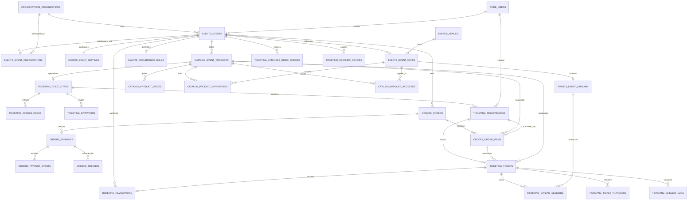

# Composable Event Platform Database Design

**Date:** 2026-07-13
**Status:** Approved architecture specification
**Stack:** Rails 8.1 modular monolith, PostgreSQL
**Purpose:** A simple event model that supports ticketed, RSVP, invite-only, in-person, online, hybrid, recurring, and multi-day events without a rigid event-type enum.

## 1. Executive summary

The platform has one small event core:

```text
Event
├── Event Settings
├── Collaborating Organizations
├── Event Dates
├── Recurrence Rule
├── Event Streams
└── Event Products
    ├── Product Prices
    ├── Product Inventory
    ├── Product Access
    └── Ticket Type Settings (only when product type = ticket)
```

The central rule is:

> An event is not “Ticketed,” “RSVP,” or “Invite Only.” An event offers products whose pricing, approval, audience, dates, and access channels can be combined.

Examples:

- A listing-only event has no products and no registration process.
- A standard concert has a General Admission ticket product.
- A hybrid concert has venue tickets, cheaper stream tickets, and a venue-plus-stream VIP product.
- A press RSVP is a zero-price ticket product requiring organizer approval.
- An invite-only VIP tier is a free or paid ticket product restricted by invitations or access codes.
- A three-day festival can sell individual day passes and a single full-festival pass.
- Parking, merchandise, food vouchers, donations, and future add-ons are event products that use the same prices, inventory, order, and payment models.

Every controlled attendee admission eventually produces a normal `Ticket`. Free and paid flows therefore share QR versioning, revocation, transfer, offline scanning, and check-in behavior.

## 2. Important design decisions

### 2.1 No event-type column

Do not add:

```text
events.type = ticketed | rsvp | invite_only | online
```

Those labels are organizer-wizard presets only. They create products and settings:

| Wizard preset | Records created |
|---|---|
| Ticketed | Ticket product + price + venue access |
| RSVP | Ticket product + zero or paid price + approval settings |
| Invite Only | Ticket product + invitation/code restriction |
| Online | Ticket product + stream access |
| Hybrid | Separate venue/stream products or one product with both accesses |
| Listing Only | Event and dates only; no product, registration, order, or ticket |

### 2.2 One primary organization plus collaborators

`events.organization_id` is the primary owner. It is responsible for publication, cancellation, refunds, settlement, and final authority.

`event_organizations` adds collaborators such as co-organizers, venue partners, promoters, and sponsors. This supports multiple organizers without making ownership ambiguous.

Revenue sharing is not inferred from collaborator roles. A future payout module may add explicit settlement splits.

### 2.3 Products are the commerce seam

`event_products` contains everything that can be selected, claimed, or purchased:

- ticket
- parking
- merchandise
- food
- donation
- digital add-on
- other future add-on

A ticket product gets one `ticket_types` row containing ticket-only behavior. Other products do not carry ticketing columns.

This is class-table composition, not Rails STI.

### 2.4 Tickets remain the admission credential

There is no separate `ticket_entitlements` table.

Ticket rights come from immutable `product_accesses` rows:

- which event date;
- venue, stream, or parking channel;
- how many entries are allowed;
- when access is valid.

After the first ticket is issued for a product, its access rows are immutable. A changed access package is a new product/version. This keeps issued-ticket behavior stable and aligns with the existing QR v3 design.

### 2.5 Multi-currency is built in

Every product has:

- one base price;
- optional fixed prices for other currencies;
- automatic conversion when no fixed override exists.

Every order snapshots the charged currency, settlement currency, exchange rate, source, and converted totals. Historical money never changes when future rates change.

### 2.6 Business `type` columns deliberately disable STI

Rails reserves `type` for Single Table Inheritance. This design intentionally uses `type` as a business discriminator, as requested.

Every model backed by a table containing a business `type` column must include:

```ruby
self.inheritance_column = nil
```

This applies initially to:

- `Events::EventOrganization`
- `Catalog::EventProduct`
- `Catalog::ProductPrice`
- `Catalog::ProductAccess`

Each model must have a regression test proving that reading or assigning `type` does not instantiate an STI subclass. Rails documents that `type` is normally reserved for STI and that `inheritance_column` can be overridden; this project is making that trade-off explicitly.

## 3. Reuse from the current repository

Do not recreate these existing tables:

| Existing table | Use |
|---|---|
| `core_users` | Buyers, attendees, ticket owners, staff |
| `organizations_organizations` | Primary owners and collaborators |
| `organizations_memberships` | Organization-level owner/admin/staff authority |
| `events_venues` | Physical venues |
| `events_categories` | Event discovery categories |
| `events_artists` | Artists and talent |
| `core_roles`, `core_permissions`, `core_user_roles` | Platform staff RBAC |
| `core_audit_logs` | Event, refund, transfer, and support audit trail |
| `core_follows` | Existing discovery/social foundation |

New event tables must reference the actual repository names, especially `core_users` and `organizations_organizations`.

## 4. Domain modules

| Module | Responsibility |
|---|---|
| `Events` | Event identity, settings, collaborators, dates, recurrence, streams |
| `Catalog` | Products, prices, access packages, inventory, exchange rates |
| `Ticketing` | Ticket-specific product settings, registrations, access restrictions, tickets, QR/offline operations, stream sessions |
| `Orders` | Orders, line snapshots, payments, refunds |
| `Core` | Existing identity, RBAC, audit, shared idempotency/outbox infrastructure |

The app remains a modular monolith. Foreign keys cross module boundaries where referential integrity matters. Service objects coordinate checkout, approval, ticket issuance, refunds, transfers, scans, and streaming authorization.

## 5. Final ERD



## 6. Event domain tables

### 6.1 `events_events`

The event's public identity.

| Column | Type | Rules |
|---|---|---|
| `id` | UUIDv7 | Primary key |
| `organization_id` | UUID | Required FK to `organizations_organizations`; primary owner |
| `created_by_id` | UUID | Required FK to `core_users` |
| `category_id` | UUID | Optional FK to existing `events_categories` |
| `title` | string | Required |
| `slug` | string | Required, case-insensitive unique |
| `description` | text | Optional |
| `status` | string | `draft`, `pending_review`, `published`, `cancelled`, `archived` |
| `published_at` | timestamptz | Required when published |
| `cancelled_at` | timestamptz | Optional |
| `revocation_version` | bigint | Required, default `0`; QR v3 delta version |
| `attendee_index_version` | bigint | Required, default `0`; QR v3 attendee-index delta |
| `lock_version` | integer | Optimistic locking |
| timestamps | timestamptz | Required |

Indexes:

- unique `lower(slug)`;
- `(organization_id, status, created_at DESC)`;
- partial public-discovery index for published events;
- `(category_id, status)`.

### 6.2 `events_event_organizations`

Additional organizations collaborating on one event.

| Column | Type | Rules |
|---|---|---|
| `event_id` | UUID | Required FK |
| `organization_id` | UUID | Required FK |
| `type` | string | `co_organizer`, `venue_partner`, `promoter`, `sponsor` |
| `permissions` | jsonb | Narrow collaborator abilities; default `{}` |
| `active` | boolean | Required, default `true` |
| timestamps | timestamptz | Required |

Constraints:

- unique `(event_id, organization_id)`;
- primary owner may not also appear as a collaborator;
- `type` check constraint;
- model declares `self.inheritance_column = nil`.

`permissions` may contain explicitly supported booleans such as `manage_catalog`, `manage_attendees`, or `view_reports`. It is not a replacement for organization memberships or platform RBAC.

### 6.3 `events_event_settings`

One row per event for event-wide behavior.

| Column | Type | Rules |
|---|---|---|
| `event_id` | UUID | Primary key and FK |
| `visibility` | string | `public`, `unlisted` |
| `timezone` | string | Required IANA timezone, e.g. `Africa/Addis_Ababa` |
| `base_currency` | char(3) | Required ISO 4217 code, default `ETB` |
| `settlement_currency` | char(3) | Required; organizer payout currency |
| `allow_guest_checkout` | boolean | Default `true` |
| `allow_ticket_transfers` | boolean | Default `false` |
| `show_remaining_inventory` | boolean | Default `false` |
| `minimum_age` | smallint | Optional |
| `require_id_check` | boolean | Default `false` |
| `max_products_per_order` | smallint | Required sensible limit |
| `config` | jsonb | Only non-critical, non-queryable future display settings |
| timestamps | timestamptz | Required |

Pricing, approval, invitation, capacity, venue/stream access, and waitlist rules do not belong here because they can differ between products.

### 6.4 `events_event_dates`

Materialized event sessions/dates. A one-day event has one row. A multi-day or recurring event has several.

| Column | Type | Rules |
|---|---|---|
| `event_id` | UUID | Required FK |
| `venue_id` | UUID | Optional FK to `events_venues` |
| `name` | string | Optional, e.g. `Festival Day 2` |
| `doors_at` | timestamptz | Optional |
| `starts_at` | timestamptz | Required |
| `ends_at` | timestamptz | Required |
| `status` | string | `scheduled`, `cancelled`, `completed` |
| `venue_capacity` | integer | Optional global physical capacity |
| `held_venue_count` | integer | Required, default `0` |
| `issued_venue_count` | integer | Required, default `0` |
| `source_key` | string | Optional recurrence generation key |
| timestamps | timestamptz | Required |

Constraints:

- `ends_at > starts_at`;
- `doors_at <= starts_at` when present;
- counts are nonnegative;
- held plus issued venue count may not exceed venue capacity when capped;
- unique `(event_id, source_key)` where source key is present;
- index `(event_id, starts_at)`.

An overnight event simply has an `ends_at` on the next calendar date. Multiple sessions on one date are supported because rows are keyed by timestamp, not by a unique calendar date.

### 6.5 `events_recurrence_rules`

Optional generation rule for repeated dates.

| Column | Type | Rules |
|---|---|---|
| `event_id` | UUID | Required, unique FK |
| `rrule` | text | Required RFC 5545 rule |
| `timezone` | string | Required |
| `dtstart_local` | timestamp | Required local wall time |
| `duration_seconds` | integer | Required, positive |
| `generated_until` | timestamptz | Last materialized horizon |
| `active` | boolean | Default `true` |
| timestamps | timestamptz | Required |

The rule generates normal `event_dates` rows. Sold or individually edited dates are never recalculated destructively when the rule changes.

### 6.6 `events_event_streams`

One optional stream configuration per event date.

| Column | Type | Rules |
|---|---|---|
| `event_date_id` | UUID | Required, unique FK |
| `provider` | string | Internal, Mux, Cloudflare Stream, or another adapter |
| `provider_stream_id` | string | Encrypted or protected identifier |
| `provider_playback_id` | string | Protected as required by provider |
| `status` | string | `scheduled`, `live`, `ended`, `disabled` |
| `live_from` | timestamptz | Required |
| `live_until` | timestamptz | Required |
| `replay_enabled` | boolean | Default `false` |
| `replay_available_until` | timestamptz | Required when replay is enabled |
| `max_concurrent_devices` | smallint | Per ticket; default `1` |
| `config` | jsonb | Provider-specific, non-secret settings |
| timestamps | timestamptz | Required |

Provider secrets live in Rails credentials or encrypted columns, never public serializers.

## 7. Catalog domain tables

### 7.1 `catalog_event_products`

Anything an attendee can select, claim, or purchase.

| Column | Type | Rules |
|---|---|---|
| `event_id` | UUID | Required FK |
| `name` | string | Required |
| `description` | text | Optional |
| `type` | string | `ticket`, `parking`, `merchandise`, `food`, `donation`, `digital_addon`, `other` |
| `active` | boolean | Default `true` |
| `hidden` | boolean | Default `false`; restricted products |
| `allow_custom_price` | boolean | Default `false`; donations/pay-what-you-want |
| `sales_start_at` | timestamptz | Optional |
| `sales_end_at` | timestamptz | Optional |
| `min_per_order` | integer | Default `1` |
| `max_per_order` | integer | Optional |
| `sort_order` | integer | Default `0` |
| `metadata` | jsonb | Non-critical product presentation data |
| `lock_version` | integer | Optimistic locking |
| timestamps | timestamptz | Required |

Constraints:

- type allowlist check;
- quantity limits positive and ordered;
- sales end after sales start;
- index `(event_id, active, sort_order)`;
- model declares `self.inheritance_column = nil`.

Ticket products require a `ticket_types` row. Other product types must not have one.

### 7.2 `catalog_product_prices`

Base and organizer-overridden currency prices.

| Column | Type | Rules |
|---|---|---|
| `event_product_id` | UUID | Required FK |
| `type` | string | `base`, `override` |
| `currency` | char(3) | Required ISO 4217 code |
| `amount_minor` | bigint | Required, nonnegative |
| `sales_start_at` | timestamptz | Optional price window |
| `sales_end_at` | timestamptz | Optional |
| `active` | boolean | Default `true` |
| timestamps | timestamptz | Required |

Constraints:

- exactly one active base price per product and price window;
- no overlapping active windows for the same product/type/currency;
- override currency must differ from or intentionally replace automatically converted output;
- model declares `self.inheritance_column = nil`.

Zero is a valid amount. A zero-price ticket still creates a registration and ticket; it simply skips payment.

### 7.3 `catalog_exchange_rates`

Historical exchange-rate quotes used by automatic conversion.

| Column | Type | Rules |
|---|---|---|
| `base_currency` | char(3) | Required |
| `quote_currency` | char(3) | Required |
| `rate` | decimal(24,12) | Required, positive |
| `source` | string | Provider/manual source |
| `effective_at` | timestamptz | Required |
| `expires_at` | timestamptz | Required |
| `created_at` | timestamptz | Required |

Indexes:

- `(base_currency, quote_currency, effective_at DESC)`;
- `(expires_at)` for cleanup/refresh jobs.

Rates are never floats. Orders snapshot the selected rate so this table may retain or archive old quotes without changing financial history.

### 7.4 `catalog_product_inventories`

Capacity or stock for a product, optionally scoped to one event date.

| Column | Type | Rules |
|---|---|---|
| `event_product_id` | UUID | Required FK |
| `event_date_id` | UUID | Optional FK; null means event-wide stock |
| `capacity` | integer | Required |
| `held_count` | integer | Required, default `0` |
| `sold_count` | integer | Required, default `0` |
| `lock_version` | integer | Required |
| timestamps | timestamptz | Required |

Checks:

```sql
capacity >= 0
held_count >= 0
sold_count >= 0
held_count + sold_count <= capacity
```

Unique `(event_product_id, event_date_id)`, with a separate partial unique index for a null event date.

For physical tickets, confirmation must satisfy both product inventory and the event date's global venue capacity. Stream-only products may be uncapped and omit inventory.

### 7.5 `catalog_inventory_reservations`

Short-lived holds during checkout or approval.

| Column | Type | Rules |
|---|---|---|
| `product_inventory_id` | UUID | Required FK |
| `registration_id` | UUID | Nullable FK |
| `order_item_id` | UUID | Nullable FK |
| `reservation_group_id` | UUID | Required; groups multi-day/add-on holds |
| `quantity` | integer | Required, positive |
| `status` | string | `held`, `processing`, `committed`, `released`, `expired` |
| `expires_at` | timestamptz | Required for nonterminal holds |
| `committed_at` | timestamptz | Optional |
| `released_at` | timestamptz | Optional |
| timestamps | timestamptz | Required |

Exactly one of registration or order item owns a reservation:

- a free ticket/RSVP uses the registration;
- a paid product uses the order item.

Pool counter change and reservation creation occur in one locked PostgreSQL transaction.

### 7.6 `catalog_product_accesses`

Describes what a credential-bearing product grants.

| Column | Type | Rules |
|---|---|---|
| `event_product_id` | UUID | Required FK |
| `event_date_id` | UUID | Required FK |
| `type` | string | `venue`, `stream`, `parking` |
| `entry_limit` | integer | Optional; null means unlimited within window |
| `valid_from` | timestamptz | Optional override |
| `valid_until` | timestamptz | Optional override |
| timestamps | timestamptz | Required |

Constraints:

- unique `(event_product_id, event_date_id, type)`;
- entry limit positive when present;
- validity end after start;
- product and event date must belong to the same event;
- model declares `self.inheritance_column = nil`.

Examples:

- one-day venue ticket: one `venue` row;
- one-day stream ticket: one `stream` row;
- hybrid ticket: one venue row and one stream row;
- three-day festival pass: three venue rows;
- festival venue + replay pass: venue and stream rows for each covered day;
- parking pass: one parking row.

## 8. Ticketing domain tables

### 8.1 `ticketing_ticket_types`

Ticket-only behavior attached one-to-one to a product whose type is `ticket`.

| Column | Type | Rules |
|---|---|---|
| `event_product_id` | UUID | Required, unique FK |
| `approval_mode` | string | `automatic`, `manual` |
| `audience` | string | `public`, `access_code`, `invitation`, `code_or_invitation` |
| `date_selection` | string | `fixed`, `choose_one` |
| `waitlist_enabled` | boolean | Default `false` |
| `transferable` | boolean | Optional override of event setting |
| `guest_limit` | smallint | Additional guests allowed per registration |
| timestamps | timestamptz | Required |

There is no separate RSVP table or RSVP type. RSVP behavior is composed from:

- zero or paid product price;
- automatic or manual approval;
- public, code, or invitation audience;
- optional waitlist.

### 8.2 `ticketing_access_codes`

Shared codes that authorize a ticket product.

| Column | Type | Rules |
|---|---|---|
| `ticket_type_id` | UUID | Required FK |
| `code_digest` | string | Required deterministic keyed digest |
| `label` | string | Optional organizer label |
| `max_uses` | integer | Optional |
| `used_count` | integer | Default `0` |
| `max_quantity_per_use` | integer | Default `1` |
| `starts_at` | timestamptz | Optional |
| `expires_at` | timestamptz | Optional |
| `active` | boolean | Default `true` |
| timestamps | timestamptz | Required |

Unique `(ticket_type_id, code_digest)`. Plaintext codes are normalized before hashing and are not written to logs.

### 8.3 `ticketing_invitations`

Named guest-list invitations.

| Column | Type | Rules |
|---|---|---|
| `ticket_type_id` | UUID | Required FK |
| `invited_user_id` | UUID | Optional FK to `core_users` |
| `name` | string | Optional |
| `email_ciphertext` | text | Optional encrypted contact |
| `phone_ciphertext` | text | Optional encrypted contact |
| `contact_digest` | string | Required searchable identity digest |
| `token_digest` | string | Required, unique high-entropy link token digest |
| `allowed_quantity` | integer | Required, default `1` |
| `status` | string | `pending`, `accepted`, `revoked`, `expired` |
| `expires_at` | timestamptz | Optional |
| `accepted_at` | timestamptz | Optional |
| `created_by_id` | UUID | Required FK to `core_users` |
| timestamps | timestamptz | Required |

### 8.4 `ticketing_registrations`

The attendee's request or booking. Used for free and paid ticket products.

| Column | Type | Rules |
|---|---|---|
| `event_id` | UUID | Required FK |
| `ticket_type_id` | UUID | Required FK |
| `user_id` | UUID | Optional FK for guest checkout |
| `selected_event_date_id` | UUID | Required only for `choose_one` ticket types |
| `access_code_id` | UUID | Optional FK |
| `invitation_id` | UUID | Optional FK |
| `identity_digest` | string | Required deduplication key |
| `party_size` | integer | Required, positive |
| `status` | string | `pending_payment`, `pending_approval`, `waitlisted`, `confirmed`, `rejected`, `cancelled`, `expired` |
| `submitted_at` | timestamptz | Required |
| `confirmed_at` | timestamptz | Optional |
| `cancelled_at` | timestamptz | Optional |
| `lock_version` | integer | Optimistic locking |
| timestamps | timestamptz | Required |

Rules:

- free automatic: confirm immediately if capacity is available;
- free manual: await organizer approval;
- paid automatic: confirm only after payment succeeds;
- paid manual: approval and payment order are explicit product policy; recommended default is approve first, then collect payment;
- confirmation reserves/commits all required product inventories and venue capacity;
- one confirmed registration issues `party_size` tickets.

### 8.5 `ticketing_tickets`

The QR/offline/stream credential. Compatible with QR architecture v3.

| Column | Type | Rules |
|---|---|---|
| `event_id` | UUID | Required FK |
| `event_product_id` | UUID | Required FK |
| `registration_id` | UUID | Optional FK for admission tickets |
| `order_item_id` | UUID | Optional FK for paid ticket/add-on credentials |
| `owner_user_id` | UUID | Optional FK to `core_users` |
| `holder_name` | string | Optional |
| `holder_email_ciphertext` | text | Optional |
| `holder_phone_ciphertext` | text | Optional |
| `version` | integer | Required, default `1` |
| `qr_token` | text | Required signed QR payload |
| `lookup_code` | string | Required event-scoped PNR code |
| `status` | string | `active`, `transferred`, `refunded`, `void` |
| `issued_at` | timestamptz | Required |
| `first_scanned_at` | timestamptz | Optional cache |
| `last_scanned_at` | timestamptz | Optional cache |
| `lock_version` | integer | Optimistic locking |
| timestamps | timestamptz | Required |

Constraints:

- unique `(event_id, lookup_code)`;
- QR version positive;
- product belongs to the same event;
- product must have at least one access row to issue a credential;
- at least one of registration or order item must be present.

The ticket remains `active` across a multi-day event. Usage is derived from successful check-in rows per event date. This avoids calling a festival pass globally “used” after Day 1.

### 8.6 `ticketing_checkin_logs`

Append-only venue/parking scan attempts.

| Column | Type | Rules |
|---|---|---|
| `ticket_id` | UUID | Required FK |
| `event_date_id` | UUID | Required FK |
| `scanner_device_id` | UUID | Optional FK |
| `client_scan_id` | UUID | Required idempotency key |
| `result` | string | `success`, `duplicate`, `invalid`, `version_mismatch`, `revoked`, `wrong_date`, `wrong_channel` |
| `lookup_via` | string | `qr`, `code`, `phone`, `name` |
| `reason_code` | string | Optional manual-lookup reason |
| `scanned_at` | timestamptz | Scanner time |
| `received_at` | timestamptz | Server time |
| timestamps | timestamptz | Required |

Unique `client_scan_id`. Index `(ticket_id, event_date_id, result)` and `(event_date_id, received_at)`.

Entry limits are evaluated from immutable product accesses plus successful check-ins for that date/channel.

### 8.7 `ticketing_stream_sessions`

Short-lived authorization for in-app live/replay playback.

| Column | Type | Rules |
|---|---|---|
| `ticket_id` | UUID | Required FK |
| `event_stream_id` | UUID | Required FK |
| `user_id` | UUID | Optional FK |
| `device_id` | string | Required normalized device identifier |
| `token_digest` | string | Required unique playback token digest |
| `status` | string | `active`, `expired`, `revoked` |
| `expires_at` | timestamptz | Required |
| `last_seen_at` | timestamptz | Optional |
| `revoked_at` | timestamptz | Optional |
| timestamps | timestamptz | Required |

Before creating/refreshing a stream session, the service verifies:

1. ticket is active and current version;
2. product has stream access for the stream's event date;
3. live or replay window is open;
4. concurrent-device limit has not been exceeded.

### 8.8 QR/offline support tables retained from v3

The following QR v3 concepts remain:

#### `ticketing_revocations`

- event, ticket, revoked-through version, dead flag, monotonic revocation version;
- unique ticket;
- indexed event/revocation version for delta sync.

#### `ticketing_attendee_index_entries`

- event, lookup code, privacy-aware phone lookup hashes, ticket, product label, ticket version, valid dates, entry policy, monotonic index version, removed flag;
- unique event/lookup code;
- indexed event/index version.

#### `ticketing_scanner_devices`

- organization, optional event assignment, device identifier, token digest, status, last sync/seen timestamps;
- unique device identifier and token digest.

#### `ticketing_ticket_transfers`

- ticket, from/to user, previous/new version, transfer reason, completed timestamp;
- transferring increments ticket version and writes/updates a revocation row before issuing a new QR.

## 9. Orders and payments

### 9.1 `orders_orders`

One order belongs to one event. This keeps cancellation, ownership, taxes, and organizer settlement simple.

| Column | Type | Rules |
|---|---|---|
| `event_id` | UUID | Required FK |
| `buyer_user_id` | UUID | Optional FK |
| `status` | string | `draft`, `pending_payment`, `paid`, `fulfilled`, `cancelled`, `partially_refunded`, `refunded` |
| `charge_currency` | char(3) | Currency shown/charged to buyer |
| `subtotal_minor` | bigint | Required |
| `discount_minor` | bigint | Required, default `0` |
| `fee_minor` | bigint | Required, default `0` |
| `tax_minor` | bigint | Required, default `0` |
| `total_minor` | bigint | Required |
| `settlement_currency` | char(3) | Organizer settlement currency |
| `settlement_total_minor` | bigint | Required snapshot |
| `exchange_rate` | decimal(24,12) | Settlement units per charge unit |
| `exchange_rate_source` | string | Fixed override or rate provider |
| `exchange_rate_quoted_at` | timestamptz | Required when currencies differ |
| `exchange_rate_expires_at` | timestamptz | Checkout lock deadline |
| `expires_at` | timestamptz | Inventory/order expiry |
| `paid_at` | timestamptz | Optional |
| `lock_version` | integer | Optimistic locking |
| timestamps | timestamptz | Required |

Check:

```text
total_minor = subtotal_minor - discount_minor + fee_minor + tax_minor
```

All amounts are nonnegative integer minor units.

### 9.2 `orders_order_items`

Immutable product and currency snapshot once payment starts.

| Column | Type | Rules |
|---|---|---|
| `order_id` | UUID | Required FK |
| `event_product_id` | UUID | Required FK |
| `registration_id` | UUID | Optional unique FK for ticket products |
| `name_snapshot` | string | Required |
| `type_snapshot` | string | Required product type snapshot |
| `quantity` | integer | Required, positive |
| `base_currency` | char(3) | Required |
| `base_unit_amount_minor` | bigint | Required |
| `charge_currency` | char(3) | Required |
| `charge_unit_amount_minor` | bigint | Required |
| `exchange_rate` | decimal(24,12) | Required when converted |
| `discount_minor` | bigint | Default `0` |
| `total_minor` | bigint | Required |
| `fulfillment_status` | string | `pending`, `fulfilled`, `cancelled`, `refunded` |
| timestamps | timestamptz | Required |

Ticket products connect to registrations. Add-ons such as parking and merchandise do not require a registration.

### 9.3 `orders_payments`

Provider payment attempts.

| Column | Type | Rules |
|---|---|---|
| `order_id` | UUID | Required FK |
| `provider` | string | Required |
| `provider_reference` | string | Optional |
| `idempotency_key` | string | Required |
| `amount_minor` | bigint | Required |
| `currency` | char(3) | Required; equals order charge currency |
| `status` | string | `created`, `processing`, `succeeded`, `failed`, `cancelled` |
| `failure_code` | string | Optional |
| `succeeded_at` | timestamptz | Optional |
| timestamps | timestamptz | Required |

Unique `(provider, idempotency_key)` and `(provider, provider_reference)` where reference is present.

### 9.4 `orders_payment_events`

Durable inbox for provider webhooks. The HTTP endpoint stores the event first, acknowledges it, and processes it asynchronously.

| Column | Type | Rules |
|---|---|---|
| `payment_id` | UUID | Optional FK until the provider reference is matched |
| `provider` | string | Required |
| `provider_event_id` | string | Required |
| `event_type` | string | Required provider event name; not an STI discriminator |
| `payload` | jsonb | Required immutable provider payload |
| `status` | string | `received`, `processing`, `processed`, `ignored`, `failed` |
| `attempts_count` | integer | Required, default `0` |
| `received_at` | timestamptz | Required |
| `processed_at` | timestamptz | Optional |
| `last_error` | text | Optional, scrubbed of secrets |
| timestamps | timestamptz | Required |

Unique `(provider, provider_event_id)` makes webhook receipt idempotent. Processing locks this row, then locks the payment/order as needed. The raw payload is retained according to a short, explicit retention policy.

### 9.5 `orders_refunds`

| Column | Type | Rules |
|---|---|---|
| `payment_id` | UUID | Required FK |
| `idempotency_key` | string | Required |
| `provider_reference` | string | Optional |
| `amount_minor` | bigint | Required, positive |
| `currency` | char(3) | Required; same as payment |
| `status` | string | `created`, `processing`, `succeeded`, `failed` |
| `reason` | text | Optional |
| timestamps | timestamptz | Required |

The payment is locked while verifying cumulative refunds do not exceed the succeeded payment amount.

## 10. Composition examples

### 10.1 Hybrid concert

```text
Event: Addis Live
Date: 2026-09-12
Stream: live + 48-hour replay

Products:
1. General Venue Ticket
   - type: ticket
   - product access: venue
   - base price: 800 ETB
   - override price: 15 USD

2. Stream Ticket
   - type: ticket
   - product access: stream
   - base price: 250 ETB
   - automatic conversion for USD/EUR/GBP

3. VIP Hybrid Pass
   - type: ticket
   - product accesses: venue + stream
   - audience: code_or_invitation
   - base price: 3,000 ETB

4. Parking Pass
   - type: parking
   - product access: parking
   - inventory: 120
```

### 10.2 Three-day festival

```text
Event dates: Friday, Saturday, Sunday

Products:
- Friday Pass: venue access Friday
- Saturday Pass: venue access Saturday
- Sunday Pass: venue access Sunday
- Full Festival Pass: venue access Friday + Saturday + Sunday
- Full Hybrid Pass: venue + stream access for all three dates
- Weekend Parking: parking access for all three dates
```

One full-pass ticket remains active across the festival. QR claims contain the allowed dates and entry limits. Check-ins determine whether today's entry is still available.

### 10.3 Recurring workshop

```text
Event dates generated weekly from recurrence rule
Product: Workshop Seat
Ticket type date_selection: choose_one
Product accesses list all available dates
Registration stores selected_event_date_id
Issued ticket is valid only for the chosen date
```

### 10.4 Free or paid RSVP

```text
Free RSVP:
- ticket product
- zero base price
- approval automatic or manual
- confirmation issues ticket

Paid RSVP:
- ticket product
- positive base price
- approval automatic or manual
- payment + confirmation issues ticket
```

RSVP is a product configuration, not a separate database domain.

### 10.5 Invite-only product

```text
Ticket type audience: invitation, access_code, or code_or_invitation
Price: zero or positive
Approval: automatic or manual
Successful claim creates registration
Confirmed registration issues ticket
```

### 10.6 Listing-only event

```text
Event + settings + one or more dates
No event products
No registration button
No ticket, order, or inventory records
```

## 11. Multi-currency flow

1. Organizer creates one base product price in the event's base currency.
2. Organizer may add fixed override prices for selected currencies.
3. Buyer chooses a supported charge currency.
4. Checkout uses an active fixed override when one exists.
5. Otherwise checkout loads a current exchange-rate quote and converts the base amount using currency-specific rounding.
6. The order and every order item snapshot the applied rate and both monetary representations.
7. Payment is created in the charge currency.
8. Organizer reporting uses settlement currency snapshots.
9. Refunds occur in the original payment currency.

Hard rules:

- store money as integer minor units;
- use ISO 4217 currency codes;
- use high-precision decimal rates, never floats;
- never recompute a historical order from current prices or rates;
- rate markup/fees must be disclosed and snapshotted separately when introduced;
- cross-currency organizer payouts require a dedicated settlement ledger before launch, not ad-hoc calculations from orders.

## 12. Inventory and concurrency

For each reservation:

1. Begin PostgreSQL transaction.
2. Lock required product-inventory rows in deterministic ID order.
3. For venue/parking access, lock the applicable event-date row.
4. Verify all capacities.
5. Insert reservation rows and increment held counters.
6. Commit.

On successful free confirmation or payment:

1. Lock registration/order and reservations.
2. Move held counts to sold counts.
3. Move held venue counts to issued counts.
4. Confirm registration when applicable.
5. Issue tickets for credential-bearing products.
6. Commit before sending notifications.

On expiry/cancellation, release holds in the same locked transaction.

The database checks prevent negative counters and overselling. Application validations alone are insufficient.

## 13. State flows

### Event

```text
draft → pending_review → published → cancelled/archived
draft → published when moderation is not required
```

### Registration

```text
pending_approval → pending_payment → confirmed
pending_approval → confirmed          (free)
pending_approval → rejected/waitlisted
pending_payment → confirmed/expired/cancelled
waitlisted → pending_payment/confirmed/expired/cancelled
confirmed → cancelled
```

### Order

```text
draft → pending_payment → paid → fulfilled
draft/pending_payment → cancelled
paid/fulfilled → partially_refunded/refunded
```

### Ticket

```text
active → transferred/refunded/void
transferred creates a new active version/owner and revokes the previous QR version
```

Multi-day usage does not transition the whole ticket to `used`; successful check-ins are evaluated per date/access rule.

## 14. QR v3 compatibility and required updates

The existing [TICKET QR CODE AND OFFLINE SCANNING ARCHITECTURE v3](./TICKET%20QR%20CODE%20AND%20OFFLINE%20SCANNING%20ARCHITECTURE%20v3.md) remains the gate-security design.

### Keep unchanged in principle

- Ed25519 signed QR payloads;
- ticket version increment on transfer/reissue;
- revocation delta sync;
- event-level revocation and attendee-index versions;
- PNR/lookup code;
- dual-path manual lookup;
- append-only check-in logs;
- scanner-device authentication;
- offline first-scan behavior and server conflict resolution.

### Update in QR v3

1. Replace the event-level `entry_policy` source with immutable `catalog_product_accesses`.
2. QR claims should contain compact allowed date/channel/entry-limit data derived at issue time.
3. Replace `ticket_type_id` as the sole commercial reference with `event_product_id`; admission tickets still reach `ticket_types` through the product.
4. Keep the ticket active across multiple days and determine usage from check-in logs per date.
5. Attendee-index `ticket_type` fields should use product slug/name snapshots.
6. Use the live namespaces and table prefixes (`Core`, `Events`, `Catalog`, `Ticketing`, `Orders`) instead of conceptual `Platform::*` examples.
7. Stream authorization is online and uses `ticketing_stream_sessions`; it is not part of the offline gate scanner path.
8. Parking products that issue QR credentials may use the same signed ticket and scan pipeline with product-access type `parking`.

No `ticket_entitlements` table is required.

## 15. Key database constraints and indexes

At minimum:

- every foreign key has an index;
- event slug is case-insensitively unique;
- one event setting and recurrence rule per event;
- one stream configuration per event date;
- collaborator organization unique per event;
- exactly one ticket-type row per ticket product;
- one base price per product/window;
- no overlapping active price windows for product/type/currency;
- product/date inventory unique;
- product access unique by product/date/type;
- code digest unique within ticket type;
- invitation token digest globally unique;
- active registration deduplication by ticket type, identity, and selected date;
- provider payment idempotency keys unique;
- provider payment-event IDs unique;
- event-scoped ticket lookup codes unique;
- scanner client-scan IDs unique;
- revocation version indexed by event;
- attendee index version indexed by event;
- money/capacity/count checks enforced in PostgreSQL;
- parent/child event ownership checked so records from different events cannot be connected.

## 16. Security and privacy

- Encrypt invitation, buyer, and ticket-holder contact fields.
- Store separate keyed digests only for necessary lookup/deduplication.
- Access-code and invitation tokens are never logged in plaintext.
- QR signing private keys never reach scanner devices; scanners receive public verification keys.
- Stream playback tokens are short-lived and stored as digests.
- Stream provider secrets never appear in public event serializers.
- Public serializers never expose inventory counters, invitation lists, buyer data, order FX internals, payment references, or collaborator private permissions.
- Organization/event policies determine who can manage products, attendees, streams, refunds, and scanners.
- Financial, ticket, transfer, revocation, and check-in rows are not hard-deleted.

## 17. What is intentionally deferred

The core has attachment points but does not prebuild:

- resale marketplace listings and seller payouts;
- split organizer settlement/revenue shares;
- full tax/fee rule engine;
- cash box-office sessions and till reconciliation;
- merchandise variants/SKUs and shipping;
- seating maps and reserved seats;
- marketing campaign billing;
- corporate invoicing and credit notes;
- advanced subscription/season auto-renewal;
- DRM/vendor-specific streaming analytics.

These features add their own tables around existing event products, orders, tickets, and collaborators. They do not require an event-schema rewrite.

## 18. Implementation phases

### Phase 1: Event foundation

- events;
- collaborator organizations;
- settings;
- dates;
- recurrence;
- existing venues/categories integration.

### Phase 2: Composable catalog

- event products;
- product prices;
- exchange rates;
- product inventory/reservations;
- product accesses;
- ticket-type settings;
- access codes and invitations.

### Phase 3: Registration and orders

- free/paid registration flows;
- manual approval and waitlist;
- multi-currency checkout snapshots;
- orders, items, payments, refunds;
- idempotent payment/webhook processing.

### Phase 4: Tickets and gates

- ticket issuance;
- QR v3 namespace/schema updates;
- revocations;
- attendee index;
- scanner devices;
- check-in logs;
- transfer history.

### Phase 5: Streaming

- event-stream configuration;
- venue/stream/hybrid product access;
- short-lived stream sessions;
- live and replay windows;
- concurrent-device enforcement.

### Phase 6: Add-ons

- parking credentials;
- merchandise/food/donation products;
- add-on inventory and fulfillment;
- organizer reporting by product type.

## 19. Final model summary

The final core is:

```text
EVENT
├── settings
├── primary organization
├── collaborator organizations
├── dates / recurrence
├── streams
└── products
    ├── prices in multiple currencies
    ├── inventory
    ├── venue / stream / parking access
    └── optional ticket-type behavior

TICKET PRODUCT
├── approval and audience rules
├── access codes / invitations
├── registration
├── optional order and payment
└── ticket
    ├── signed/versioned QR
    ├── offline revocation/index support
    ├── check-ins
    ├── stream sessions
    └── transfers

ADD-ON PRODUCT
├── prices
├── inventory
├── order item
└── optional QR credential when it grants controlled access
```

This is simple enough to explain from one ERD, composable enough for mixed real-world events, compatible with the existing QR/offline design, multi-currency from the first checkout, and extensible through concrete product/module tables instead of a generic feature engine.
