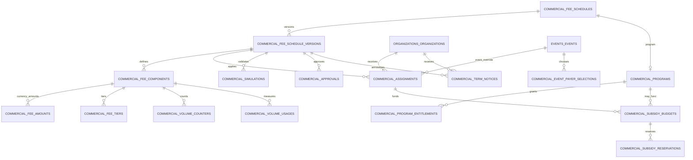

# Commercial Agreements and Platform Pricing Design

**Date:** 2026-08-08  
**Status:** Approved for implementation  
**Normative parents:**

- `docs/COMPOSABLE_EVENT_PLATFORM_DATABASE_DESIGN.md`
- `docs/superpowers/plans/2026-07-17-event-platform-master-roadmap.md`

## 1. Goal

Build a configurable, provider-independent commercial system that lets Digis:

- define safe platform-default fees;
- grant temporary or permanent benefits to an organization or one event;
- run reusable launch, charity, partnership, and volume programs;
- negotiate organization-specific and event-specific commercial agreements;
- charge different components to the buyer or organizer where the agreement permits;
- waive commission without accidentally waiving payment-provider costs;
- fund explicit subsidies with hard currency budgets;
- support primary sales and resale with separate fee components;
- explain, simulate, approve, audit, and reproduce every result; and
- preserve the exact commercial evidence used by every paid order.

The system must be flexible without becoming an administrator-authored
programming language. It uses allowlisted components, calculations, bases,
scopes, metrics, and refund policies. It never evaluates arbitrary expressions.

## 2. Why this belongs before Orders

The project is pre-launch and Orders has not become the authoritative payment
system. Implementing Commercial before Orders avoids building a temporary
global commission branch and replacing it later.

The dependency order becomes:

```text
Organizations / Events / Catalog / Registration
                       ↓
          Commercial schedules and resolver
                       ↓
       Orders quotes and immutable adjustments
                       ↓
     Provider instructions and Finance settlement
```

Orders remains the historical pricing boundary. Commercial decides what new
adjustments should be written; `orders_order_adjustments` stores what was
actually used. Historical orders are never re-resolved after a schedule,
agreement, program, provider contract, or exchange rate changes.

## 3. Product research translated into requirements

The design adopts proven platform patterns without copying a provider's data
model:

- [Stripe platform pricing](https://docs.stripe.com/connect/platform-pricing-tools)
  separates defaults, groups, and connected-account overrides.
- [Stripe pricing schemes](https://docs.stripe.com/connect/platform-pricing-tools/pricing-schemes)
  use deterministic conditional fees, explicit fallbacks, fixed/variable/blended
  calculations, testing, scheduling, and historical pricing evidence.
- [Eventbrite's terms](https://www.eventbrite.com/help/en-us/articles/251210/eventbrite-terms-of-service/)
  recognize individual organizer agreements and organizer-versus-buyer fee
  funding.
- [Ticket Tailor](https://help.tickettailor.com/en/articles/8687492-what-discounts-do-we-offer)
  uses verified/discretionary charity and nonprofit discounts, limits stacking,
  and keeps payment-processing cost outside those discounts.
- [Chapa split payments](https://docs.chapa.global/docs/v1/integrations/split-payment)
  support default subaccount commission plus per-transaction flat/percentage
  overrides, but provider settlement behavior is not a substitute for Digis's
  contract, order, refund, or ledger evidence.

The resulting Digis requirement is an agreement-first commercial system, not
a generic rules engine and not a payment-provider configuration mirror.

## 4. Ownership and module boundaries

Introduce a top-level `Commercial` module.

| Module | Owns |
|---|---|
| `Legal` | Published agreement/fee-schedule text and acceptance evidence |
| `Organizations` | Organizer identity, membership, and platform authorization subject |
| `Events` | Event ownership and event-level fee-payer selection |
| `Catalog` | Buyer product prices and organizer-created promotions |
| `Commercial` | Platform fees, negotiated terms, grants, programs, resolution, simulation, subsidies, and commercial usage |
| `Orders` | Quotes, immutable adjustments, payment totals, and historical calculation snapshots |
| `Finance` | Accepted-sale ledger postings, provider costs, refunds, reserves, and payouts |
| `Marketplace` | Resale policy/listings/sales; consumes Commercial's distinct resale components |

Commercial does not own taxes, buyer promotion eligibility, product prices,
payment attempts, provider webhooks, refunds, or organizer payouts.

## 5. Core terminology

- **Fee schedule:** named container for a platform default, reusable program,
  or custom commercial definition.
- **Schedule version:** immutable financial definition that can be simulated,
  approved, scheduled, activated, superseded, expired, or terminated.
- **Fee component:** one independently resolved charge or subsidy, such as
  platform commission, buyer service fee, processing-cost recovery, or resale
  platform fee.
- **Program:** reusable launch, charity, partnership, or volume offer with
  automatic or manual enrollment.
- **Assignment:** applies one exact schedule version to an organization or event.
- **Platform grant:** unilateral benefit that may only improve the organizer's
  position.
- **Mutual agreement:** negotiated terms that may increase or condition an
  organizer's obligations and therefore require acceptance evidence.
- **Subsidy:** explicit platform-funded offset with a hard budget when it creates
  a cash cost.
- **Resolution:** deterministic selection of one applicable rule for one fee
  component.

## 6. Commercial resolution contract

Resolution happens independently for each required fee component:

```text
event assignment
    → organization agreement
        → assigned program
            → platform default
```

The first applicable result wins for that component. Unspecified components
fall through to the next layer. A 0% event commission therefore overrides only
commission; processing-cost recovery and buyer service fees continue to resolve.

Within one schedule version, specificity is fixed:

1. exact event product;
2. product type;
3. sale context;
4. provider and payment method;
5. sales channel;
6. currency;
7. general component fallback.

The resolver ranks a rule from this predefined specificity vector. It does not
accept a user-supplied priority. Two matching rules with the same component and
specificity are a configuration conflict and prevent activation.

Supported bounded scopes are:

- primary sale or resale;
- event product or product type;
- charge and settlement currency;
- payment provider and allowlisted provider payment method;
- online, assisted walk-up, or resale sales channel.

No scope row means the component fallback for that schedule version. Scope is
not a free-form JSON predicate.

## 7. Fee components and calculations

Launch allowlisted component types are:

- `platform_commission`;
- `buyer_service_fee`;
- `processing_cost_recovery`;
- `platform_subsidy`;
- `resale_platform_fee`.

Future components require a reviewed code/schema allowlist change. Tax and buyer
discounts remain separate.

Calculation types are:

- `explicit_zero`;
- `percentage`;
- `fixed`;
- `blended` (fixed plus percentage);
- `tiered` (prospective fixed/percentage/blended bands).

Percentage rates use basis points. Calculations use integer minor units,
`BigDecimal`, and half-up rounding. Fixed amounts, minimums, maximums, and hard
budgets are explicit per supported currency. The system never invents a fixed
contract amount through live FX conversion.

Allowlisted percentage bases include:

- item face value before buyer promotion;
- item net value after organizer-funded promotion;
- eligible order subtotal;
- resale acquisition/sale amount;
- another reviewed, named basis added in code.

Every result snapshots the basis name and amount. Arbitrary formulas are not
supported.

### 7.1 Payer choice

A component defines its default payer and whether the organizer may choose an
alternative buyer/organizer payer for an event. An organizer can choose only a
mode allowed by the resolved commercial terms.

Commission, buyer service fee, processing-cost recovery, provider actual cost,
and subsidy remain distinct. Relabeling one as another is prohibited.

### 7.2 Subsidies

A subsidy is a separate negative adjustment that offsets a named buyer- or
organizer-charged component and records `funded_by = platform`. This preserves
the undiscounted charge, the granted benefit, and Digis's economic cost.

Cash-cost subsidies require a hard budget per currency. A pure commission waiver
is foregone revenue and may use an optional cap but does not require a cash budget.

### 7.3 Refund behavior

Each component selects one allowlisted refund policy. The initial set remains:

- `refundable`;
- `event_cancellation_only`;
- `nonrefundable`.

The exact policy is disclosed and snapshotted on the order adjustment. Refund
services never consult the current commercial schedule for a historical order.

## 8. Volume pricing

Volume tiers are prospective. Crossing a threshold changes new quotes only;
previous orders are never repriced and no retroactive rebate is inferred.

One tier schedule chooses one metric:

- accepted paid units; or
- accepted gross value in one settlement currency.

One measurement window is selected:

- event;
- calendar month, quarter, or year; or
- agreement term.

Failed payments, abandoned carts, reversed duplicate payments, and draft orders
do not increase volume. Refunds do not decrement an `accepted` metric unless a
future separately named net-volume metric is designed and approved.

The selected tier uses the committed counter visible when the quote is created.
Concurrent quotes at a boundary may see the same prior committed tier; this is
intentional and contractually explainable. Hard subsidy budgets use reservations
instead because they must never be over-promised.

## 9. Data model

All tables use UUIDv7 primary keys, `timestamptz`, explicit foreign keys, and
one table per migration. Business `type` columns disable STI.



### 9.1 `commercial_fee_schedules`

Stable identity for a version lineage.

| Column | Rules |
|---|---|
| `name` | Required human-readable name |
| `code` | Required unique stable internal code |
| `schedule_type` | `platform_default`, `program`, `custom` |
| `created_by_id` | Required FK to `core_users` |
| timestamps | Required |

Schedules are not deleted after a version is activated.

### 9.2 `commercial_fee_schedule_versions`

| Column | Rules |
|---|---|
| `fee_schedule_id` | Required FK |
| `supersedes_version_id` | Optional self-FK in the same schedule |
| `version` | Required positive integer; unique per schedule |
| `status` | `draft`, `simulated`, `pending_approval`, `approved`, `scheduled`, `active`, `superseded`, `expired`, `terminated` |
| `definition_digest` | Required SHA-256 of canonical component definition |
| `legal_document_version_id` | Optional FK; required for platform defaults and mutual agreements that establish obligations |
| `acceptance_policy` | `none`, `notice_only`, or `explicit`; mutual increases always behave as explicit |
| `grandfather_until` | Optional end of prior accepted-default fallback for an explicit default transition |
| `effective_from`, `effective_until` | Valid ordered interval; start required before activation |
| actor/timestamp fields | submitted, approved, activated, terminated identities and times |
| `lock_version` | Required optimistic-lock counter |

Approved and later versions are definition-immutable. Successor activation closes
or supersedes the previous version atomically. Exclusion constraints prevent
overlapping authoritative intervals in one schedule lineage.

### 9.3 `commercial_fee_components`

| Column | Rules |
|---|---|
| `fee_schedule_version_id` | Required FK |
| `component_type` | Required allowlisted component |
| `calculation_type` | Required allowlisted calculation |
| `charged_to` | `buyer` or `organizer` |
| `organizer_payer_choice` | Required boolean |
| `funded_by` | `buyer`, `organizer`, or `platform`; constrained by component type |
| `basis_type` | Required for percentage/blended/tiered; allowlisted |
| `rate_bps` | Type-dependent nonnegative basis points |
| `refund_policy` | Required allowlisted snapshot value |
| `offset_component_type` | Required only for subsidy |
| scope columns | Optional product, product type, sale context, provider, payment method, channel, and currency |
| `label` | Required organizer/buyer-facing default label |
| timestamps | Required |

Type-shape checks ensure exactly the correct calculation columns are present.
Component uniqueness and activation conflict checks prevent equal-specificity
matches for the same version/context.

An exact `event_product_id` is permitted only in a custom schedule assigned to
that product's event. Reusable platform-default and program schedules may use
product type or other portable contexts but cannot retain an event-specific FK.

### 9.4 `commercial_fee_amounts`

| Column | Rules |
|---|---|
| `fee_component_id` | Required FK |
| `currency` | Required ISO alpha-3 |
| `fixed_amount_minor` | Optional nonnegative; type-dependent |
| `minimum_minor`, `maximum_minor` | Optional nonnegative; ordered when both exist |

Unique `(fee_component_id, currency)`. Required currency coverage is checked by
simulation and activation.

### 9.5 `commercial_fee_tiers`

| Column | Rules |
|---|---|
| `fee_component_id` | Required FK |
| `position` | Required positive ordering |
| `metric_type` | `accepted_paid_units` or `accepted_gross` |
| `window_type` | `event`, `calendar_month`, `calendar_quarter`, `calendar_year`, `agreement_term` |
| `currency` | Required only for gross metric |
| `starts_at_value` | Required nonnegative inclusive threshold |
| `rate_bps` | Optional type-dependent rate |
| fixed/min/max fields | Explicit per tier/currency when used |

Positions and thresholds increase strictly. The first tier starts at zero.

### 9.6 `commercial_programs`

| Column | Rules |
|---|---|
| `fee_schedule_id` | Required unique FK to a `program` schedule |
| `program_type` | `first_monetized_event`, `charity`, `partnership`, `volume`, or reviewed allowlist |
| `enrollment_mode` | `automatic` or `manual` |
| `starts_at`, `ends_at` | Program availability window |
| `per_organization_use_limit` | Optional positive limit |
| `active` | Required boolean |

Eligibility is implemented by an allowlisted strategy object per program type.
There is no condition JSON or expression evaluator.

### 9.7 `commercial_assignments`

| Column | Rules |
|---|---|
| `organization_id` | Required FK |
| `event_id` | Optional FK; when present the event belongs to the organization |
| `fee_schedule_version_id` | Required FK |
| `program_id` | Optional FK for program enrollment |
| `assignment_type` | `program`, `platform_grant`, `mutual_agreement` |
| `status` | `draft`, `pending_acceptance`, `pending_approval`, `scheduled`, `active`, `expired`, `terminated` |
| `reason` | Required internal plain-language reason |
| `external_reference` | Optional; required for externally accepted mutual agreement |
| `legal_acceptance_id` | Optional FK; alternative in-app evidence |
| `effective_from`, `effective_until` | Required start, optional end |
| `risk_level` | Controlled classification calculated by service |
| creator/approver/activator fields | Required according to transition |
| `baseline_resolution_digest` | Required for platform-grant safety proof |
| `lock_version` | Required |

Exactly one of organization-wide or event-specific targeting applies: the
organization is always present; `event_id` narrows it. A mutual agreement
requires in-app legal acceptance or an external reference before activation.
A platform grant requires neither, but activation proves it cannot worsen any
organizer-paid component or remove an existing benefit.

For a platform-default successor that worsens terms, the linked published legal
version declares `notice_only` or `explicit` treatment according to reviewed
legal policy. Notice-only applies at the scheduled effective time after durable
notice. Explicit treatment resolves the organization's previously accepted
default until it accepts the new exact legal version or `grandfather_until`
passes. If no accepted/default version is legally eligible afterward, new quote
creation fails closed and the organizer dashboard presents the acceptance gate.
`none` is permitted only where the transition cannot worsen obligations.

At the same precedence layer, active assignments may not create an ambiguous
component/scope/effective interval. The activation command validates the full
resolution matrix; a deferred constraint trigger protects cross-row ambiguity
that cannot be expressed by a simple index.

### 9.8 `commercial_program_entitlements`

Tracks limited-use benefits.

| Column | Rules |
|---|---|
| `program_id`, `organization_id` | Required FKs |
| `status` | `available`, `reserved`, `consumed`, `released`, `expired` |
| `reserved_event_id` | Required only while reserved |
| `reserved_at`, `consumed_at`, `released_at`, `expires_at` | State-coupled timestamps |
| `lock_version` | Required |

For first-event-free, publication reserves the entitlement. The first accepted
paid order consumes it. Closing/cancelling with no accepted payment releases it.
Cancellation after consumption does not restore it automatically.

Events does not depend back on Commercial. Commercial consumes the durable
`event.published` outbox event and locks the organization entitlement; the
earliest qualifying `(published_at, event_id)` wins. Checkout also performs the
same idempotent entitlement reconciliation synchronously before applying the
benefit, closing the asynchronous-delivery window. Two concurrently published
events therefore cannot both receive the one-event grant.

### 9.9 `commercial_subsidy_budgets`

| Column | Rules |
|---|---|
| `assignment_id` | Optional FK for an organization/event-specific budget |
| `program_id` | Optional FK for one shared program budget |
| `fee_component_id` | Required FK |
| `currency` | Required |
| `limit_minor` | Required positive hard limit |
| `reserved_minor`, `consumed_minor` | Required nonnegative counters |
| `lock_version` | Required |

Exactly one of `assignment_id` or `program_id` is present. Unique per budget
owner/component/currency. Check:

```text
reserved_minor + consumed_minor <= limit_minor
```

### 9.10 `commercial_subsidy_reservations`

| Column | Rules |
|---|---|
| `subsidy_budget_id`, `order_id` | Required FKs |
| `idempotency_key_digest`, `request_fingerprint` | Required SHA-256 evidence |
| `amount_minor`, `currency` | Required positive and budget-matching |
| `status` | `held`, `processing`, `committed`, `released` |
| `expires_at`, `committed_at`, `released_at` | State-coupled timestamps |

The checkout group holds/commits/releases inventory, promotion, and subsidy
reservations atomically with deterministic lock order.

### 9.11 `commercial_term_notices`

Durable evidence that an exact platform-default change was made available to
an organizer. This is not a general messaging or campaign table.

| Column | Rules |
|---|---|
| `organization_id` | Required FK to the receiving organization |
| `fee_schedule_version_id` | Required FK to the exact scheduled default version |
| `legal_document_version_id` | Required FK to the exact published terms |
| `delivery_method` | Launch allowlist contains `in_app`; later methods require an explicit adapter |
| `status` | `pending`, `delivered`, or `failed` |
| `evidence_digest` | Required SHA-256 over recipient, exact versions, method, and delivery time |
| `available_at`, `delivered_at`, `failed_at` | State-coupled timestamps |

Unique `(organization_id, fee_schedule_version_id, delivery_method)`. The
in-app notice becomes delivered only when the committed organizer terms inbox
row is available to authorized organization members. Email/SMS may be added as
secondary channels later, but their provider callbacks never overwrite the
in-app evidence. `notice_only` eligibility requires a delivered notice for the
exact version before its effective time.

### 9.12 Supporting evidence tables

- `commercial_volume_counters`: locked component/organization/event/window/currency
  accepted-value cache used by quote resolution; unique for its complete
  dimension and never decremented for an `accepted` metric.
- `commercial_volume_usages`: immutable accepted-order/component/window usage;
  unique per accepted order/component and reconciled to the cached counter.
- `commercial_event_payer_selections`: audited event/component buyer-or-organizer
  choice; resolver rejects a selection no longer permitted by effective terms.
- `commercial_simulations`: version definition digest, actor, scenario digest,
  outputs, warnings, pass/fail, and timestamp. Approval requires a passing
  simulation against the current definition digest.
- `commercial_approvals`: append-only approve/reject decisions with actor,
  reason, definition digest, and target version/assignment. Maker and checker
  must differ when risk policy requires it.

## 10. Lifecycle and governance

```text
draft → simulated → pending_approval → approved → scheduled → active
                                                        ↓
                                      superseded / expired / terminated
```

### 10.1 Platform grants

A grant:

1. selects organization and optional event;
2. copies current resolved terms or a reusable program;
3. changes only beneficial components;
4. records reason, dates/limits, and optional external reference;
5. passes simulation and baseline comparison;
6. activates with one finance grant permission when low risk;
7. requires a separate approver for indefinite or materially funded exposure.

The service compares the complete affected component matrix, not just the
entered rate. A grant cannot raise a rate, remove a cap, switch a fee from buyer
to organizer, shorten a benefit, or add an organizer-funded component.

### 10.2 Mutual agreements

A mutual agreement may change obligations. It requires:

- exact published legal version linkage where applicable;
- in-app organization acceptance or external contract reference;
- passing simulation;
- maker-checker approval by distinct authorized users;
- scheduled effective time; and
- organizer notification.

Offline negotiation remains offline. Digis stores the commercial result and
evidence reference, not a negotiation case-management system.

### 10.3 Platform-default changes

Every active default references published organizer fee terms. A successor is
classified by Commercial simulation as beneficial, neutral, or worsening across
the supported component matrix. Beneficial/neutral changes may use `none` when
legal policy permits. Worsening versions require durable scheduled notice and
the published legal version's `notice_only` or `explicit` policy. Commercial
records delivery/acceptance evidence and never silently treats a missing explicit
acceptance as consent.

### 10.4 Risk-based approval

Dedicated permissions cover view, draft, grant, simulate, submit, approve,
activate, terminate, audit, and break-glass operations.

Second approval is required for:

- every mutual agreement;
- an indefinite platform-funded subsidy;
- an uncapped/high-exposure program under configured risk policy;
- a platform-default change; and
- any break-glass candidate that would otherwise bypass normal scheduling.

Break glass requires super-admin, reason, audit, outbox security alert, and
cannot bypass organizer acceptance for worsened obligations.

## 11. Simulation and activation safety

Simulation is mandatory and uses the same resolver/calculator code as checkout.
It displays:

- matched assignment, version, component, and scope;
- current versus proposed buyer total;
- organizer proceeds;
- Digis gross fee revenue;
- known provider-cost exposure and estimated margin;
- subsidy reservation/consumption impact;
- tier boundary examples;
- currency coverage;
- refund-policy differences; and
- conflicts, gaps, expiring fallbacks, or unsupported combinations.

Approval binds to `definition_digest`. Editing a draft invalidates prior
simulation and approval. Default/high-impact changes may run in shadow mode and
compare proposed results without affecting checkout.

If runtime resolution is missing or ambiguous, quote creation fails closed and
emits an operational event. The system never interprets failure as 0%.

## 12. Orders and provider integration

`Commercial::ResolveCharges` accepts trusted server-side facts:

- organization/event/product context;
- sale context and channel;
- charge/settlement currency;
- provider and payment method when selected;
- immutable product/promotion subtotals;
- quote timestamp; and
- organizer payer selections.

It returns frozen component results and explanation evidence. It never writes
an order or calls a provider.

`Orders::CreateCheckout` owns the transaction:

1. lock inventory/promotion/purchase-limit scopes;
2. lock commercial budgets in sorted UUID order;
3. resolve charges using the quote timestamp;
4. create order/items/adjustments;
5. reserve hard subsidies;
6. reconcile buyer total and organizer settlement evidence;
7. publish the payment-ready outbox event.

Prospective changes affect only quotes created after their effective time.
Existing quotes keep their snapshot until expiry. Accepted orders never change.

A quote may omit provider/payment-method identity only when every provider/method
offered for that order resolves the same buyer total and organizer commercial
signature. `Orders::StartPaymentAttempt` re-resolves only to verify that the
selected provider/method matches the immutable order signature. A retry through
another provider may reuse the order only when the signature is identical. If
the provider would change any buyer charge, organizer charge, subsidy, payer,
currency, or refund policy, the API returns `commercial_requote_required` and
uses the existing idempotent replacement-checkout flow. It never mutates a
pending order to accommodate a different provider price.

Provider adapters translate immutable Digis results into Chapa split values,
Stripe application fees, or provider-specific instructions where supported.
Provider fees and responses are reconciled independently. A provider that
cannot split funds does not change the commercial result; Finance settles from
Digis ledger evidence.

For resale, listing activation is the seller's commercial quote boundary. It
snapshots the resolved `resale_platform_fee` and expected seller proceeds;
scheduled changes affect newly activated listings only. An active listing is
never silently repriced. A material fee change requires expiry/cancellation and
seller-confirmed relisting. Buyer processing/service components resolve
separately when the resale buyer creates checkout.

## 13. Required `orders_order_adjustments` evolution

Keep the existing table as the permanent seam and extend its allowlists/evidence:

- add `subsidy` and `resale_platform_fee` adjustment types as required;
- add the order-level nonnegative `subsidy_minor` reconciliation cache and
  subtract it explicitly in the total formula;
- add `source_version_id` or make `source_id` reference the exact immutable
  commercial component/version contract;
- add `basis_type` snapshot;
- add `calculation_type` snapshot;
- add `funded_by` snapshot for explicit platform subsidy;
- add optional `resolution_evidence` JSONB containing only allowlisted IDs,
  scope codes, tier/window values, and rounding output;
- preserve amount, currency, payer, basis, rate, fixed/min/max, and refund policy;
- enforce immutability before payment begins.

Do not store mutable schedule IDs without the exact version/component used.
Do not copy internal notes, approval comments, provider credentials, or legal
document bodies into the order.

## 14. Refunds, finance, and reconciliation

- Buyer refunds use adjustment refund-policy snapshots.
- Organizer commission reversals use settlement entries linked to original
  adjustments and refund allocations.
- Platform subsidy reversals release or reverse consumed budget only according
  to the snapshotted subsidy/refund contract; they never recreate an entitlement
  automatically.
- Actual provider costs remain separate finance evidence and may differ from
  processing-cost recovery charged under the commercial agreement.
- Reconciliation compares order adjustments, provider split/application fees,
  provider actual costs, commercial budget usage, finance ledger entries, and
  payout allocations.
- Corrections append reversing evidence; they never edit a paid order's rules.

## 15. Admin and organizer UX

### 15.1 Platform commercial dashboard

Show defaults, programs, custom agreements, event exceptions, pending acceptance,
pending approval, scheduled/expiring changes, subsidy balances, shadow mismatches,
resolver failures, and margin alerts.

### 15.2 Schedule builder

A guided editor asks what charge applies, who pays, what bounded context it
covers, how it calculates, which basis/currencies/refund policy apply, and when
it is effective. It renders normalized components; it never exposes arbitrary
JSON or executable expressions.

### 15.3 Grant/agreement wizard

1. Find organization and optional event.
2. Show current resolved terms.
3. Choose Grant Benefit or Negotiated Agreement.
4. Start from a template/current terms.
5. Display changed and inherited components separately.
6. Record reason/dates/evidence.
7. Simulate before/after buyer total, organizer proceeds, Digis revenue, costs,
   subsidy, tiers, and refund behavior.
8. Activate or submit for acceptance/approval.
9. Show final plain-language summary and notify the organizer.

### 15.4 Organizer Commercial Terms page

Show current/scheduled terms, dates, permitted payer choices, examples, linked
published terms, acceptance history, and event-specific exceptions. Hide internal
notes, approval discussion, risk flags, provider contracts, and margin analysis.

During event setup, show only allowed pass/absorb choices and a live estimated
proceeds breakdown. If effective terms change, existing orders remain untouched
and new quotes show the newly effective disclosure.

### 15.5 Support explanation

Every resolved order exposes an internal explanation of assignment, schedule
version, component, scope, tier counter, basis, rounding, payer, currency,
amount, refund policy, and provider projection status.

## 16. API boundary

Platform-admin APIs own schedule/version/program/assignment drafting, simulation,
submission, approval, activation, termination, budget inspection, and audit.
Organizer APIs are read-only except for a narrow event payer-selection command
within permitted modes. There is no public commercial-rule CRUD.

Controllers authorize, normalize, require `Idempotency-Key` for mutations, call
one `Core::BaseService` command/query, and render policy-gated serializers.
Financial transitions call `Core::Audit::Record` and `Core::Outbox::Publish`
inside their authoritative transaction.

## 17. Security and privacy

- Dedicated permissions and maker-checker separation are mandatory.
- Organizer serializers expose applicable terms, not internal economics.
- Public order/checkout serializers disclose buyer charges and refund behavior
  but never organizer commission, subsidy budget, or provider contract cost.
- External contract references are identifiers, not arbitrary URLs or secrets.
- Uploaded legal contracts, if added later, use private Active Storage and a
  separate authorization design; they are not required for launch.
- Audits exclude plaintext secrets, internal free-form negotiation content, and
  full legal bodies.
- All activation and calculation source types are allowlisted; no constantizing
  untrusted strings.

## 18. State, concurrency, and idempotency invariants

- One immutable version definition per digest.
- One authoritative effective interval per schedule lineage.
- No ambiguous active component at equal precedence/specificity.
- A grant cannot worsen the complete baseline resolution.
- Maker and checker differ when second approval is required.
- Acceptance evidence matches the exact legal/schedule version.
- One first-event entitlement reservation/consumption transition wins.
- Hard subsidy counters never exceed the limit under concurrent checkout.
- Duplicate checkout/grant/approval/activation requests return the original
  result or a request-fingerprint conflict.
- Terminal financial/history rows are never deleted.

Lock order is documented and shared by all consuming commands:

```text
organization/event commercial assignment
  → schedule/version/components
  → volume counter rows
  → subsidy budgets by UUID
  → subsidy reservations by UUID
  → order/adjustments
```

Orders composes this after its upstream inventory/promotion locks according to
one final cross-domain lock-order document; no command invents its own order.

## 19. Verification matrix

The implementation plan must prove:

- default/program/organization/event precedence and component inheritance;
- exact-product/product-type/context/provider/channel/currency specificity;
- activation rejection for gaps, overlaps, equal-specificity conflicts, missing
  fallbacks, missing currencies, or stale simulations;
- grant beneficial-only comparison across rate, caps, payer, dates, and subsidy;
- mutual acceptance, external reference, maker-checker, and break-glass rules;
- default none/notice/explicit transitions, grandfathering, and acceptance gate;
- exact-version term-notice delivery evidence before `notice_only` eligibility;
- version immutability, scheduled activation, supersession, expiry, termination,
  and prospective quote behavior;
- same-signature provider retry versus provider-specific replacement checkout;
- first-event reservation, consumption, release, and cancellation races;
- delayed/duplicated publication-outbox handling and deterministic earliest-event selection;
- subsidy budget hold/commit/release/idempotency and last-unit concurrency;
- percentage/fixed/blended/zero/tiered math, half-up rounding, min/max, and
  per-currency behavior;
- volume counter windows and boundary evidence;
- fee-payer authorization and event selection invalidation;
- refund snapshots, commission/subsidy ledger reversals, and no retroactive
  recalculation;
- primary/resale component isolation;
- provider projection and reconciliation without provider authority leakage;
- public/organizer/admin serializer privacy and authorization matrices;
- synchronous audit, outbox, retry, crash recovery, and fail-closed alerts;
- no floats and no STI regressions on business `type` columns.

## 20. Roadmap integration

Add a new plan after Registration and before Orders:

`docs/superpowers/plans/2026-08-08-commercial-agreements-platform-pricing-implementation.md`

The implementation plan will be written only after this specification is
reviewed and approved. It will cover:

1. namespace, RBAC, schema, and constraints;
2. schedules, immutable versions, components, currencies, and tiers;
3. programs, assignments, grants, agreements, and legal linkage;
4. resolver and explanation value objects;
5. simulator, approvals, activation, supersession, and termination;
6. entitlements and hybrid automatic/manual enrollment;
7. subsidy budgets and concurrency;
8. admin/organizer APIs, serializers, notifications, audits, and Postman;
9. Orders/adjustment/provider projection integration contracts; and
10. reporting, reconciliation, shadow mode, alerts, and phase gates.

The existing Orders and Marketplace plans must consume Commercial instead of
creating separate global or resale fee calculators. Tax remains a separate
future domain. Buyer promotions remain Catalog-owned.

## 21. Explicit non-goals

- arbitrary formulas, scripts, SQL, or expression trees;
- a tax engine;
- buyer promotion stacking/eligibility;
- subscription billing for organizers;
- revenue sharing between co-organizers;
- provider contract negotiation or legal verification case management;
- retroactive fee repricing or volume rebates;
- cross-currency aggregation of gross-volume tiers;
- silently treating configuration failure as zero fees.

## 22. Final design summary

```text
DEFAULT SCHEDULE
      ├── reusable PROGRAMS
      ├── ORGANIZATION AGREEMENTS
      └── EVENT EXCEPTIONS
                ↓ per component, deterministic, no accidental stacking
       COMMERCIAL RESOLUTION
                ↓ immutable calculation evidence
       ORDER ADJUSTMENTS
                ↓
   PROVIDER PROJECTION + FINANCE LEDGER
```

This design provides the flexibility of mature platform pricing systems while
keeping money movement bounded, reviewable, testable, and explainable.
