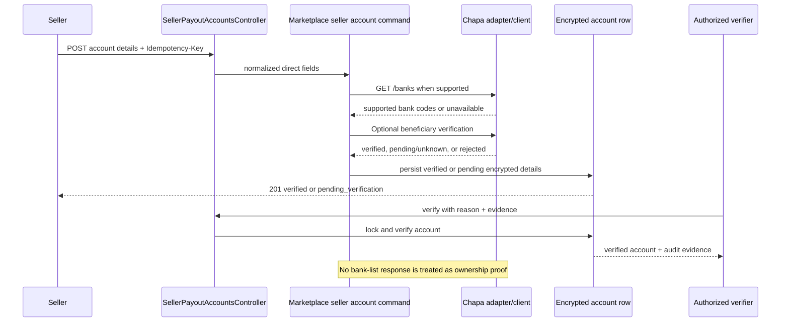

# Marketplace Seller Payout Direct-Transfer Design

**Date:** 2026-09-10  
**Status:** Direct-transfer account model implemented; payout timing superseded
**Scope:** G-03 / Gap #26 — Marketplace seller payout destination creation and Chapa dispatch

> **Superseded for resale payout timing and scope:** The 2026-10-02
> `marketplace-instant-resale-withdrawals` design replaces the event-completion,
> seven-day maturity, and one-event-per-payout assumptions below. This document
> remains the source for direct-transfer account security and provider transport.

## Decision summary

Marketplace seller payouts will use the same direct-beneficiary model as the
Finance organizer payout path:

- seller bank details are encrypted at rest;
- a keyed digest supports deterministic duplicate detection without storing a
  searchable plaintext account number;
- `bank_code` remains a normal integer because it is a provider routing value,
  not a credential;
- seller registration never treats a bank-list lookup as proof of account
  ownership;
- accounts remain `pending_verification` until a provider verification result
  or an explicit admin/manual verification command succeeds; and
- a verified seller payout dispatch passes the decrypted account number,
  beneficiary name, bank code, amount, currency, and idempotency reference to
  Chapa's direct transfer client.

Chapa subaccounts are intentionally excluded. Chapa documents subaccounts as
split-payment recipients used while initializing a customer pay-in, whereas
seller resale payouts are post-event disbursements from the Marketplace
ledger. The subaccount identifier is not treated as a generic destination
token for the direct transfer endpoint. See the [Chapa split-payment
documentation](https://developer.chapa.co/integrations/split-payment).

## Problem

`Marketplace::SellerPayoutAccount` currently assumes a provider-tokenized
destination. `Marketplace::VerifyPayoutAccount` calls
`tokenize_payout_account`, but the Marketplace Chapa adapter wraps
`Finance::PayoutProviders::ChapaTransferClient`, which implements direct
transfers and does not implement tokenization. Seller account creation
therefore returns `payout_account_provider_unavailable` before a usable
destination can be saved.

Seller dispatch has the same contract mismatch in the opposite direction:
`Marketplace::DispatchSellerPayout` sends `destination_token`, while
`ChapaTransferClient#payout` requires `account_number` and `bank_code`.

The Finance path already establishes the required direct-transfer boundary:
`Finance::PayoutAccount` encrypts beneficiary details and
`Finance::DispatchPayout` passes those details to
`ChapaTransferClient#payout`. Marketplace should adopt that boundary while
preserving its seller-specific ledger and payout allocation rules.

## Goals

1. Allow a seller to submit a Chapa bank destination without requiring an
   unsupported tokenization API.
2. Never mark a destination verified merely because its bank code exists in
   Chapa's bank list.
3. Give authorized operators an auditable manual verification path when Chapa
   does not provide a preflight beneficiary verifier.
4. Dispatch only verified seller payouts through the existing direct Chapa
   transfer client.
5. Preserve seller-ledger, allocation, reserve, idempotency, timeout, and
   reconciliation invariants.
6. Keep raw account credentials out of serializers, logs, audit metadata,
   digests, and searchable database columns.

## Non-goals

- Chapa split-payment checkout or subaccount settlement.
- Organizer payout maturity; Marketplace resale timing is superseded by the
  immediate-withdrawal design linked above.
- Changing seller ledger economics, resale pricing, marketplace fees, or
  purchase fulfillment.
- Adding a new provider-specific account-token abstraction.
- Claiming that `/v1/banks` proves account ownership.
- Enabling real-money payout dispatch in preview by default.

## Provider contract

Chapa's documented direct transfer request uses the following beneficiary
fields:

```json
{
  "account_number": "1000000000001",
  "account_name": "Seller Holder",
  "amount": "125.00",
  "bank_code": 128,
  "currency": "ETB",
  "reference": "marketplace-payout-idempotency-key"
}
```

The existing `Finance::PayoutProviders::ChapaTransferClient` owns the HTTP
transport, amount conversion, authentication, response normalization, and
provider-reference extraction. Marketplace must call that client through its
adapter; it must not duplicate HTTP or Chapa response parsing.

Chapa's bank-list endpoint returns supported bank information and codes. It
may be used to reject an unsupported `bank_code`, but it is not an account
verification operation. Chapa's transfer documentation states that the
merchant is responsible for collecting and confirming valid recipient details
before transferring. See the [Chapa transfer
documentation](https://developer.chapa.co/transfer/transfers) and [bank-list
documentation](https://developer.chapa.co/transfer/list-banks).

The existing client exposes transfer verification by provider reference. That
operation reconciles a transfer after submission; it does not verify a
beneficiary before registration. See the [Chapa transfer-verification
documentation](https://developer.chapa.co/transfer/verify-transfers).

## Domain model

### `Marketplace::SellerPayoutAccount`

The model becomes a direct-transfer account record with these persisted
attributes:

| Attribute | Persistence | Rule |
|---|---|---|
| `user_id` | UUID foreign key | Seller owner; immutable after creation |
| `type` | string | `bank` for the Chapa direct-transfer path |
| `provider` | string | `chapa` for this implementation |
| `bank_code` | integer | Positive Chapa bank code; never encrypted |
| `account_number_ciphertext` | encrypted text | Raw beneficiary account number; never serialized or queried directly |
| `account_number_digest` | 64-char string | Keyed digest from `Core::PayoutAccountDigest`, scoped to the seller |
| `account_label_ciphertext` | encrypted text | Seller-facing label; optional |
| `holder_name_ciphertext` | encrypted text | Beneficiary name; sent to Chapa as `account_name` |
| `verification_source` | string | `provider`, `test_fixture`, or `manual` when verified; otherwise null |
| `verified_by_id` | UUID foreign key | Required for manual verification; null for provider/test-fixture verification |
| `is_default` | boolean | Only verified accounts may be default; at most one per seller/provider |
| `status` | string | `pending_verification`, `verified`, `suspended`, or `closed` |
| `verified_at` | timestamp | Required only while verified |
| `last_used_at` | timestamp | Updated when a dispatch processing intent is committed |

The old `account_token` column and token uniqueness index are removed. The
original migration file is edited in place per project policy; no follow-up
alter-table migration is created.

The digest service follows the Finance pattern but uses the seller identity as
its namespace:

```ruby
Core::PayoutAccountDigest.call(
  namespace: seller.id,
  account_number: account_number
)
```

The digest is used for one seller/provider/account-number identity. The raw
account number remains available only through the encrypted Active Record
attribute inside authorized server-side commands.

All payout-account command audits use the savepoint-safe Core audit writer.
When two requests race on one audit key, the losing request must reach
`Core::Audit::Record::ReplayConflict` and return a typed idempotency conflict;
it must not surface PostgreSQL's aborted-transaction error.

### Constraints and indexes

The database must enforce:

- foreign keys from `user_id` and `verified_by_id` to `core_users`;
- positive `bank_code`;
- provider/type/status/verification-source allowlists;
- verified rows having `verified_at` and a non-null verification source;
- non-verified rows having no verification metadata;
- manual verification requiring `verified_by_id`;
- a verified default only; and
- one default account per seller/provider through a partial unique index.

The account-number digest receives a unique index scoped to
`user_id` and `provider`. The service acquires a deterministic advisory lock
before checking or inserting the digest row, and it retains the existing
idempotency audit boundary.

## Registration flow

The public endpoint remains:

```text
POST /marketplace/seller/payout_accounts
Idempotency-Key: <client-owned-key>
```

The Chapa request shape is changed to match the direct-transfer domain rather
than passing an opaque provider payload:

```json
{
  "payout_account": {
    "type": "bank",
    "provider": "chapa",
    "bank_code": 128,
    "account_number": "1000000000001",
    "holder_name": "Seller Holder",
    "account_label": "Primary bank account"
  }
}
```

The controller permits only these fields and passes them to one registration
command. It never accepts `account_token`, `verification_source`, or
`verified_by_id` from a seller request.

The command sequence is:



Registration behavior is:

1. Validate `type`, `provider`, positive `bank_code`, nonblank account number,
   and nonblank holder name.
2. If the adapter supplies a bank list and the code is absent, return
   `payout_account_bank_unsupported` without persisting credentials.
3. If the bank list is unavailable, treat that as unknown provider state; do
   not reject every bank and do not mark the account verified.
4. Compute the keyed digest and resolve an existing idempotent registration
   before provider I/O.
5. Run the optional provider verifier before persistence. A definite provider
   rejection returns `payout_account_verification_failed` without creating a
   destination row; an unknown or timeout result is safe pending state.
6. Acquire the seller/provider/account lock and persist the encrypted account
   as `verified` or `pending_verification` in one transaction.
7. Return an idempotent `201` representation containing only safe metadata.

`verification_source: "test_fixture"` is available only to internal seed/test
commands in test, development, or `RENDER_PREVIEW=true`. It is not a public
seller input and cannot be used in production.

## Manual verification flow

Because the current Chapa transfer client has no preflight beneficiary
verification operation, the implementation adds an admin-only command based
on the Finance payout-account verification lifecycle:

```text
POST /admin/marketplace/seller_payout_accounts/:id/verify
Idempotency-Key: <client-owned-key>
```

Request fields:

```json
{
  "reason": "Verified against seller-provided bank evidence",
  "evidence_reference": "case-2026-09-10-001"
}
```

The command must:

- require the dedicated Marketplace payout-account verification permission;
- require both reason and evidence reference;
- lock the account row;
- allow only `pending_verification` to transition to `verified`;
- set `verification_source: "manual"`, `verified_by_id`, and `verified_at`;
- preserve `is_default: false` unless the account is explicitly selected as
  the seller's default;
- record an idempotent audit event without raw account data; and
- return a safe serializer projection.

Registration and verification audits must be consistent across provider and
test-fixture verification. A verified registration records both the
registration transition and the verification evidence; a pending registration
records only its pending registration transition.

Default selection is included as a separate idempotent command:

```text
POST /marketplace/seller/payout_accounts/:id/set_default
Idempotency-Key: <client-owned-key>
```

It accepts only a verified account, clears the seller's other default for the
provider under the seller lock, and relies on the partial unique index as the
final backstop. `BuildSellerPayout` continues to receive an explicit account,
so existing seller payouts retain their bound account and are never retargeted
by a default change.

## Dispatch flow

`Marketplace::BuildSellerPayout` remains responsible for selecting a verified
account, reserving signed seller-ledger entries, applying availability and
seller/currency scope checks, and creating the pending seller payout. Resale availability
is immediate under the superseding design; organizer maturity rules do not
apply here.

`Marketplace::DispatchSellerPayout` continues to commit `processing` before
the provider call. After seller, account, allocation, availability, currency,
and reserve checks pass, it calls:

```ruby
adapter.payout(
  amount_minor: payout.amount_minor,
  currency: payout.currency,
  idempotency_key: payout.idempotency_key,
  payout_id: payout.id,
  account_number: account.account_number,
  account_name: account.holder_name,
  bank_code: account.bank_code
)
```

The adapter delegates to the shared Finance Chapa transfer client. It must
never pass `destination_token`, `account_token`, or raw details into logs,
audit metadata, or response serializers.

Provider results retain the existing handling:

- success → mark payout succeeded, consume allocations, and append the payout
  ledger entry;
- provider failure/cancellation → mark payout terminal and release reserved
  allocations; and
- timeout/unknown → leave the payout processing and enqueue reconciliation,
  which uses the provider reference/idempotency reference rather than blindly
  submitting a second transfer.

## API and visibility rules

Seller index/create responses may include:

```text
id, user_id, type, provider, bank_code, account_label, status,
verification_source, is_default, verified_at, last_used_at, created_at,
updated_at
```

They must exclude:

```text
account_number, account_number_ciphertext, account_number_digest,
holder_name, holder_name_ciphertext, account_token, verified_by_id,
```

The safe projection must remain explicit in the policy and serializer. No
provider request/response body may be logged with account credentials.

## Error semantics

| Condition | Result |
|---|---|
| Missing/invalid idempotency key | Existing shared `400 missing_idempotency_key` response |
| Invalid direct account shape | `422 payout_account_input_invalid` |
| Unsupported bank code when bank list is available | `422 payout_account_bank_unsupported` |
| Same seller/provider/digest with matching idempotent request | Original account result |
| Same seller/provider/digest with conflicting request | `409 payout_account_conflict` or idempotency conflict, according to the shared command resolver |
| Provider verifier unavailable or inconclusive | Account saved as `pending_verification`; no payout eligibility |
| Manual verification missing evidence | `422 payout_account_verification_required` |
| Default selection for a non-verified account | `422 payout_account_not_verifiable` |
| Build or dispatch uses pending/suspended/closed account | `422 payout_account_not_verified` |
| Provider transfer returns failure | Existing seller payout failure mapping and allocation release |
| Provider transfer times out or returns unknown | Existing processing/reconciliation path |

## Security and accounting invariants

- Encryption keys remain application-managed; no new secret is stored in the
  repository, seed data, Postman collection, or audit metadata.
- Account numbers are decrypted only inside the server-side provider-call
  boundary.
- Digests use the shared keyed digest implementation, never a plain SHA digest
  that would be cheaply reversible for predictable bank account formats.
- Manual verification binds actor, reason, evidence reference, account ID, and
  idempotency key into an audit record.
- Seller identity, account ownership, provider, currency, availability, allocation
  totals, and reserve checks remain locked and validated before dispatch.
- Provider success cannot rewrite payout amount or currency.
- A provider timeout cannot release allocations or trigger an unbounded blind
  retry.
- Existing seller payout records retain their account foreign key and are not
  rewritten during account migration or default selection.

## Verification requirements

The implementation is complete only when all of the following are proven:

1. Model tests prove encryption, digest persistence, status metadata checks,
   verified-default constraints, and safe searchable attributes.
2. Registration tests prove pending behavior for an unavailable verifier,
   definitive provider rejection without persistence, bank-list rejection,
   internal test-fixture verification, consistent verification audits,
   idempotent replay, and cross-seller ownership boundaries.
3. Manual-verification tests prove permission, evidence, state transition,
   audit idempotency, and safe response behavior.
4. Concurrent registration tests prove one same-key/different-payload request
   succeeds and the other returns `idempotency_conflict` without an unhandled
   audit or PostgreSQL transaction error.
5. Dispatch tests prove the exact direct-transfer payload contains decrypted
   account number, holder name as `account_name`, and bank code, and contains
   no destination token.
6. Existing seller payout tests continue to prove reservation, ledger,
   immediate availability, reserve, failure, timeout, and reconciliation behavior.
7. The full Rails test suite, RuboCop, Zeitwerk, Brakeman, and `git diff --check`
   pass.
8. A controlled Render preview check proves migration/seed completion, safe
   account creation, manual verification, and service health. A real Chapa
   test-mode transfer is an additional gated check requiring explicit payout
   credentials and `CHAPA_PAYOUT_ENABLED=true`; it is not enabled by default.

## Files expected to change

### Data and domain

- `db/migrate/20260814090001_create_marketplace_seller_payout_accounts.rb`
- `app/models/marketplace/seller_payout_account.rb`
- `app/services/marketplace/seller_payout_accounts/payout_account_digest.rb`
- `app/services/marketplace/verify_payout_account.rb`
- `app/services/marketplace/seller_payout_support.rb`

### Provider and dispatch

- `app/services/marketplace/payout_providers/adapter.rb`
- `app/services/marketplace/payout_providers/chapa_adapter.rb`
- `app/services/marketplace/dispatch_seller_payout.rb`
- `app/services/marketplace/reconcile_seller_payout.rb` if its request shape
  assumes a destination token

### API and authorization

- `app/controllers/marketplace/seller_payout_accounts_controller.rb`
- admin seller payout-account controller, policy, serializer, and route files
  for manual verification
- `app/policies/marketplace/seller_payout_account_policy.rb`
- `app/serializers/marketplace/seller_payout_account_serializer.rb`
- `config/routes.rb`
- Marketplace permission seed/locale files

### Tests and contracts

- Marketplace seller payout-account model, service, controller, provider,
  dispatch, and integration tests
- `postman/Digis API_collection.json` for changed request/response contracts
- G-03 status and evidence in
  `docs/operations/frontend-backend-gap-tracker-2026-09-08.md`

The implementation plan will confirm the exact admin route/policy files and
remove any file from this list that repository reconnaissance shows is not
needed.
